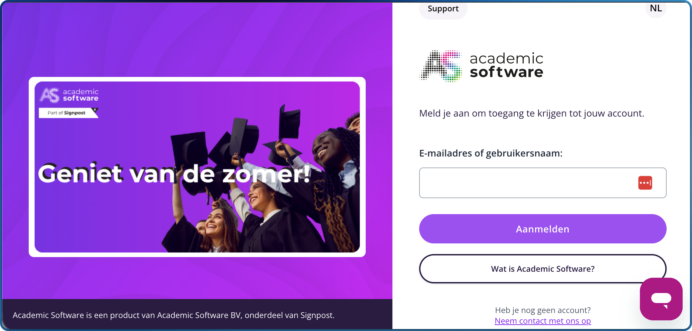
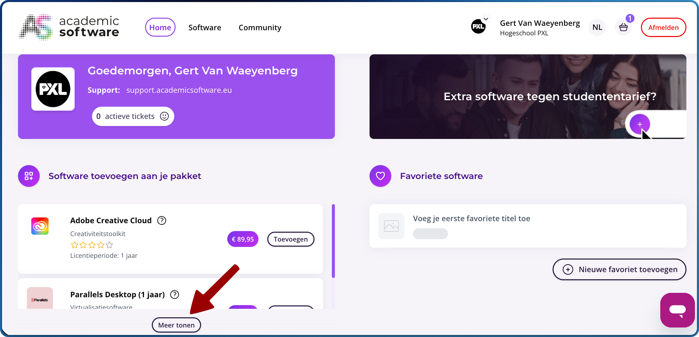
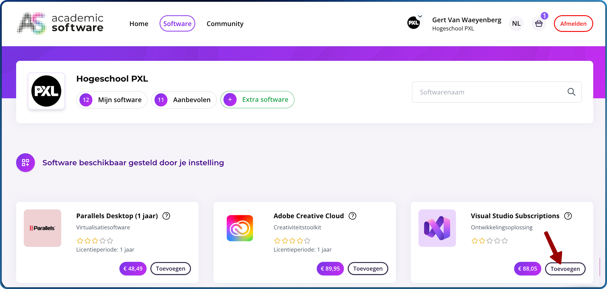
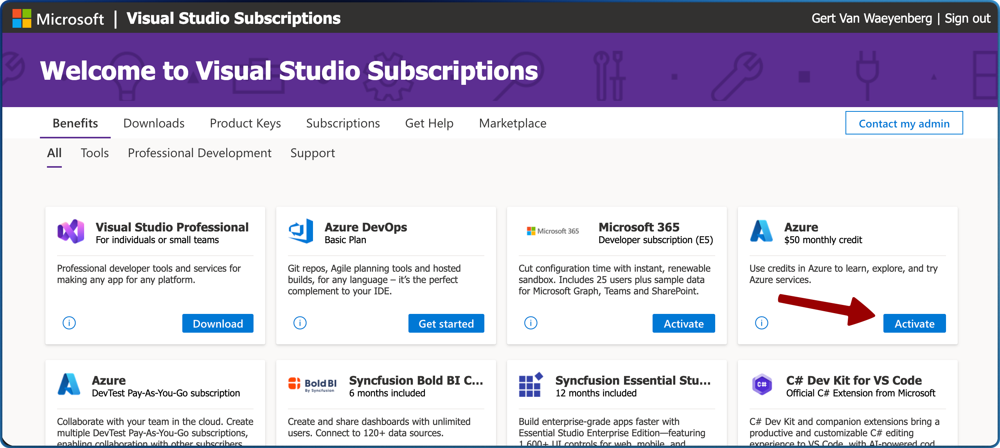
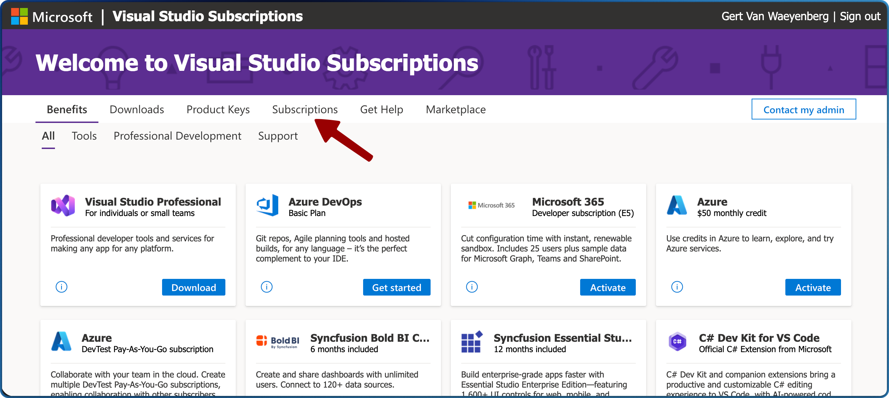
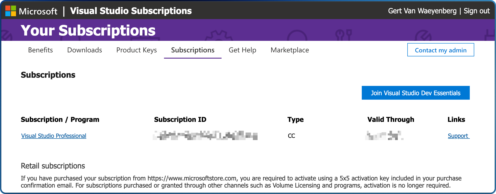

# Microsoft Visual Studio Pro Subscriptie

Voor het maken van de oefeningen kan je gebruik maken van een Linux in de Cloud. Hiervoor gebruiken we de Visual Studio Pro-licentie die je nodig hebt bij andere opleidingsonderdelen. Deze licentie moet individueel worden aangekocht via Academic Software. Hieronder de procedure:

## 1. De subscriptie aankopen via Academic Software

### 1.1. Website

Ga naar [https://academicsoftware.eu/login](https://academicsoftware.eu/login)

Voer je PXL-e-mailadres in (in de vorm `xxxxxx@student.pxl.be`) en meld je aan met je PXL-e-mailaccount.

### 1.2. Academic Software-portaal

Je bevindt je nu op het Academic Software-portaal. Klik op de startpagina op **"Meer tonen"**.

### 1.3. Winkelmandje Visual Studio Pro

Klik bij het product **"Visual Studio Subscriptions"** op **"Toevoegen"** en voltooi vervolgens de verdere stappen om de aankoop af te ronden.

::: info
Binnen maximum twee werkdagen ontvang je een e-mail met verdere instructies. In de praktijk duurt dit meestal slechts ongeveer 10 minuten.
:::

## 2. De licentie van Visual Studio Pro verkrijgen

### 2.1. Website

Ga naar [https://academicsoftware.eu/login](https://academicsoftware.eu/login)

Voer je PXL-e-mailadres in (in de vorm `xxxxxx@student.pxl.be`) en meld je aan met je PXL-e-mailaccount.

### 2.2. Licentie aanvragen

Je bevindt je nu op het Academic Software-portaal. Klik op de startpagina op **"Software"** en vervolgens op **"Licentie verkrijgen"** bij Visual Studio Pro.

::: info
Binnen maximum twee werkdagen ontvang je een e-mail met verdere instructies. In de praktijk duurt dit meestal slechts ongeveer 10 minuten.
:::

## 3. Azure monthly credit activeren

### 3.1. E-mail

Nadat je de Visual Studio Pro-licentie via Academic Software hebt aangekocht, ontvang je een e-mail. Klik in deze e-mail op de knop **"Access My Subscription"**.

### 3.2. Visual Studio-portaal

Je kan ook rechtstreeks naar de Visual Studio-omgeving gaan via [https://my.visualstudio.com/](https://my.visualstudio.com/) en inloggen met je studentennummer (in de vorm `xxxxxx@student.pxl.be`).

### 3.3. Azure monthly credit activeren

Zoek naar **"Azure $50 monthly credit"** en klik op **"Activate"**.

### 3.4. Azure monthly credit controleren

Surf naar [https://my.visualstudio.com/](https://my.visualstudio.com/) en log in. Klik op **"Subscriptions"** om je credit te controleren.

