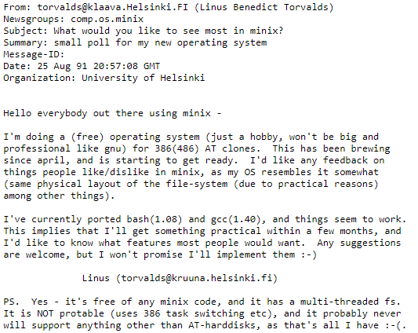

# 01. Introductie

## Wat is Linux?
Windows, gemaakt door Microsoft, is een bekend besturingssysteem dat meestal wordt gebruikt op desktopcomputers, maar er zijn ook andere alternatieven. Enkele van de meer populaire zijn macOS, ChromeOS en, natuurlijk, Linux. Linux met een desktopomgeving is minder prominent aanwezig dan de andere.

Linux zelf is eigenlijk enkel de **kernel**: het kernonderdeel van het besturingssysteem dat de hardware (processor, geheugen, schijven, netwerk, ...) beheert en de communicatie tussen software en hardware regelt. Alles errond (commando's, programma's, grafische omgeving) komt uit andere projecten, zoals GNU.

In server-, IoT- en mobiele omgevingen speelt Linux een hoofdrol. Android, het meest gebruikte mobiele besturingssysteem, is bijvoorbeeld gebouwd op de Linux-kernel. Enkele interessante bronnen (Engelstalig):

[De meeste supercomputers draaien op Linux](https://www.top500.org/statistics/details/osfam/1/)  
[111+ Linux statistieken en feiten – Linux Rocks!](https://webtribunal.net/blog/linux-statistics/)  
[De populairste cloudinfrastructuurproviders gebruiken Linux](https://www.linuxfoundation.org/blog/how-amazon-web-services-uses-linux-and-open-source/)  

Linux wordt gebruikt in smartphones, (web)servers, tablets, IoT-apparaten, slimme wasmachines, auto's, modems, routers, spelconsoles, ... Kortom: Linux wordt veel meer gebruikt dan je in eerste instantie zou denken. Linux heeft zelfs zijn eigen mascotte, de pinguïn Tux!

## Unix
Dennis Ritchie en Ken Thompson creëerden het Unix-besturingssysteem in 1969 bij Bell Labs (AT&T). De broncode van dit besturingssysteem werd destijds gedeeld, onder meer met universiteiten. Na een tijdje besloot AT&T dat het Unix commercieel wilde verkopen. Aan de Universiteit van Berkeley werd Unix intussen verder ontwikkeld tot **BSD** (Berkeley Software Distribution), met een vrijere licentie. Dit leidde tot twee lijnen:

* **Unix:** de commerciële versie
* **BSD:** de (grotendeels) open source versie

In de jaren '80 waren er verschillende versies van Unix. Omdat Unix werd gecommercialiseerd, startte Richard Stallman in 1983 het **GNU-project** ("GNU's Not Unix"): een volledig vrij besturingssysteem, geschreven van nul, waar iedereen als gemeenschap aan kon werken. Het GNU-project miste wel nog een werkende kernel.

## Linux ontstaat
In 1991 postte Linus Torvalds, een student in Helsinki, een bericht in de nieuwsgroep `comp.os.minix` over zijn eigen hobby-besturingssysteem (afgeleid van de leerzame Unix-variant MINIX van professor Tanenbaum):

  

Samen met de GNU-tools vormde de Linux-kernel een volledig, vrij besturingssysteem (daarom spreekt men ook van **GNU/Linux**). We gebruiken vandaag nog steeds de Linux-kernel en hij wordt elke dag verder ontwikkeld door duizenden vrijwilligers en bedrijven.

* [De geschiedenis van Linux - Tijdlijn 1](https://en.wikipedia.org/wiki/Linux#/media/File:Unix_timeline.en.svg)  
* [De geschiedenis van Linux - Tijdlijn 2](https://www.linuxbe.com/images/linux_events30.jpg)  

## Linux-distributies
Linux-distributies (kortweg distro's) bundelen de Linux-kernel met GNU-tools, een pakketbeheerder en andere software, en vereenvoudigen zo het installeren van GNU/Linux en andere apps op je computer. Bekende distro's zijn Ubuntu, Debian, Fedora, Red Hat Enterprise Linux (RHEL), Arch Linux en Oracle Linux. Ook de gratis RHEL-varianten AlmaLinux en Rocky Linux zijn populair, als opvolgers van CentOS Linux (dat in 2024 stopte). Omdat Linux erg schaalbaar is, zijn er ook speciale distro's voor bepaalde doelen, bijvoorbeeld Clonezilla (schijven klonen).

 [Unix vs Linux (Eerste 10:30 minuten)](https://www.youtube.com/watch?v=jowCUo_UGts)  
 [Wat is linux?](https://www.youtube.com/watch?v=zA3vmx0GaO8)  
 [High level overview Linux](https://www.linux.com/what-is-linux/)  
 [Meest populaire linux distros](https://distrowatch.com/dwres.php?resource=popularity)  
