# Oefeningen op Installatie
 
### In deze oefeningen ga je een Ubuntu Server installeren in Azure Cloud


## Oefening 1 - Visual Studio Pro Subscription
Om in Azure Cloud te kunnen werken moet je eerst een Visual Studio Pro Subscription aanvragen. Dit hoef je maar één keer te doen voor alle opleidingsonderdelen (=vakken) van dit academiejaar.

De Procedure staat [hier](https://hogeschoolpxl.sharepoint.com/:w:/g/pxl-digital/IQAB4yrYj_CzS7zaj5xQQ34VAUTo40OkYaDrlYcz9j7j_bA) uitgelegd.

Je krijgt dan maandelijks een tegoed van ongeveer €45 dat je kan spenderen in Azure Cloud. Zolang je binnen het budget blijft, ben je dus eigenlijk gratis resources aan het gebruiken. Let wel op dat je het tegoed niet opgebruikt door van alles te exploreren dat ook in Azure zit, maar niet in de les behandeld wordt. Want soms kan het tegoed wel heel snel opraken op deze manier. Wanneer je tegoed op is, zal je moeten wachten tot de volgende periode begint (maandelijks op zelfde dag als de startdatum van je subscription)


## Oefening 2 - Aanmaken SSH key in aparte Resource Group

Het kan zijn dat je je Instance (=VM) eens wilt weggooien met alles wat daarbij hoort. Alles wat bij elkaar hoort zit in een Resource Group. Maar als je die weggooit, ben je ook je public SSH key kwijt om te verbinden met je Instance.

Daarom kan het good practice zijn om je SSH-key aan te maken in een aparte Resource Group, die enkel daarvoor gebruikt wordt. Zolang je deze Resource Group dan niet verwijdert, blijft je SSH-key bestaan en kan je deze hergebruiken voor andere/nieuwe instances.

We maken dus een Resource Group aan en plaatsen hier een SSH-key in:

Surf naar [portal.azure.com](https://portal.azure.com/) en log, indien nodig, in met je studentennummer@student.pxl.be.

### Stap 1: Aanmaken Resource Group

Zoek naar Resource Groups en selecteer

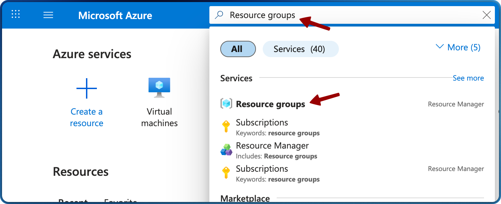

Klik op + Create om een nieuwe Resource Group aan te maken

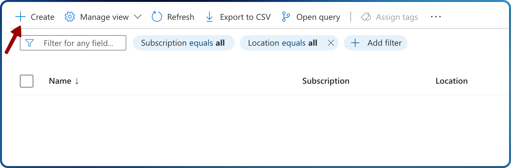  

Opgelet! Vergeet niet om de Region op *West Europe* te zetten.

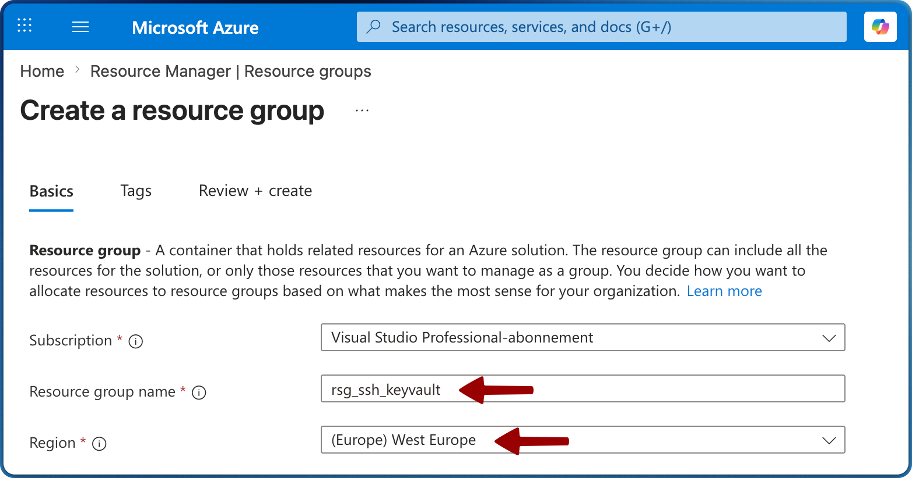

### Stap 2: Aanmaken SSH keypair

Er wordt een keypair aangemaakt. De public key blijft op Azure en wordt toegekend aan een standaard gebruiker van iedere nieuwe Instance die we aanmaken. De private key downloaden we naar onze laptop en is enkel voor ons en niemand anders. Als we later willen aanmelden met een bepaalde gebruiker op een bepaalde server, kunnen we dit omdat onze private key (vanop de laptop) hoort bij de public key op de server (bij die bepaalde gebruiker). Je zou het keypair dus kunnen zien als een slot en bijbehorende sleutel.

Zoek naar ssh en selecteer SSH keys

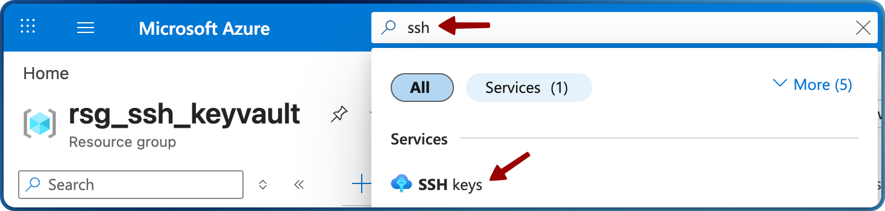

Klik op + Create om een nieuw SSH Keypair aan te maken

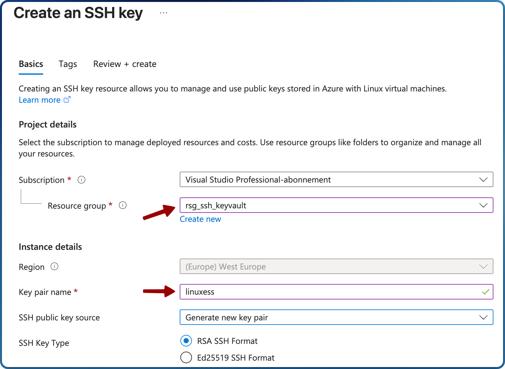

::: warning
Opgelet! Tijdens het maken van het keypair wordt de Private Key gedownload. Verwijder deze niet van je laptop! Er is geen enkele manier om deze private key opnieuw vast te krijgen op een later tijdstip!
:::

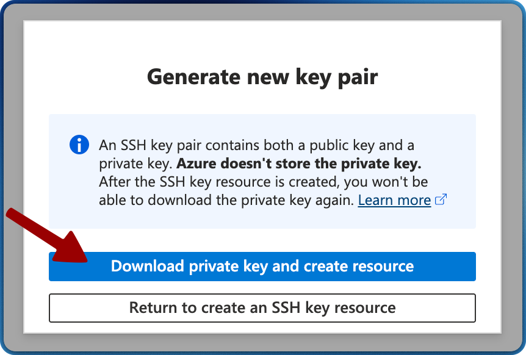

### Stap 3: Verplaatsen van de private key naar een veiligere plek

De downloads-map is niet de veiligste plek om belangrijke bestanden te bewaren. Ook voor de gemakkelijkheid nadien is het beter om de key te verplaatsen.

Verplaats de key naar het mapje:

Rechtsklik op de startknop en selecteer Terminal

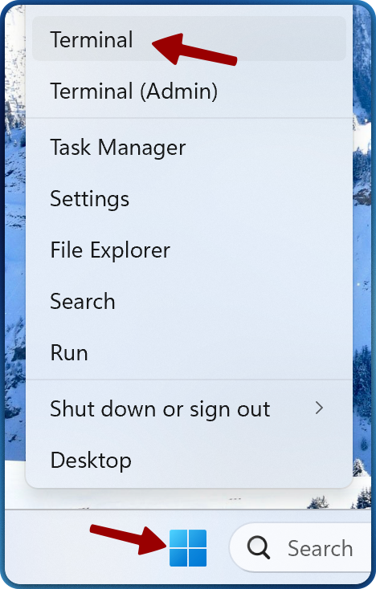

Je komt standaard terecht in jouw homefolder (C:\Users\<jouw loginnaam>). Verplaats de private key van het Downloads-mapje naar de huidige map voorgesteld door een . (punt).

Je kan controleren of het gelukt is met ls

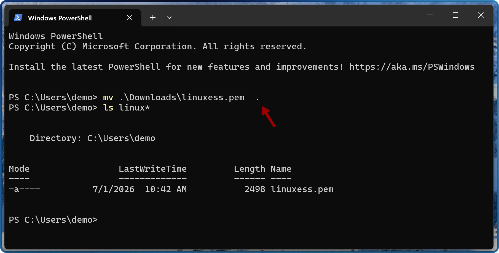


## Oefening 3 - Aanmaken Free VM (werkt meestal niet)
Je hebt normaal gezien recht op het aanmaken van één gratis instance (=VM) met onderstaande procedure. Maar omdat dit gratis is, werkt dit meestal niet en is er ook geen support om dit op te lossen.

Indien onderstaande procedure niet werkt, ga je gewoon door met de volgende oefening.

Procedure:

Zoek naar Free services

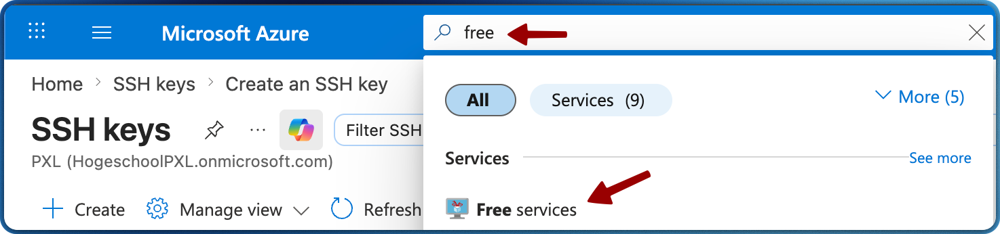

Klik op Create onder Linux Virtual Machine

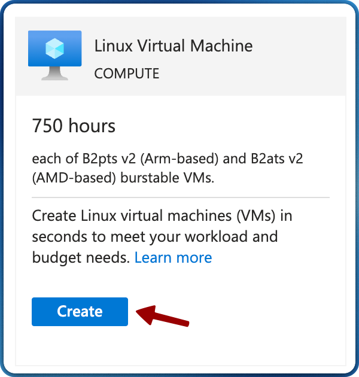

- Virtual Machine name: Free_Linux
- Resource Group wordt automatisch ingevuld
- Region: West US 2 (in West Europe geen rechten om aan te maken)
- Image: Ubuntu Server 26.04 LTS – x64 Gen2
- Size: Standard_B2ats_v2 (of wat er voorgesteld wordt)
- Username: student
- SSH: Use Existing key stored in Azure
- gebruik je bestaande key: linuxess

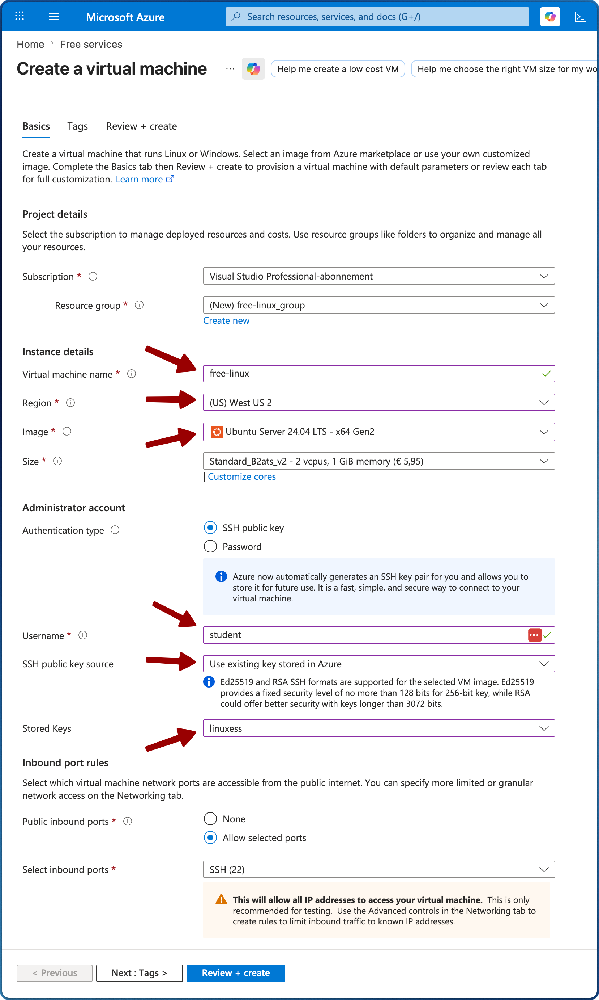

Klik op Review + create

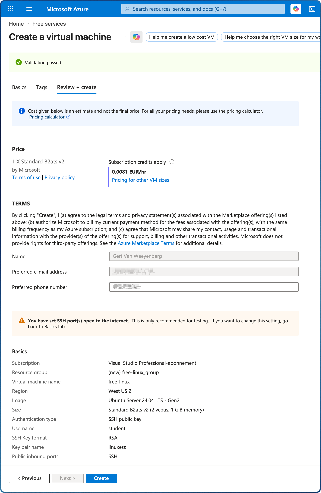

Klik op Create

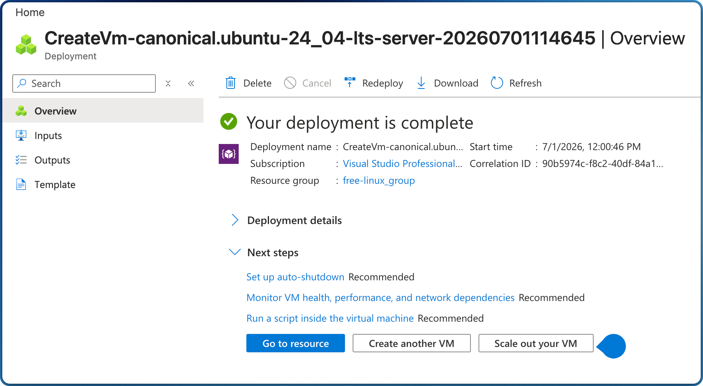

Het is gelukt!

Zoek naar virt en selecteer Virtual machines

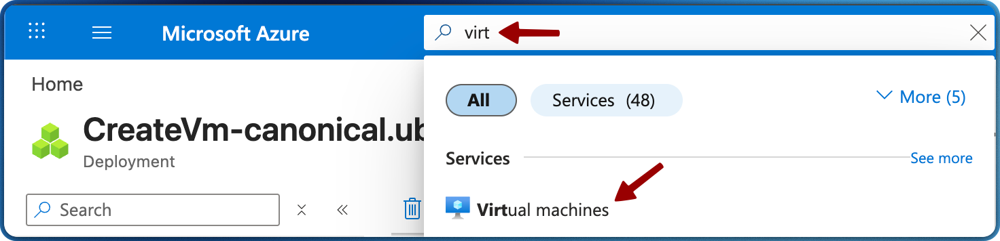

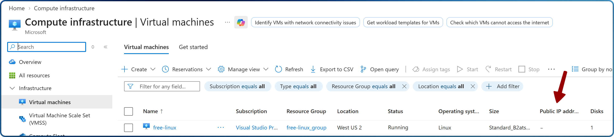  

Opgelet! Indien de Virtuele Machine geen Public IP address heeft gekregen, moeten we dat zelf nog toevoegen.  

Zet de VM uit 

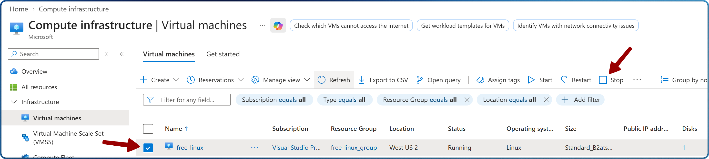  

Klik op refresh om te checken of de VM uit staat en klik op de naam van de VM op deze te editeren  

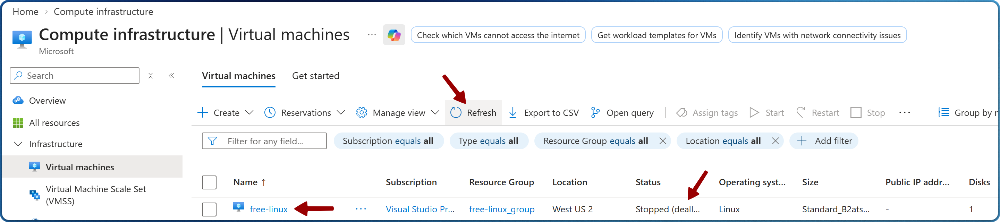  

Klik op Configure bij Public IP  

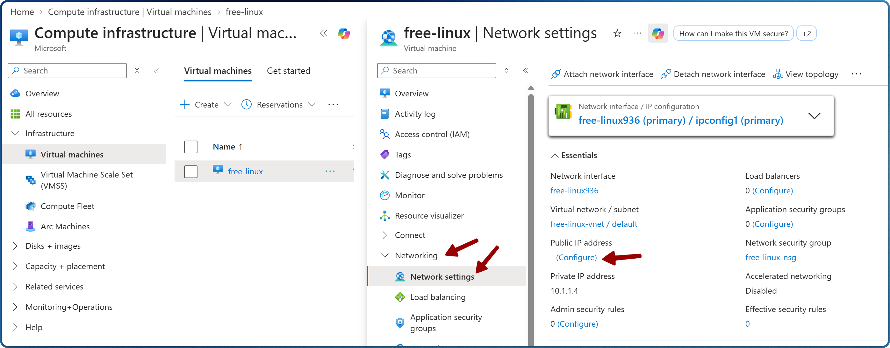  

Klik op ipconfig1, vink Associate Public IP aan en klik op Save  

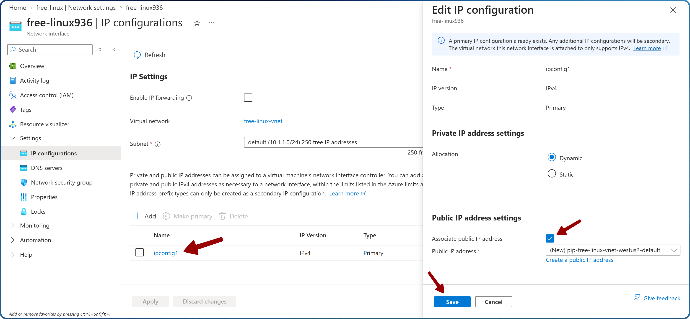  

Start de VM. We zien dat hij nu wel een Public IP address heeft  

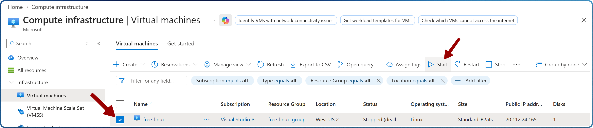  

  


## Oefening 4 - Aanmaken VM (indien Free VM niet lukte)

::: warning
Opgelet! Je hoeft dit enkel te doen indien het aanmaken van de Free VM niet lukte.
:::

Zoek naar virt en selecteer Virtual machines


Klik op Create

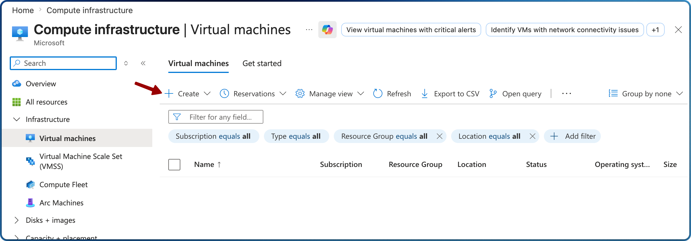

- Virtual Machine name: LinuxEss
- Resource Group wordt automatisch ingevuld
- Region: West Europe
- Zone options: Azure-selected zone
- Image: Ubuntu Server 26.04 LTS – x64 Gen2
- Size: Standard_B2ts_v2 (als deze niet kan klik je op See all sizes en selecteer je een andere → zie laatste kolom voor prijs per maand!)
- Username: student
- SSH: Hergebruik je bestaande key: linuxess

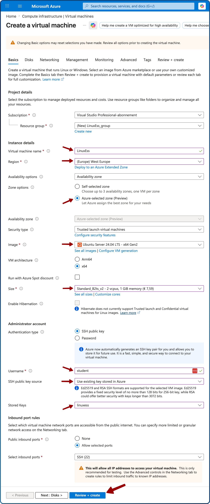

Het is gelukt!

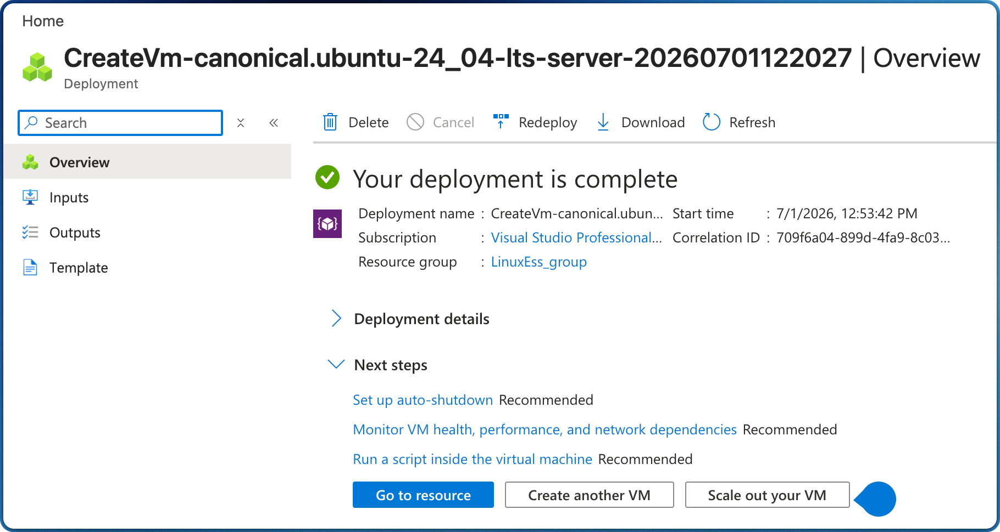

Zoek naar virt en selecteer Virtual machines

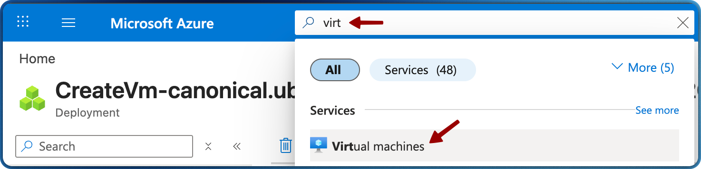

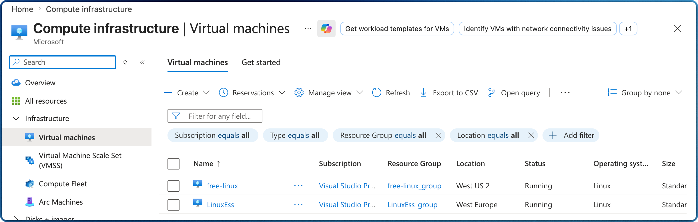


## Oefening 5 - Zorgen dat de VM niet automatisch iedere avond uitgezet wordt
Standaard wordt een VM uitgezet iedere avond om 19u. Indien jij de Free Linux hebt kunnen aanmaken staat dit wel standaard uit.

We gaan dit even uit zetten.

Zoek naar virt en selecteer Virtual machines. Klik op de naam van de VM.

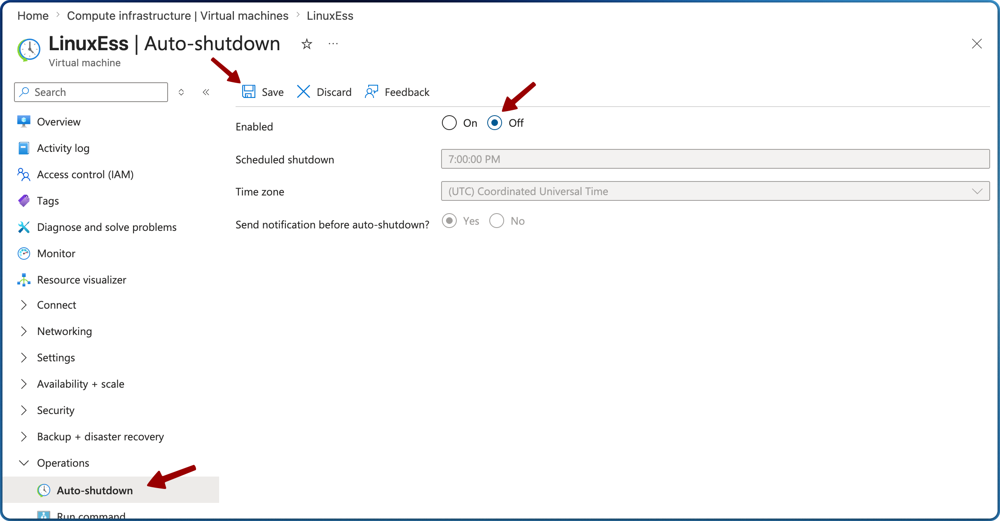


## Oefening 6 - Verbinding maken met de Linux VM
We kunnen nu verbinding maken met de VM en inloggen met het SSH-keypair.

We zoeken eerst uit wat het IP adres van onze VM is:

Zoek naar virt en selecteer Virtual machines. Klik op de naam van de VM. Klik achter het Publiek IP van de Server op het Copy-icoontje

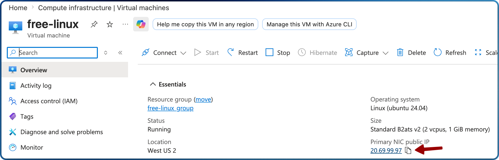

Open een Terminal-venster door te rechtsklikken op de start-knop en te kiezen voor Terminal


Maak een ssh-connectie door op te geven welke private key je wilt gebruiken (`-i`), met welke gebruiker je wilt inloggen (`student`) en op welke server (het IP-adres dat je net kopieerde):

```powershell
ssh -i .\linuxess.pem student@<IP-adres>
```

Omdat dit de eerste keer is dat je naar die server verbindt moet je bevestigen met yes. Dit zal je in de toekomst niet meer moeten doen.

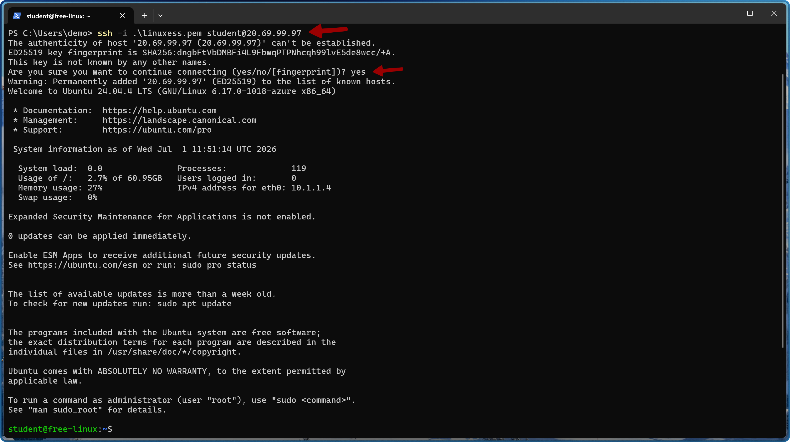  
  
::: warning Unprotected private key?
Opgelet! Indien het inloggen niet lukt en je een waarschuwing krijgt zoals *WARNING: UNPROTECTED PRIVATE KEY FILE!*, dan kan je dit oplossen met onderstaande PowerShell-commando's (andere gebruikers verliezen dan de leesrechten op je sleutel):

```powershell
$path = ".\linuxess.pem"
icacls.exe $path /inheritance:r
icacls.exe $path /GRANT:R "$($env:USERNAME):(R)"
```
:::


## Oefening 7 - VM resources checken 
Je kan met een aantal commando's de resources van de VM checken.

RAM-geheugen (`free -h`):

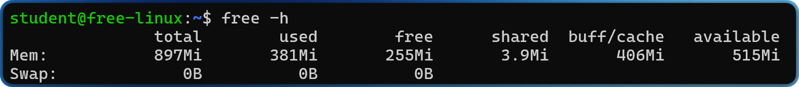

Schijfruimte (`df -h`):

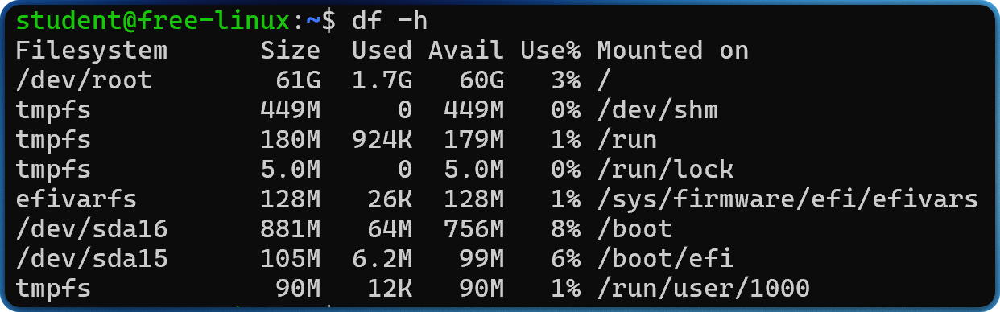

Processoren (`lscpu -e=cpu`, elke regel is één virtuele processor):

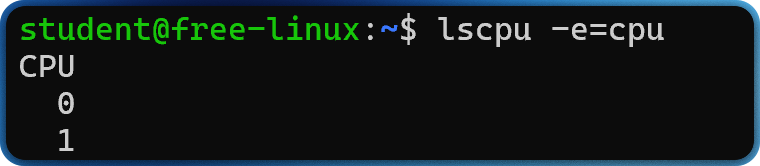


## Oefening 8 - Connectie afsluiten 
Je kan de connectie afsluiten met het commando `exit` (of {{Ctrl+D}}).

Hierdoor worden alle toepassingen gesloten, wordt je afgemeld en wordt de connectie afgesloten.

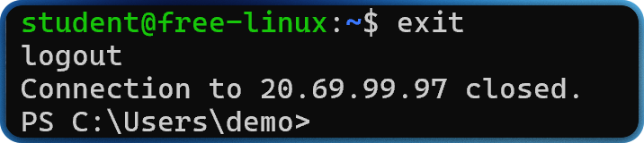
