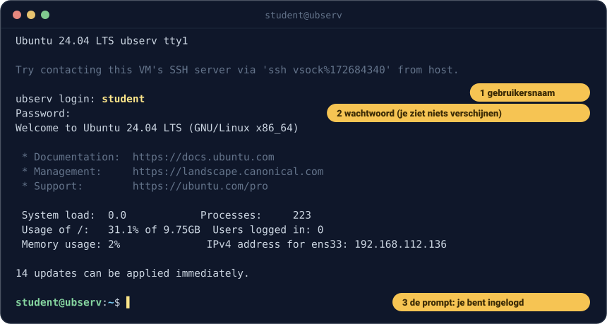
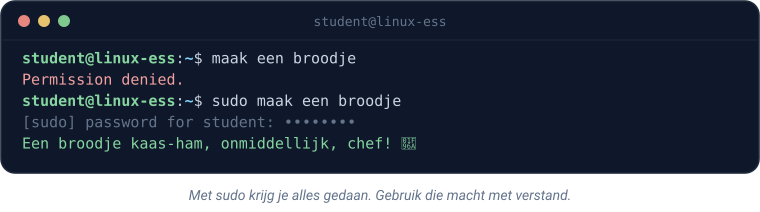

# 03. Command line Interface (CLI)


## Command line Interface (CLI)
Bij het opstarten van de virtuele machine wordt alleen een zwart scherm weergegeven met wat witte tekst:



Je zal merken dat er geen muisaanwijzer beschikbaar is. We gebruiken alleen maar ons toetsenbord als invoerapparaat. Deze omgeving wordt een command line interface (CLI) genoemd. Er is geen graphical user interface (GUI) aanwezig in Ubuntu-server. Een van de redenen waarom ze hiervoor hebben gekozen, is omdat het hebben van geen GUI systeembronnen bespaart en het aanvalsoppervlak verkleint. Een CLI is ook bewezen een zeer efficiënte en betrouwbare manier van werken met een besturingssysteem en zijn diensten te zijn.

Je logt in met de gebruikersnaam `student` en het wachtwoord dat je tijdens de installatie hebt ingesteld (`pxl`). Typ het wachtwoord in en druk op {{Enter}}.

::: info Wachtwoord niet zichtbaar
Je ziet niet wat je typt voor het wachtwoord — dit is normaal in een CLI-omgeving.
:::

CLIs zullen interessanter worden in het deel automatisering, iets dat moeilijker is bij het gebruik van een GUI. We kunnen deze trend ook zien in Windows-systemen, waar PowerShell steeds populairder wordt om Windows-servers te configureren en automatiseringstaken uit te voeren.


## De prompt
Na het inloggen krijg je de volgende regel in de CLI te zien. Dit wordt de prompt genoemd:


De prompt bestaat uit meerdere onderdelen die ons meer informatie geven over het systeem dat we gebruiken. We zien informatie over onze gebruiker en de hostnaam van de server waarop we zijn ingelogd.

Het `~`-symbool is een afkorting van de homefolder van de ingelogde gebruiker (in ons geval de map /home/student). We zullen in een later hoofdstuk meer te weten komen over paden en mappen. Voor nu kun je dit vergelijken met het pad C:\Users\student in Windows. Dus wat we eigenlijk zien tussen de : en het $ teken is een pad dat verwijst naar de map waarin we momenteel werken.

[Linux prompt definitie](http://www.linfo.org/prompt.html#:~:text=A%20commd%20prompt%2C%20also%20referred,terminal%20window%20by%20a%20shell.)




## Commando's, argumenten en opties
Wanneer je iets typt met behulp van het toetsenbord, verschijnt de invoer na het $-teken. Het $-teken geeft het einde van de prompt en het begin van de invoer van de gebruiker (= een commando/opdracht) aan. Om het besturingssysteem te gebruiken met behulp van een CLI, zullen we commando's moeten gebruiken. Het eerste commando dat we zullen gebruiken is het echo commando:

```bash
student@linux-ess:~$ echo hello world 
hello world
```

De tekst `hello world` is een **argument** van het commando `echo`. Dit commando drukt gewoon het argument af dat we meegeven.

Het tweede commando dat we gebruiken is `shutdown`:

```bash
student@linux-ess:~$ sudo shutdown now 
```

Met deze opdracht wordt de Ubuntu-servermachine afgesloten. Dit is ook de correcte manier om de virtuele machine af te sluiten! `sudo` staat voor *superuser do*. Voor sommige opdrachten zijn beheerdersrechten nodig. Zet je `sudo` vooraan, dan voert Linux het commando uit als de superuser, die in Linux **root** heet (te vergelijken met de administrator in Windows). In het voorbeeld voert `sudo` dus het commando `shutdown` uit, en `now` is het argument van `shutdown`: *nu afsluiten*.

::: tip Wachtwoord bij sudo
Op Ubuntu 26.04 zie je sterretjes (`*`) terwijl je je wachtwoord typt bij `sudo`. Op oudere versies en bij het inloggen verschijnt niets. In beide gevallen wordt je wachtwoord wel degelijk ingevoerd.
:::

Commando's hebben vaak **opties** (beginnend met een koppelteken `-`) en **argumenten** (gescheiden door spaties) om hun werking aan te passen. Het commando `shutdown` neemt een optionele tijdswaarde die bepaalt wanneer de server afsluit. Geef je geen waarde, dan wordt het afsluiten één minuut na het uitvoeren van het commando gepland. Laten we de andere opties bekijken met `man shutdown`:

```output
SHUTDOWN(8)                                            shutdown                                           SHUTDOWN(8)
 
NAME
       shutdown - Halt, power-off or reboot the machine
 
SYNOPSIS
       shutdown [OPTIONS...] [TIME] [WALL...]
 
DESCRIPTION
       ...
 
OPTIONS
       The following options are understood:
 
       --help
           Print a short help text and exit.
       -H, --halt
           Halt the machine.
       -P, --poweroff
           Power-off the machine (the default).
       -r, --reboot
           Reboot the machine.
       -h
           Equivalent to --poweroff, unless --halt is specified.
       -k
           Do not halt, power-off, reboot, just write wall message.
       --no-wall
           Do not send wall message before halt, power-off, reboot.
       -c
           Cancel a pending shutdown. This may be used to cancel the effect of an invocation of shutdown with a time
           argument that is not "+0" or "now".
```

Zoals je ziet, heeft `shutdown` veel opties. Zo herstart je de machine met `sudo shutdown -r now`.

Ieder commando heeft zijn eigen set opties.

::: warning Linux is hoofdlettergevoelig
Commando's, opties, argumenten, bestands- en mapnamen, ... Het verschil tussen hoofdletters en kleine letters telt overal: `Documents` en `documents` zijn twee verschillende mappen, en `-r` en `-R` zijn verschillende opties.
:::

[Linux commandostructuur](https://uofabioinformaticshub.github.io/BASH-Intro/notes/extra_command_syntax.html)


### manpages tonen met man
In Linux gebruiken we een CLI. Daarom zullen we met verschillende commando's moeten werken. Onze Ubuntu-installatie heeft allerlei ingebouwde commando's. Om commando's te vinden die we kunnen gebruiken zouden we Google kunnen gebruiken, maar het besturingssysteem zelf heeft ook informatie over alle geïnstalleerde commando's. Deze info is gebundeld in manpages (afkorting voor manual pages). Je hebt toegang tot deze manpages via het commando `man`.

Typ `man` gevolgd door een commando waarvoor je hulp wilt, en begin te lezen:

```bash
student@linux-ess:~$ man shutdown
```

Niet alleen commando's hebben hun eigen manpage, configuratie-/systeembestanden kunnen ook een manpage hebben. De onderstaande opdracht toont de manpage van het bestand sudo.conf:

```bash
student@linux-ess:~$ man sudo.conf
```

manpages zijn behoorlijk groot en bestaan uit meerdere pagina's en/of secties. Manpages worden getoond met de pager `less` (zie hoofdstuk 06). Om de volgende pagina te bekijken druk je op de spatiebalk, of je gebruikt de pijltjestoetsen. Een manpage verlaat je met `q` (*quit*). Meer weten over manpages? Typ `man man`!

Je kan als volgt zoeken in de beschrijving van geïnstalleerde commando's met behulp van de optie -k (of het commando apropos gebruiken):

```bash
student@linux-ess:~$ man -k shutdown
student@linux-ess:~$ apropos shutdown
```

Beide commando's doen hetzelfde.


#### manpage secties
Met `man <sleutelwoord>` krijg je hulp over een commando, maar ook over een (configuratie)bestand, daemon, ... Wat als het sleutelwoord zowel als commando als als configuratiebestand bestaat? Een perfect voorbeeld is `passwd`:

```bash
student@linux-ess:~$ apropos passwd
...
passwd (1)           - change user password
passwd (1ssl)        - compute password hashes
passwd (5)           - the password file
```

Als we naar de bovenstaande uitvoer kijken, zien we 3 passwd items met verschillende nummers tussen de ronde haakjes. De getallen verwijzen naar de secties van de manpage. Standaard opent `man` de eerste sectie die het vindt. In dit geval sectie 1, die informatie bevat over het commando passwd. Sectie 5 bevat informatie over het bestandsformaat van `/etc/passwd`. We kunnen deze sectie openen door deze als volgt op te geven:

```bash
student@linux-ess:~$ man 5 passwd
```

Deze opdracht toont nu de manpage van het configuratiebestand in plaats van het commando passwd.


#### Handige manpage sneltoetsen
In een manpage (en dus in `less`) ga je met `g` naar de eerste regel en met `G` (hoofdletter) naar de laatste. Met `h` krijg je een hulpscherm.


#### Zoeken door de manpage
Typ een schuine streep `/` gevolgd door een zoekwoord en druk op {{Enter}}. Met `n` (*next*) ga je naar de volgende treffer, met `N` naar de vorige.

::: tip Begin bovenaan
Typ eerst `g` om naar de eerste regel te gaan voordat je begint met zoeken, anders zoek je enkel vanaf de plaats waar je nu staat.
:::


### Snelle hulp met tldr
Een manpage is volledig, maar vaak veel te lang als je gewoon wil weten *hoe* je iets gebruikt. Met `tldr` (*too long; didn't read*) krijg je een korte uitleg in het Nederlands met praktische voorbeelden. Dit is een aanvulling op `man`, geen vervanging: `man` om alles op te zoeken, `tldr` om snel op weg te zijn.

```bash
student@linux-ess:~$ sudo apt install tealdeer
student@linux-ess:~$ tldr -L nl --update
student@linux-ess:~$ tldr -L nl tar
```

Een alias `hulp` maken (`echo "alias hulp='tldr -L nl'" >> ~/.bashrc`) maakt het nog sneller. Het overzicht van dit hoofdstuk legt het stap voor stap uit in de sectie *Snelle hulp met tldr*.


### whatis & whereis
Met `whatis` bekijk je snel de korte beschrijving van een commando, zonder de volledige manpage te openen:

```bash
student@linux-ess:~$ whatis route
route (8) - show / manipulate the IP routing table
```

Met `whereis -m` zie je waar de manpage zelf staat:

```bash
student@linux-ess:~$ whereis -m ls
ls: /usr/share/man/man1/ls.1.gz
```

Manpages worden gecomprimeerd opgeslagen in bestanden met de extensie `.gz` (vergelijkbaar met een zip-bestand). Met `man ls` leest `man` dus eigenlijk het gecomprimeerde bestand `/usr/share/man/man1/ls.1.gz`.


### Shell history
Het programma dat je commando's inleest en uitvoert, heet de **shell** (op Ubuntu is dat `bash`). De shell houdt alle commando's bij die we in het verleden hebben gebruikt. Dit betekent dat we dit kunnen gebruiken om eerder gebruikte opdrachten eenvoudig te herhalen, te bewerken of op te zoeken.

Probeer de toetsen pijl omhoog en pijl omlaag te gebruiken na het gebruik van enkele opdrachten. Je zal merken dat deze opdrachten na de prompt opnieuw verschijnen.

Het laatste commando herhalen is heel eenvoudig: typ `!!` (*bang bang*) en de shell voert het laatst gebruikte commando opnieuw uit. Handig wanneer je vergat `sudo` te gebruiken:

```bash
student@linux-ess:~$ cat /etc/shadow
cat: /etc/shadow: Permission denied
student@linux-ess:~$ sudo !!
sudo cat /etc/shadow
[sudo] password for student:
root:*:19103:0:99999:7:::
daemon:*:19103:0:99999:7:::
bin:*:19103:0:99999:7:::
...
usbmux:*:19150:0:99999:7:::
student:$6$2YcjTQ1OiAVeexi5$MgKJ3MAZBx5P2ZfGIkIjbYYLtcPjxKBVAJx.RnuzPn.EJk/rQgQqAXiiR3jMfq4sDn31e9k5HkuwwR5vKy/D.0:19150:0:99999:7:::
lxd:!:19150::::::
```

::: warning /etc/shadow is beveiligd
Het bestand `/etc/shadow` bevat de (gehashte) wachtwoorden van de gebruikers en kan om veiligheidsredenen enkel door root gelezen worden. Daarom kreeg je eerst *Permission denied*.
:::

Met `history` bekijk je de lijst van je laatst gebruikte commando's:

```bash
student@linux-ess:~$ history 10
  257  ls
  258  pwd
  259  cd
  260  ls
  261  mkdir testfolder
  262  rm -rf testfolder
  263  pwd
  264  cat /etc/shadow
  265  sudo cat /etc/shadow
  266  history 10
```

Het getal dat we als argument gebruiken, is het aantal commando's dat de uitvoer zal weergeven. Je kan elk van die commando's opnieuw uitvoeren met `!n`, waarbij `n` het nummer vóór het commando is. `!261` voert dus `mkdir testfolder` uit.

::: info Wat wordt niet opgeslagen in history?
Op Ubuntu worden commando's die **beginnen met een spatie** niet aan de geschiedenis toegevoegd. Ook een commando dat **identiek is aan het vorige** wordt niet opnieuw opgeslagen (instelling `HISTCONTROL=ignoreboth` in `~/.bashrc`). Handig als je een wachtwoord in een commando moet typen.
:::

```bash
student@linux-ess:~$ echo Start
Start
student@linux-ess:~$ echo "echo commando dat niet begint met een spatie"
echo echo commando dat niet begint met een spatie
student@linux-ess:~$ echo "echo commando dat niet begint met een spatie"
echo echo commando dat niet begint met een spatie
student@linux-ess:~$  echo "echo commando dat wel begint met een spatie"
echo echo commando dat wel begint met een spatie
student@linux-ess:~$ echo Einde
Einde
student@linux-ess:~$ history 4
  220  echo Start
  221  echo "echo commando dat niet begint met een spatie"
  222  echo Einde
  223  history 4
```

Een slimme gewoonte is {{Ctrl+R}}: een zoekopdracht achterwaarts (van nieuw naar oud) door je geschiedenis. Druk op {{Ctrl+R}} en typ een stukje van het commando. Druk opnieuw op {{Ctrl+R}} voor de volgende treffer. Met de pijltjestoetsen pas je het commando aan, met {{Enter}} voer je het uit en met {{Ctrl+C}} annuleer je en ga je terug naar een lege opdrachtregel.


## Extra cursusmateriaal
[Linux manpages guide](https://itsfoss.com/linux-man-page-guide/)
