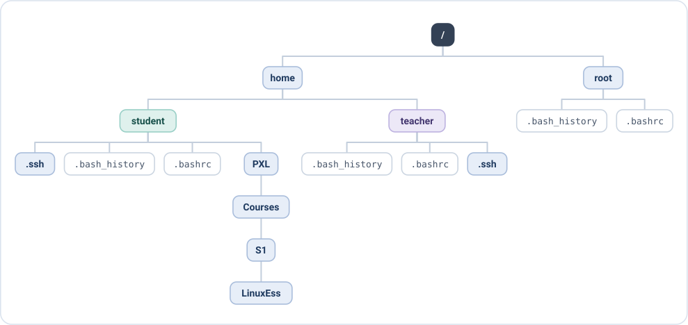
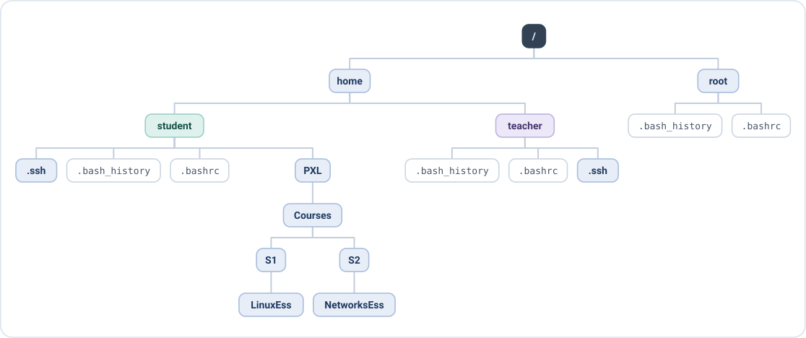
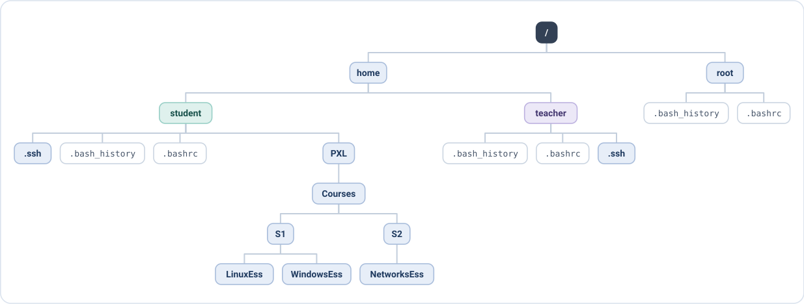
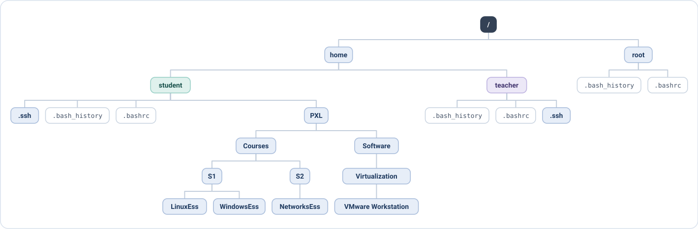

# Oefeningen op bestanden en mappen

::: warning
Maak via ssh verbinding met je server om de oefeningen te doen.
:::

## Oefening 1
Navigeer naar je homefolder met het minste aantal toetsaanslagen mogelijk (drie om precies te zijn). Wat is het commando om het volledige pad weer te geven van waar je je in de bestandsstructuur bevindt? Wat is het volledige pad van je homefolder?

::: details Oplossing tonen
```
cd
```
```
pwd
```
*Het volledige pad van je homefolder is `/home/student`.*
:::

## Oefening 2
Maak in je homedirectory de volgende structuur: `PXL/Courses/S1/LinuxEss`

Doe dit door naar elke gemaakte map te gaan om de volgende te maken.



Je hebt deze structuur nodig in een volgende oefening.

::: details Oplossing tonen
```
cd
```
```
mkdir PXL
```
```
cd PXL
```
```
mkdir Courses
```
```
cd Courses
```
```
mkdir S1
```
```
cd S1
```
```
mkdir LinuxEss
```
```
cd
```
```
tree PXL
```
:::

## Oefening 3
Ga terug naar je homefolder. Terwijl je in je homefolder blijft, maak je de map _S2_ als een submap van _Courses_. Doe dit met behulp van een **absoluut pad**. Terwijl je in je homefolder blijft, maak je de map _NetworksEss_ als een submap van _S2_. Doe dit ook met behulp van een **absoluut pad**.

Gebruik tab-completion wanneer je maar kunt!



::: details Oplossing tonen
```
cd
```
```
mkdir /home/student/PXL/Courses/S2
```
```
mkdir /home/student/PXL/Courses/S2/NetworksEss
```
```
cd
```
```
tree PXL
```
:::

## Oefening 4
Maak de map _WindowsEss_ als een submap van _S1_ terwijl je in je homefolder bent. Doe dit met behulp van een **relatief pad**.

Gebruik tab-completion wanneer je maar kunt!



::: details Oplossing tonen
```
cd
```
```
mkdir PXL/Courses/S1/WindowsEss
```
```
cd
```
```
tree PXL
```
:::

## Oefening 5
Maak in je homedirectory de volgende structuur met slechts één commando: `PXL/Software/Virtualization/VMware Workstation`

Let op de spatie in de bestandsnaam!

Je moet in de manpage zoeken naar de optie om te gebruiken. Het maakt alle bovenliggende mappen die nodig zijn. Hier betekent het dat om de map _VMware Workstation_ te maken, de server eerst alle andere mappen zal maken als ze nog niet bestaan (PXL, Software en Virtualization).



::: details Oplossing tonen
```
man mkdir
```
```
cd
```
```
mkdir -p "PXL/Software/Virtualization/VMware Workstation"
```
```
tree PXL
```
:::

## Oefening 6
Installeer het commando `tree` op je ubuntu machine. Je kan dit commando gebruiken om een overzicht te krijgen van directorystructuren op je systeem. Doorzoek de manpage van `tree` om de inhoud van de root directory en een extra level te tonen.

::: details Oplossing tonen
```
sudo apt install tree
```
```
man tree
```
```
tree -L 2 /
```
:::

## Oefening 7
Waarom werkt het aanvullen met tab niet bij het uitvoeren van de volgende opdracht om `.bashrc` te openen?: `cat /home/student/.bash<tab>`

::: details Oplossing tonen
Er bestaan meerdere bestanden die beginnen met `.bash` (zoals `.bashrc`, `.bash_history`, `.bash_logout`, …). Druk `<tab><tab>` om de mogelijkheden te tonen en typ verder om te disambigueren.
:::

## Oefening 8
Ga naar de map `/etc`. Gebruik een absoluut pad om naar de directory `PXL/Software/Virtualization/VMware Workstation` te gaan.

::: details Oplossing tonen
```
cd /etc
```
```
cd "/home/student/PXL/Software/Virtualization/VMware Workstation"
```
:::

## Oefening 9
Je bevindt je in de map _VMware Workstation_. Gebruik een relatief pad om naar de directory _LinuxEss_ te gaan.

::: details Oplossing tonen
```
cd ../../../Courses/S1/LinuxEss
```
:::

## Oefening 10
Je bevindt je in de directory _LinuxEss_. Gebruik de `~` om naar de map `.ssh` in je homefolder te gaan.

::: details Oplossing tonen
```
cd ~/.ssh
```
:::

## Oefening 11
Ga naar je homefolder. Toon een lijst van de bestanden en mappen. Toon een lijst van de bestanden en mappen in een lange lijst. Toon ook de verborgen bestanden. Toon de bestanden van de map `/etc` in een lange lijst met de bestandsgrootten in een human readable-indeling.

::: details Oplossing tonen
```
cd
```
```
ls
```
```
ls -l
```
```
ls -a
```
```
ls -lh /etc
```
:::

## Oefening 12
Maak een nieuwe map `My Pictures` in je homefolder. Ga naar deze map en maak, met slechts één commando, de volgende bestanden (let op het hoofdlettergebruik):

- `Picture1.JPG`
- `picture2.JPG`
- `Picture3.jpg`
- `picture4.jpg`

::: details Oplossing tonen
```
cd
```
```
mkdir My\ Pictures
```
```
cd My\ Pictures
```
```
touch Picture1.JPG picture2.JPG Picture3.jpg picture4.jpg
```
:::

## Oefening 13
Gebruik het commando `rename` om alle bestanden te hernoemen, zodat er geen hoofdletters meer staan in de bestandsnamen van de vorige oefening. Zoek in de examples van de manpage voor een oplossing.

::: details Oplossing tonen
```
rename 'y/A-Z/a-z/' *
```
:::

## Oefening 14
Zorg ervoor dat je je in je homedirectory bevindt (`~`). Maak een nieuwe map met de naam `backup` in je homefolder. Kopieer alle bestanden in je homedirectory naar de submap `backup`. Je hoeft de submappen niet te kopiëren, maar je moet wel de verborgen bestanden kopiëren.

::: details Oplossing tonen
```
cd
```
```
mkdir ~/backup
```
```
find ~ -maxdepth 1 -type f -exec cp -t ~/backup {} \;
```
:::

## Oefening 15
Verwijder, met slechts één commando, de map `PXL` met alle inhoud die is gemaakt in Oefening 5.

::: details Oplossing tonen
```
rm -rf ~/PXL
```
:::

## Oefening 16
Maak deze directorystructuur met slechts 1 commando: `/home/student/school/semester/1/courses/ubuntuserver/exercises/chapter5`

::: details Oplossing tonen
```
mkdir -p /home/student/school/semester/1/courses/ubuntuserver/exercises/chapter5
```
:::

## Oefening 17
Maak in de map `exercises` een map met de naam `chapter6`.

::: details Oplossing tonen
```
mkdir /home/student/school/semester/1/courses/ubuntuserver/exercises/chapter6
```
:::

## Oefening 18
Verwijder de map `chapter5` zonder het commando `rm` te gebruiken.

::: details Oplossing tonen
```
rmdir /home/student/school/semester/1/courses/ubuntuserver/exercises/chapter5
```
:::

## Oefening 19
Maak de directory `chapter5` opnieuw aan.

::: details Oplossing tonen
```
mkdir /home/student/school/semester/1/courses/ubuntuserver/exercises/chapter5
```
:::

## Oefening 20
Navigeer met behulp van het absolute pad naar de map `log` dat een submap is van de directory `var`.

::: details Oplossing tonen
```
cd /var/log
```
:::

## Oefening 21
Navigeer naar je homefolder.

::: details Oplossing tonen
```
cd
```
:::

## Oefening 22
Gebruik `cat` om de inhoud af te drukken van het `.bashrc`-bestand dat zich in de homefolder van root bevindt. Gebruik de syntaxis van een relatief pad. Gebruik bang bang (`!!`) als je meer privileges nodig hebt!

::: details Oplossing tonen
_Vanaf `/home/student`:_
```
sudo cat ../../root/.bashrc
```
:::

## Oefening 23
Probeer naar de directory `/etc/dhcp` te navigeren met een maximum van 10 toetsaanslagen.

::: details Oplossing tonen
_Voorbeeld met tab-completion (`/e` + Tab geeft `/etc/`, `dh` + Tab geeft `dhcp/`; samen 9 toetsaanslagen vóór Enter):_
```
cd /e<Tab>dh<Tab>
```
:::

## Oefening 24
Maak het scherm leeg.

::: details Oplossing tonen
```
clear
```
:::

## Oefening 25
Meerdere mensen kunnen een ssh-verbinding hebben met dezelfde server en ondertussen kan een persoon op de server zelf werken. Elke persoon heeft zijn eigen scherm (terminalvenster).

Zorg ervoor dat je bent ingelogd op de server zelf én ook bent ingelogd via ssh. Indien je op een server in de Cloud werkt open je twee terminal-vensters met een SSH naar dezelfde server.
Zorg ervoor dat je beide schermen tegelijkertijd ziet.

Zoek naar commando's met de tekst `"logged on"` in hun korte beschrijving van de manpage.

::: details Oplossing tonen
```
apropos "logged on"
  dit geeft w en who
```
:::

## Oefening 26
Typ in de shell van je ssh-sessie een van de twee commando's die je in de vorige oefening hebt gevonden. Je ziet twee schermen, `tty1` en `pts/0`,  of `pts/0` en `pts/1`.

Alles is een bestand in Linux. Dit geldt ook voor het scherm/venster waarin je werkt. Wanneer je verbonden bent via ssh, is je schermnaam `pts/x`. Wanneer je op de server zelf werkt, wordt je schermnaam `ttyx`.

Typ in de shell van je ssh-sessie `echo hello there > /dev/ttyx` of `echo hello there > /dev/pts/1` vanuit je eerste ssh-sessie. Het groter-dan-teken leidt de uitvoer van de tekst _hello there_ om naar het `scherm`-apparaat. De tekst verschijnt op het scherm van de andere gebruiker (hier tweemaal dezelfde gebruiker, maar met andere login-sessie).

Probeer het volgende commando in de shell van je ssh-verbinding: `sl > /dev/tty1`  of  `sl > /dev/pts/1` .

Als je je prompt opnieuw op de server zelf wilt zien, hoef je alleen maar op enter te drukken.

::: details Oplossing tonen
```
w
```
```
who
```
```
echo "hello there" > /dev/tty1
OF
echo "hello there" > /dev/pts/1
```
```
sl > /dev/tty1
OF
sl > /dev/pts/1
```
_Op de server: druk `<enter>` om de prompt te tonen._
:::

## Oefening 27
Vanuit de homefolder: maak een leeg bestand met de naam `sourcefile` in `~/school/semester/1/courses/ubuntuserver/exercises/chapter5`. Toon een boomstructuur van de map `school`. Toon een lange lijst van de map `chapter5`.

::: details Oplossing tonen
```
touch ~/school/semester/1/courses/ubuntuserver/exercises/chapter5/sourcefile
```
```
tree ~/school/
```
```
ls -l ~/school/semester/1/courses/ubuntuserver/exercises/chapter5/
```
:::

## Oefening 28
Zoek in de manpage van `touch` waarvoor dit commando wordt gebruikt. Probeer het in eigen woorden uit te leggen.

::: details Oplossing tonen
```
man touch
```
_`touch` maakt lege bestanden aan (indien afwezig) en kan toegangstijd/gewijzigde tijd (timestamps) aanpassen._
:::

## Oefening 29
Verplaats het bestand `sourcefile` van de map `chapter5` naar de map `chapter6`.

::: details Oplossing tonen
```
mv ~/school/semester/1/courses/ubuntuserver/exercises/chapter5/sourcefile \
   ~/school/semester/1/courses/ubuntuserver/exercises/chapter6/
```
:::

## Oefening 30
Verplaats het bestand `sourcefile` terug van de map `chapter6` naar de map `chapter5`, maar wijzig ook de naam naar `SourceFile` tijdens het verplaatsen. Let op de hoofdletters.

::: details Oplossing tonen
```
mv ~/school/semester/1/courses/ubuntuserver/exercises/chapter6/sourcefile \
   ~/school/semester/1/courses/ubuntuserver/exercises/chapter5/SourceFile
```
:::

## Oefening 31
Kopieer het bestand `SourceFile` naar `chapter6`.

::: details Oplossing tonen
```
cp ~/school/semester/1/courses/ubuntuserver/exercises/chapter5/SourceFile \
   ~/school/semester/1/courses/ubuntuserver/exercises/chapter6/
```
:::

## Oefening 32
Kopieer het bestand `SourceFile` van `chapter6` naar je homefolder, maar wijzig de naam ook naar `SourceFile.backup` tijdens het kopiëren.

::: details Oplossing tonen
```
cp ~/school/semester/1/courses/ubuntuserver/exercises/chapter6/SourceFile \
   ~/SourceFile.backup
```
:::

## Oefening 33
Kopieer de map `school` met alle bestanden en submappen naar de map `/tmp`. Bekijk een directorylijst van `/tmp`. Bekijk de directory tree van `/tmp/school`. Start de server opnieuw op. Kijk of de directory tree van `school` nog aanwezig is in `/tmp`. Gebruik `man hier` om te zoeken naar `/tmp` en ontdek waarom.

::: details Oplossing tonen
```
cp -r ~/school /tmp
```
```
ls /tmp
```
```
tree /tmp/school
```
```
sudo reboot
```
_Na herstart:_
```
tree /tmp/school
```
```
ls /tmp
```
```
man hier
```
_`/tmp` bevat tijdelijke bestanden die vaak worden geleegd bij een herstart._
:::

## Oefening 34
Zoek uit wat voor type bestanden `/etc/passwd`, `/dev/tty1` en `/dev/sda` zijn.

::: details Oplossing tonen
```
file /etc/passwd
```
```
file /dev/tty1
```
```
file /dev/sda
```
:::

## Oefening 35
Gebruik `sudo` om alle bestanden op het bestandssysteem te vinden die `SourceFile` als exacte naam hebben.

::: details Oplossing tonen
```
sudo find / -name "SourceFile"
```
:::

## Oefening 36
Vind alle bestanden in je homefolder die `file` hebben in hun naam, maar doe het deze keer hoofdletterongevoelig.

::: details Oplossing tonen
```
find ~/ -iname "*file*"
```
:::

## Oefening 37
Gebruik `sudo` om alle bestanden te lokaliseren die `SourceFile` in hun naam hebben. Als je geen bestanden kunt vinden, zoek dan in de manpage van `locate` naar de string `update` om te zien welk commando je moet geven om de database bij te werken. Voer dit commando uit en probeer vervolgens `locate` opnieuw.

::: details Oplossing tonen
```
sudo locate "SourceFile"
```
_Als nodig, eerst de database updaten:_
```
sudo updatedb
```
:::

## Oefening 38
Lokaliseer alle bestanden die `sourcefile` in de naam hebben, maar doe het deze keer hoofdletterongevoelig. Zoek in de manpage van `locate` op `case`.

::: details Oplossing tonen
```
locate -i sourcefile
```
:::

## Oefening 39
Verwijder het bestand `SourceFile.backup` uit je homefolder.

::: details Oplossing tonen
```
rm ~/SourceFile.backup
```
:::

## Oefening 40
Sluit de server via de ssh-sessie af.

::: details Oplossing tonen
```
sudo shutdown now
```
:::
