# 04. Bestanden en mappen


## Werken met mappen


### huidige map tonen (pwd)
Het eerste commando is `pwd` (*print working directory*). De manpages geven een nauwkeurige beschrijving van wat het commando doet:

```bash
student@linux-ess:~$ whatis pwd
pwd - print name of current/working directory
```

Met deze opdracht wordt de huidige werkmap afgedrukt. De werkmap verwijst naar de map waarin de prompt actief is.

```bash
student@linux-ess:~$ pwd
/home/student
```

In Windows begint een absoluut pad met C:\.... In Linux gebruiken we geen schijfletters. De C:\ schijf in Windows wordt in Linux de root directory genoemd. Deze map wordt aan het begin van een pad aangeduid als een /. Meer over absolute en relatieve paden komt verderop in dit hoofdstuk.

De map student is onze huidige werkmap. Deze map is een submap van de map home die op zijn beurt een submap is van de root directory /.

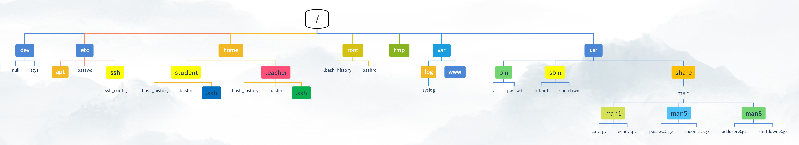

Herinner je je de prompt die een actief pad bevatte? Het `~`-teken was een afkorting voor de map `/home/student`. Dit is de **homefolder**. Elke gebruiker krijgt zijn eigen homefolder in de map `/home`, net als in Windows, waar elke gebruiker een eigen map heeft onder `C:\Users`. Een gebruiker heeft alle machtigingen (lezen, schrijven, uitvoeren) in zijn eigen homefolder. Buiten die map heeft hij vaak enkel leesrechten.


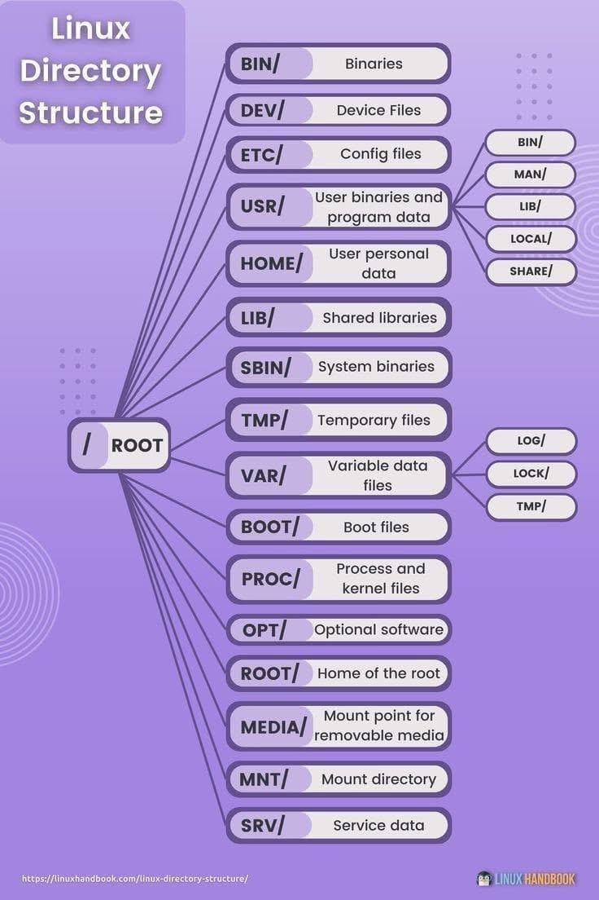


### Werkmap wijzigen (cd)
Je kan de huidige werkmap wijzigen met het commando cd (change directory):

```bash
student@linux-ess:~$ pwd
/home/student
student@linux-ess:~$ cd /etc
student@linux-ess:/etc$ pwd
/etc
student@linux-ess:/etc$ cd ~
student@linux-ess:~$ pwd
/home/student
```

Dit commando neemt een pad als argument. In het bovenstaande voorbeeld navigeren we naar de map etc in de hoofdmap (ook root-directory genoemd) /. We kunnen dit zien in de uitvoer van het pwd-commando en aan de prompt. Zoals getoond in het tweede deel van het bovenstaande voorbeeld kunnen we ook het ~ teken gebruiken om snel naar de homefolder van de gebruiker te navigeren.

We zouden ook het commando cd zonder enig argument kunnen gebruiken. Dit navigeert ook terug naar de homefolder van de gebruiker:

```bash
student@linux-ess:~$ cd /home/student
student@linux-ess:~$ pwd
/home/student
student@linux-ess:~$ touch emptyfile
student@linux-ess:~$ ls
emptyfile
student@linux-ess:~$ cd /etc
student@linux-ess:/etc$ pwd
/etc
student@linux-ess:/etc$ cd
student@linux-ess:~$ pwd
/home/student
student@linux-ess:~$ ls
emptyfile
```

Het commando touch wordt hier gebruikt om een leeg bestand aan te maken met de naam emptyfile. Het commando wordt verderop in dit hoofdstuk nog uitgelegd.

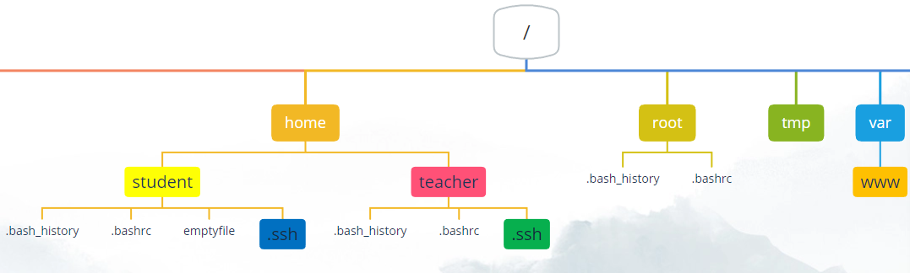

We zouden ook het commando cd - kunnen gebruiken. Dit navigeert terug naar de folder waar je je bevond vooraleer je naar deze folder kwam:

```bash
student@linux-ess:~$ cd /etc/netplan
student@linux-ess:/etc/netplan$ ls
50-cloud-init.yaml
student@linux-ess:/etc/netplan$ cd /var/log
student@linux-ess:/var/log$ ls
alternatives.log                dmesg                           syslog
apport.log                      dpkg.log                        ubuntu-advantage.log
apt                             faillog                         ubuntu-advantage-timer.log
auth.log                        installer                       unattended-upgrades
bootstrap.log                   journal                         vmware-network.log
btmp                            kern.log                        vmware-vmsvc-root.log
cloud-init.log                  landscape                       vmware-vmtoolsd-root.log
cloud-init-output.log           lastlog                         wtmp
dist-upgrade                    private
student@linux-ess:/var/log$ cd -
student@linux-ess:/etc/netplan$ pwd
/etc/netplan
student@linux-ess:/etc/netplan$ ls
50-cloud-init.yaml
```


### Een boomstructuur weergeven (tree)
Je kan een boomstructuur van een map met zijn submappen weergeven met het commando tree:

```bash
student@linux-ess:~$ tree
.
└── emptyfile
 
0 directories, 1 file
```

::: info tree niet gevonden?
Krijg je de melding dat `tree` niet geïnstalleerd is, voer dan het voorgestelde commando uit: `sudo apt install tree`.
:::

We kunnen ook de optie `-a` gebruiken om de verborgen bestanden te bekijken (bestanden die beginnen met een punt):

```bash
student@linux-ess:~$ tree -a
.
├── .bash_history
├── .bash_logout
├── .bashrc
├── .cache
│   └── motd.legal-displayed
├── .lesshst
├── .local
│   └── share
│       └── nano
├── .profile
├── emptyfile
├── .ssh
│   └── authorized_keys
├── .sudo_as_admin_successful
└── .wget-hsts
 
5 directories, 10 files
```

We kunnen ook een pad opgeven als argument om een weergave van die bepaalde map te krijgen:

```bash
student@linux-ess:~$ tree /etc/dhcp
/etc/dhcp
├── debug
├── dhclient.conf
├── dhclient-enter-hooks.d
│   └── debug -> ../debug
└── dhclient-exit-hooks.d
    ├── debug -> ../debug
    ├── hook-dhclient
    ├── resolved
    ├── rfc3442-classless-routes
    └── timesyncd
 
2 directories, 8 files
```


### Absolute en relatieve paden
Bij het gebruik van commando's moeten we vaak paden naar bepaalde mappen of bestanden gebruiken. Het commando cd vereist bijvoorbeeld een pad om naartoe te navigeren.

Paden worden gebruikt om naar bestanden en mappen op het bestandssysteem te wijzen. We kunnen twee soorten paden gebruiken: relatieve en absolute paden.

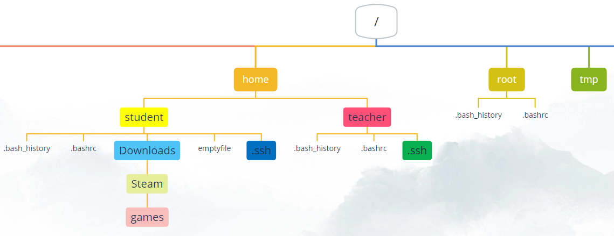


#### Absoluut pad
Absolute paden moeten beginnen met een / teken. Dit betekent dat een absoluut pad begint vanuit de rootmap (/) (het hoogste niveau op het bestandssysteem) en zich een weg naar beneden baant. Bijvoorbeeld:

```bash
student@linux-ess:/tmp$ pwd
/tmp
student@linux-ess:/tmp$ cd /home/student/
student@linux-ess:~$ pwd
/home/student
```

In Windows begint een absoluut pad met `C:\` in plaats van `/`.

::: tip Tab-completion: je beste vriend
De Linux-shell kan commando's en paden automatisch aanvullen. Typ het begin van een commando, bestands- of mapnaam en druk op {{Tab}}. Is er maar één mogelijkheid, dan wordt het woord voor je voltooid. Zijn er meerdere, druk dan nog eens op {{Tab}} om alle mogelijkheden te zien.

Bij een map eindigt de aanvulling met een schuine streep (`cd /home/student/`). Die laatste `/` is optioneel: `cd /home/student` is precies hetzelfde.
:::


#### Relatief pad
Een relatief pad begint altijd vanaf de huidige directory en verwijst van daaruit naar een ander bestand of een andere map. Bijvoorbeeld:

```bash
student@linux-ess:~$ pwd
/home/student
student@linux-ess:~$ cd Downloads/Steam/games
student@linux-ess:~/Downloads/Steam/games$ pwd
/home/student/Downloads/Steam/games
```

Wanneer je relatieve paden gebruikt, kunnen we enkele afkortingen gebruiken:

| Afkorting | Betekenis |
| --- | --- |
| `.` (één punt) | de huidige map |
| `..` (twee punten) | de bovenliggende map |
| `~` (tilde) | de thuismap van de huidige gebruiker |

Staan we in `/home/student/Downloads`, dan kunnen we `..` gebruiken om naar de bovenliggende map `/home/student` te navigeren:

```bash
student@linux-ess:~/Downloads$ pwd
/home/student/Downloads
student@linux-ess:~/Downloads$ cd ..
student@linux-ess:~$ pwd
/home/student
```

We kunnen deze afkortingen ook integreren in relatieve paden:

```bash
student@linux-ess:/etc$ pwd
/etc
student@linux-ess:/etc$ cd /home/student/Downloads # Absoluut pad
student@linux-ess:~/Downloads$ pwd
/home/student/Downloads
student@linux-ess:~/Downloads$ cd ../../teacher # Relatief pad
student@linux-ess:/home/teacher$ pwd
/home/teacher
```

::: info Commentaar met #
Een hekje `#` vertelt de shell dat alles erachter een opmerking is en niet als commando of argument wordt uitgevoerd.
:::


### mapinhoud tonen (ls)
Om de inhoud van een map weer te geven, kunnen we het commando ls gebruiken. Als je dit commando zonder opties of argumenten gebruikt, wordt de inhoud van de huidige werkmap weergegeven:

```bash
student@linux-ess:~$ ls
emptyfile  Downloads
```

We kunnen ook in een bepaalde map gaan om de inhoud ervan te tonen:

```bash
student@linux-ess:~$ cd /
student@linux-ess:/$ ls     
bin   dev  home  lib32  libx32      media  opt   root  sbin  srv  tmp  var
boot  etc  lib   lib64  lost+found  mnt    proc  run   snap  sys  usr
```

Het commando ls kan ook één argument gebruiken. Dit argument is een pad dat absoluut of relatief kan zijn. Het commando ls toont dan de inhoud van die map.

```bash
student@linux-ess:~$ ls
emptyfile  Downloads
student@linux-ess:~$ ls /
bin   dev  home  lib32  libx32      media  opt   root  sbin  srv  tmp  var
boot  etc  lib   lib64  lost+found  mnt    proc  run   snap  sys  usr
```

Het commando ls heeft ook verschillende opties. Deze opties zijn te vinden in de manpage met man ls. Bijvoorbeeld:

```bash
student@linux-ess:~$ ls -alh .       # Het puntje verwijst naar de huidige map, die in dit geval optioneel zou zijn 
total 45M
drwxr-xr-x 5 student student 4.0K Mar 27 16:36 .
drwxr-xr-x 3 root    root    4.0K Oct  5 13:40 ..
-rw------- 1 student student 1.7K Mar 17 12:14 .bash_history
-rw-r--r-- 1 student student  220 Oct  5 13:40 .bash_logout
-rw-r--r-- 1 student student 3.7K Oct  5 13:40 .bashrc
drwxrwxr-x 2 student student 4.0K Oct  1 14:31 Downloads
-rw-r--r-- 1 student student    0 Feb 28 11:48 emptyfile
-rw-r--r-- 1 student student  807 Oct  5 13:40 .profile
drwxr-xr-x 2 student student 4.0K Oct  5 13:40 .ssh
-rw-r--r-- 1 student student    0 Oct  6 08:20 .sudo_as_admin_successful
```

::: tip Opties combineren
Zowel `ls -a -l -h` als `ls -alh` werken precies hetzelfde — opties kunnen in elke volgorde worden opgegeven, dus `ls -hal` is ook correct.
:::

Deze 3 opties gebruik je het vaakst bij `ls`:

* `-a` (*all*) toont ook verborgen bestanden en mappen. In Linux beginnen die met een punt, bv. `.bashrc`.
* `-l` toont een *long listing*: naast de naam ook rechten, eigenaar, grootte en datum.
* `-h` (*human readable*) toont bestandsgroottes met een leesbare eenheid (K, M, G) in plaats van in bytes. Werkt enkel samen met `-l`.
  

::: tip Hoe lees je een regel van `ls -l`?
Te lezen als: `-rw-r--r--` zijn de **machtigingen** (uitgelegd in het hoofdstuk Rechten), `student student` zijn de **eigenaar** en de **groep**, `3.7K` is de **bestandsgrootte** en `Oct 5 13:40` is de **tijdstempel van de laatste wijziging**. Een regel die met `d` begint is een map (*directory*).
:::

::: info Alles in Linux is een bestand
Niet alleen de bestanden, maar ook de mappen: die zijn gewoon speciale bestanden. Je harde schijf? Een bestand. Een USB-stick? Een bestand. Je toetsenbord? Je raadt het al: ook een bestand!
:::


### Mappen maken (mkdir)
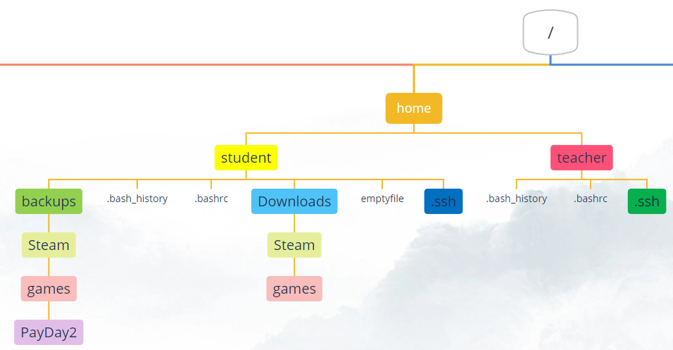

Om nieuwe mappen aan te maken kunnen we het commando mkdir (make directory) gebruiken. Dit commando neemt een pad als argument:

```bash
student@linux-ess:~$ mkdir backups
student@linux-ess:~$ ls
backups  Downloads  emptyfile
```

In het bovenstaande voorbeeld maakt het commando mkdir een map met de naam backups aan in de huidige werkmap (~ of /home/student). De mapnaam hier is een relatief path.


### paden met submappen
Bij het gebruik van relatieve of absolute paden kunnen we het volgende doen:

```bash
student@linux-ess:~$ mkdir backups/Steam/games/PayDay2
mkdir: cannot create directory ‘backups/Steam/games/PayDay2’: No such file or directory
```

Het commando probeert de map `PayDay2` te maken in `games`, in `Steam`, in `backups`. We krijgen een foutmelding omdat de mappen `Steam` en `games` niet bestaan. Met de optie `-p` (*parents*) worden ontbrekende tussenliggende mappen mee aangemaakt:

```bash
student@linux-ess:~$ mkdir -p backups/Steam/games/PayDay2
student@linux-ess:~$ tree backups
backups
└── Steam
    └── games
        └── PayDay2
 
3 directories, 0 files
```

Hiermee worden de mappen Steam en games gemaakt als deze niet bestaan.

::: warning Hoofdlettergevoelig
Zoals eerder vermeld is alles in Linux hoofdlettergevoelig, ook bij het maken van bestanden en mappen. `mkdir walkthroughs Walkthroughs` maakt 2 mappen: `walkthroughs` en `Walkthroughs`.
:::


## Werken met bestanden


### Een leeg bestand maken (touch)
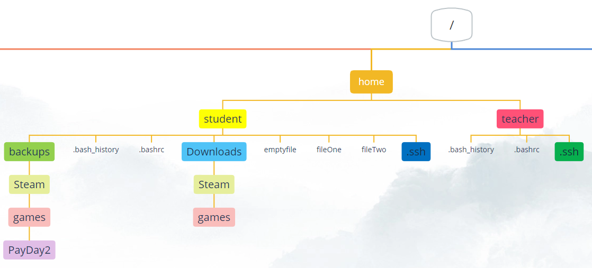

Een eenvoudige manier om een leeg bestand te maken is `touch`. Het voorbeeld maakt twee bestanden en toont ze daarna:

```bash
student@linux-ess:~$ ls -l
total 8
drwxrwxr-x 3 student student 4096 Oct  1 14:34 backups
drwxrwxr-x 2 student student 4096 Oct  1 14:31 Downloads
-rw-rw-r-- 1 student student    0 Oct  1 14:31 emptyfile
student@linux-ess:~$ touch fileOne
student@linux-ess:~$ touch fileTwo
student@linux-ess:~$ ls -l
total 0
drwxrwxr-x 3 student student 4096 Oct  1 14:34 backups
drwxrwxr-x 2 student student 4096 Oct  1 14:31 Downloads
-rw-rw-r-- 1 student student    0 Oct  1 14:31 emptyfile
-rw-r--r-- 1 student student 0 Feb 12 09:50 fileOne
-rw-r--r-- 1 student student 0 Feb 12 09:50 fileTwo
```

::: info Lege bestanden
Beide bestanden zijn leeg, zoals je ziet aan de bestandsgrootte (0). In hoofdstuk 06 leer je bestanden met inhoud maken. (`touch` op een bestaand bestand wijzigt enkel de tijdstempel.)
:::


### Bestanden met spaties in de naam
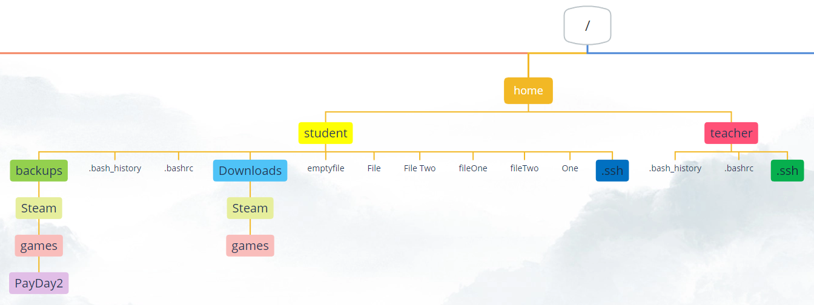

Een spatie scheidt in de shell de argumenten van elkaar. `touch File One` maakt dus **twee** bestanden: `File` en `One`. Willen we één bestand met een spatie in de naam, dan plaatsen we de naam tussen aanhalingstekens:

```bash
student@linux-ess:~$ ls -l
total 0
drwxrwxr-x 3 student student 4096 Oct  1 14:34 backups
drwxrwxr-x 2 student student 4096 Oct  1 14:31 Downloads
-rw-rw-r-- 1 student student    0 Oct  1 14:31 emptyfile
-rw-r--r-- 1 student student 0 Feb 12 09:50 fileOne
-rw-r--r-- 1 student student 0 Feb 12 09:50 fileTwo
student@linux-ess:~$ touch File One
student@linux-ess:~$ ls -l
total 0
drwxrwxr-x 3 student student 4096 Oct  1 14:34 backups
drwxrwxr-x 2 student student 4096 Oct  1 14:31 Downloads
-rw-rw-r-- 1 student student    0 Oct  1 14:31 emptyfile
-rw-r--r-- 1 student student 0 Feb 12 09:50 fileOne
-rw-r--r-- 1 student student 0 Feb 12 09:50 fileTwo
-rw-r--r-- 1 student student 0 Feb 12 09:50 File
-rw-r--r-- 1 student student 0 Feb 12 09:50 One
student@linux-ess:~$ touch "File Two"
student@linux-ess:~$ ls -l
total 0
drwxrwxr-x 3 student student 4096 Oct  1 14:34 backups
drwxrwxr-x 2 student student 4096 Oct  1 14:31 Downloads
-rw-rw-r-- 1 student student    0 Oct  1 14:31 emptyfile
-rw-r--r-- 1 student student 0 Feb 12 09:50 fileOne
-rw-r--r-- 1 student student 0 Feb 12 09:50 fileTwo
-rw-r--r-- 1 student student 0 Feb 12 09:50 File
-rw-r--r-- 1 student student 0 Feb 12 09:50 'File Two'
-rw-r--r-- 1 student student 0 Feb 12 09:50 One
```

::: tip Spaties in bestandsnamen
Je kunt ook enkele aanhalingstekens gebruiken (`touch 'File Two'`) of een backslash om de spatie te escapen (`touch File\ Two`).
:::


### Bestanden verplaatsen (mv)
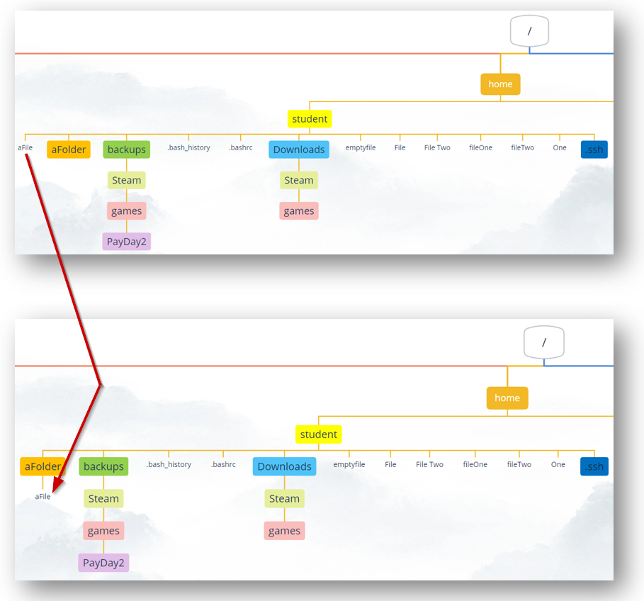

Om een bestand naar een andere map te verplaatsen gebruiken we `mv` (*move*). Dit commando heeft twee argumenten: de bron en de bestemming:

```bash
student@linux-ess:~$ ls
aFile  aFolder  backups  Downloads  emptyfile  File  fileOne  fileTwo  'File Two'  One
student@linux-ess:~$ mv aFile aFolder/
student@linux-ess:~$ ls
aFolder  backups  Downloads  emptyfile  File  fileOne  fileTwo  'File Two'  One
student@linux-ess:~$ ls aFolder
aFile
```

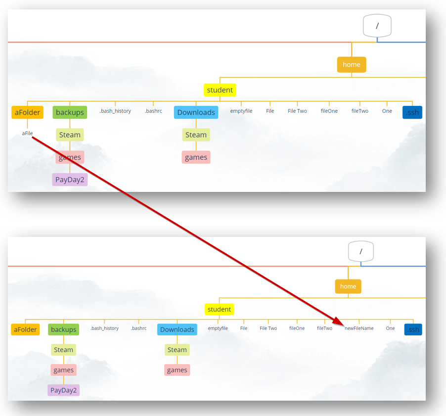

Aangezien het tweede argument een doelbestand of -map is, kunnen we deze opdracht ook gebruiken om een bestand te hernoemen. In het onderstaande voorbeeld gebruiken we het commando mv om het bestand terug te verplaatsen naar de homefolder, maar ook om het te hernoemen:

```bash
student@linux-ess:~/aFolder$ ls 
aFile
student@linux-ess:~/aFolder$ mv aFile ../newFileName
student@linux-ess:~/aFolder$ ls 
student@linux-ess:~/aFolder$ ls ~
aFolder  backups  Downloads  emptyfile  File  fileOne  fileTwo  'File Two'  newFileName  One
```

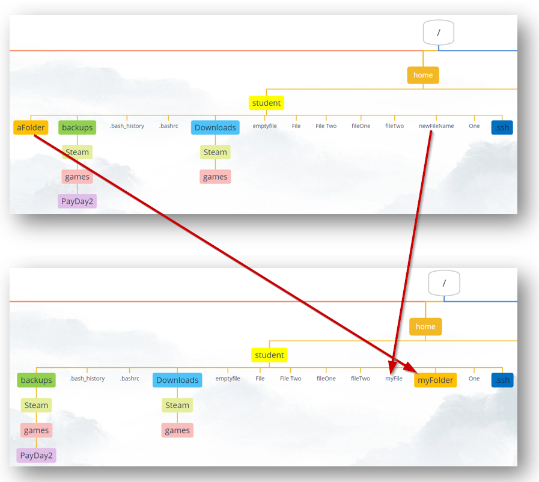

Bij het hernoemen van slechts één bestand of map is mv het voorkeurscommando dat je wilt gebruiken. De voorbeelden gebruikten beide bestanden, maar dezelfde logica werkt ook voor het hernoemen en verplaatsen van mappen.

```bash
student@linux-ess:~$ ls 
aFolder  backups  Downloads  emptyfile  File  fileOne  fileTwo  'File Two'  newFileName  One
student@linux-ess:~$ mv newFileName myFile 
student@linux-ess:~$ mv aFolder myFolder 
student@linux-ess:~$ ls
backups  Downloads  emptyfile  File  fileOne  fileTwo  'File Two'  myFile  myFolder  One
```


### Bestanden kopiëren (cp)
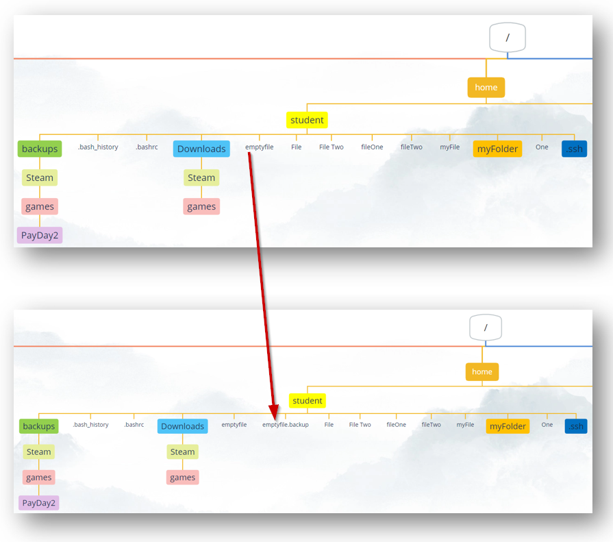

Om een kopie van een bestand te maken kunnen we het commando cp (copy) als volgt gebruiken:

```bash
student@linux-ess:~$ ls
backups  Downloads  emptyfile  File  fileOne  fileTwo  'File Two'  myFile  myFolder  One
student@linux-ess:~$ cp emptyfile emptyfile.backup
student@linux-ess:~$ ls
backups  Downloads  emptyfile  emptyfile.backup  File  fileOne  fileTwo  'File Two'  myFile  myFolder  One
```

Beide argumenten zijn paden. Het eerste pad is het oorspronkelijke bestand/map. Het tweede pad is een pad naar de nieuwe locatie en (optionele) bestandsnaam/mapnaam. We kunnen het cp-commando gebruiken om zowel bestanden als mappen naar dezelfde map of een andere map te kopiëren.


### Kopiëren naar een andere map
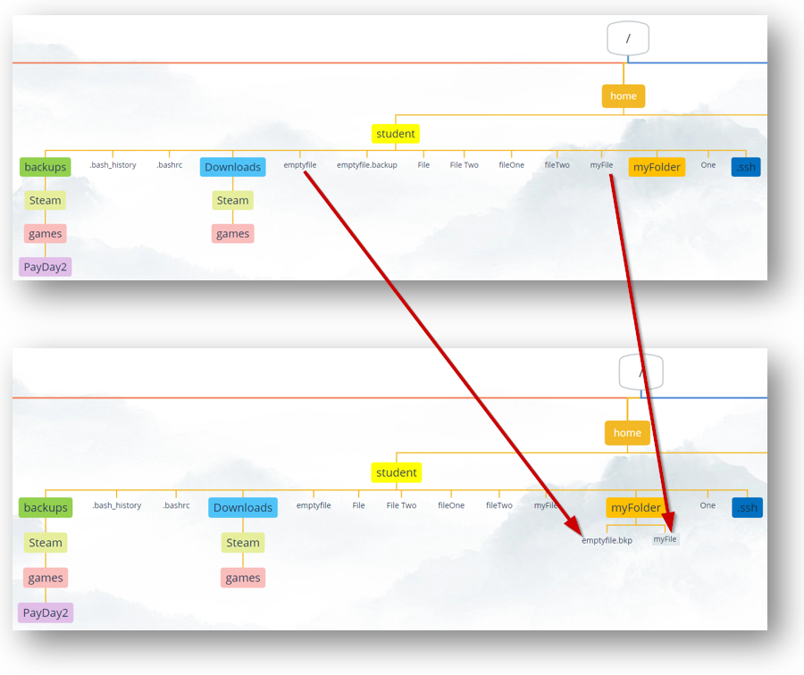

Het onderstaande voorbeeld laat ons zien hoe we de argumenten in het commando cp kunnen gebruiken om bestanden of mappen naar een andere map te kopiëren. In dit voorbeeld kopiëren we het bestand met de naam myFile naar de map myFolder met behulp van een relatief pad. We kopiëren ook het bestand met de naam emptyfile naar de map met de naam myFolder en geven het de nieuwe naam emptyFile.bkp. Dit doen we met behulp van een absoluut pad.

```bash
student@linux-ess:~$ ls
backups  Downloads  emptyfile  emptyfile.backup  File  fileOne  fileTwo  'File Two'  myFile  myFolder  One
student@linux-ess:~$ cp myFile myFolder/
student@linux-ess:~$ ls myFolder
myFile
student@linux-ess:~$ ls
backups  Downloads  emptyfile  emptyfile.backup  File  fileOne  fileTwo  'File Two'  myFile  myFolder  One
student@linux-ess:~$ cp /home/student/emptyfile /home/student/myFolder/emptyFile.bkp
student@linux-ess:~$ ls myFolder
myFile  emptyFile.bkp
student@linux-ess:~$ ls
backups  Downloads  emptyfile  emptyfile.backup  File  fileOne  fileTwo  'File Two'  myFile  myFolder  One
```

::: tip Relatieve en absolute paden
Je kunt zowel relatieve als absolute paden gebruiken in het commando `cp`, voor zowel de bron als de bestemming.
:::


### Recursief kopiëren
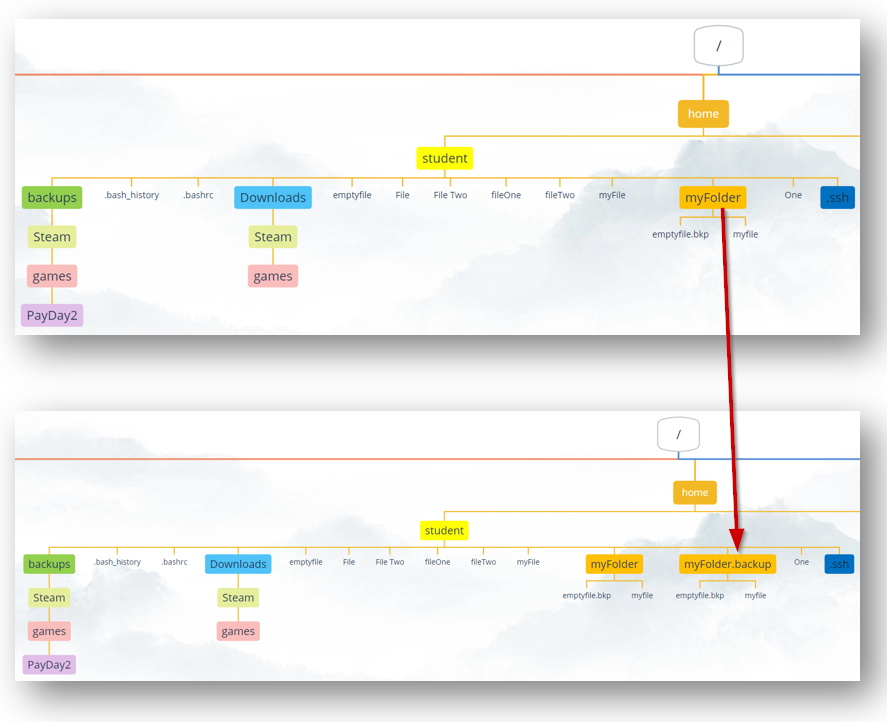

Om volledige mappen (met alle submappen en files in deze map) te kopiëren moeten we de optie -r (recursief) gebruiken:

```bash
student@linux-ess:~$ ls
backups  Downloads  emptyfile  emptyfile.backup  File  fileOne  fileTwo  'File Two'  myFile  myFolder  One
student@linux-ess:~$ ls myFolder
myFile  emptyFile.bkp
student@linux-ess:~$ cp -r myFolder/ myFolder.backup
student@linux-ess:~$ ls
backups  Downloads  emptyfile  emptyfile.backup  File  fileOne  fileTwo  'File Two'  myFile  myFolder  myFolder.backup  One
student@linux-ess:~$ ls myFolder.backup
myFile  emptyFile.bkp
```


### Bestanden overschrijven
We moeten ons ervan bewust zijn dat het cp-commando standaard bestaande bestanden overschrijft. We kunnen de optie -i (interactief) gebruiken om een prompt te krijgen waarbij we moeten bevestigen of we het bestand willen overschrijven, zoals te zien is in het onderstaande voorbeeld:

```bash
student@linux-ess:~$ ls
backups  Downloads  emptyfile  emptyfile.backup  File  fileOne  fileTwo  'File Two'  myFile  myFolder  myFolder.backup  One
student@linux-ess:~$ ls myFolder
myFile  emptyFile.bkp
student@linux-ess:~$ cp myFile myFolder/emptyFile.bkp     # Geen error, de file wordt overschreven
student@linux-ess:~$ ls myFolder
myFile  emptyFile.bkp
student@linux-ess:~$ cp -i myFile myFolder/emptyFile.bkp     # Je wordt gevraagd of je wil overschrijven of niet
cp: overwrite 'myFolder/emptyFile.bkp'? y
```


### Bestanden hernoemen (rename)
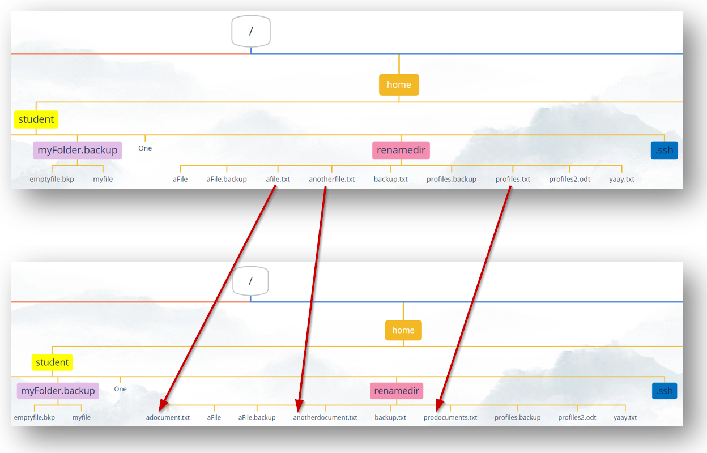

We zagen dat we het commando mv konden gebruiken om bestanden en mappen te hernoemen. Dit werkt en is vaak heel eenvoudig, maar wanneer je bestanden in bulk moet hernoemen, wil je misschien een andere aanpak overwegen. Het commando rename is speciaal ontworpen om meerdere bestanden en mappen met één commando te hernoemen. Om dit te doen gebruikt het een reguliere expressie/regular expression (Regex). Een Regex is een reeks tekens die een zoekpatroon definiëren. We zullen later in deze cursus meer leren over reguliere expressies. Het gebruikt dit zoekpatroon om bepaalde wijzigingen aan te brengen in de bestandsnamen:

```bash
student@linux-ess:~$ mkdir renamedir 
student@linux-ess:~$ cd renamedir
student@linux-ess:~/renamedir$ touch aFile  aFile.backup  afile.txt  anotherfile.txt  backup.txt  profiles.backup  profiles.txt  profiles2.ODT  yaay.txt
student@linux-ess:~/renamedir$ ls
aFile  aFile.backup  afile.txt  anotherfile.txt  backup.txt  profiles.backup  profiles.txt  profiles2.ODT  yaay.txt
student@linux-ess:~/renamedir$ rename 's/file/document/' *.txt
student@linux-ess:~/renamedir$ ls
aFile  aFile.backup  adocument.txt  anotherdocument.txt  backup.txt  prodocuments.txt  profiles.backup  profiles2.ODT  yaay.txt
```

Als rename nog niet is geïnstalleerd, kan je dit doen met het commando sudo apt -y install rename.

Er gebeurt veel in het bovenstaande voorbeeld. Stap voor stap:

1. De map bevat enkele `.txt`-bestanden, enkele backup-bestanden en bestanden zonder extensie. Sommige namen bevatten het woord `file`, dat we willen vervangen door `document`. Linux is hoofdlettergevoelig: `file` is niet hetzelfde als `File`.
2. `rename` krijgt de tekst `s/file/document/`. Dit is de regex: **s**ubstitute (*zoek* `file`, *vervang door* `document`).
3. Het laatste argument is `*.txt`: enkel bestanden die op `.txt` eindigen worden behandeld.
4. Een `*` (sterretje) is een *wildcard* (joker) in bash: nul, één of meer willekeurige tekens. `*.txt` betekent dus *alle bestanden die eindigen op .txt*. De shell vervangt `*.txt` door de lijst bestandsnamen voordat `rename` start.

We kunnen `rename` ook gebruiken om de bestandsextensie te wijzigen:

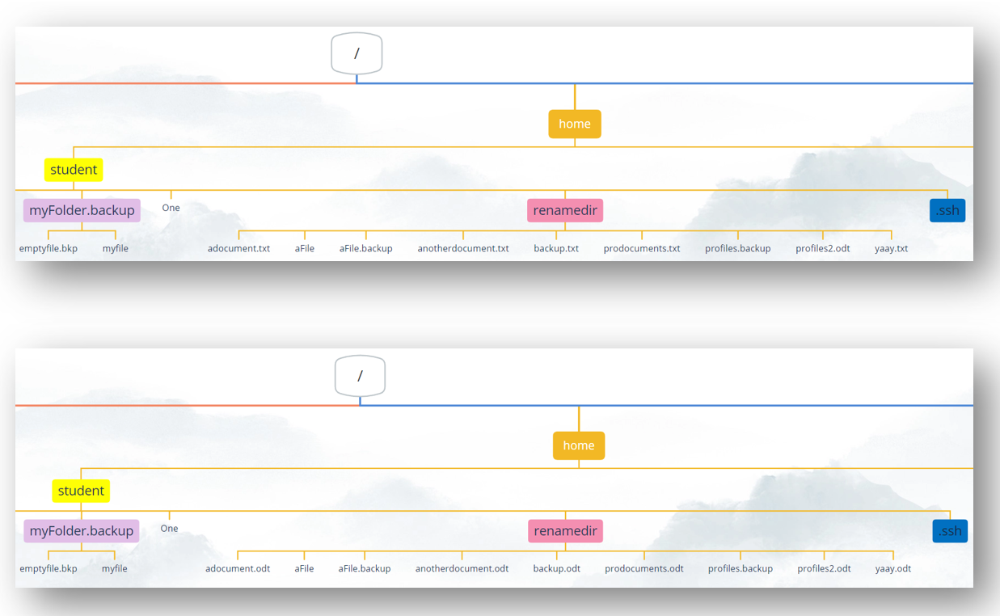

```bash
student@linux-ess:~/renamedir$ ls
aFile  aFile.backup  adocument.txt  anotherdocument.txt  backup.txt  prodocuments.txt  profiles.backup  profiles2.ODT  yaay.txt
student@linux-ess:~/renamedir$ rename 's/\.txt/.odt/' *
student@linux-ess:~/renamedir$ ls
aFile  aFile.backup  adocument.odt  anotherdocument.odt  backup.odt  prodocuments.odt  profiles.backup  profiles2.ODT  yaay.odt
```

Merk je op dat we een `\` (backslash) voor de punt in het zoekpatroon plaatsen? Sommige tekens hebben een speciale betekenis in reguliere expressies (bv. `* . $ [ ] ( ) / { }`). In een regex betekent `.` *elk willekeurig teken*. Willen we echt een punt, dan **escapen** we die met een `\`: het teken dat volgt wordt dan letterlijk genomen.

We kunnen ook het commando rename gebruiken om meerdere bestandsextensies tegelijk te wijzigen:

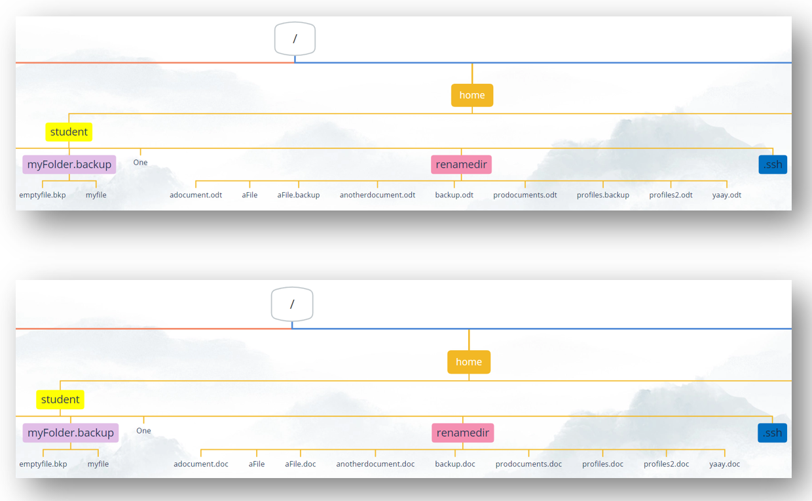

```bash
student@linux-ess:~/renamedir$ ls
aFile  aFile.backup  adocument.odt  anotherdocument.odt  backup.odt  prodocuments.odt  profiles.backup  profiles2.ODT  yaay.odt
student@linux-ess:~/renamedir$ rename -E 's/\.odt/.doc/i' -E 's/\.backup/.doc/' *
student@linux-ess:~/renamedir$ ls
aFile  aFile.doc  adocument.doc  anotherdocument.doc  backup.doc  prodocuments.doc  profiles.doc  profiles2.doc  yaay.doc
```

::: tip Hoofdletterongevoelig hernoemen
De `i`-vlag aan het einde van de perl-expressie maakt de zoekopdracht hoofdletterongevoelig. Het commando `rename -E 's/\.odt/.doc/i'` hernoemt zowel `.odt` als `.ODT` naar `.doc`.
:::


### Bestanden identificeren (file)
In Linux zijn bestandsextensies niet verplicht, dus aan de naam zie je niet altijd welk type een bestand is. Met `file` kan je het type identificeren:

```bash
student@linux-ess:~$ wget --cipher 'DEFAULT:!DH' https://www.pxl.be/media/5zcbf0yp/1314_logo_pxl_bol.png
student@linux-ess:~$ file 1314_logo_pxl_bol.png
1314_logo_pxl_bol.png: PNG image data, 1167 x 1168, 8-bit/color RGBA, non-interlaced
student@linux-ess:~$ file /etc/passwd
/etc/passwd: ASCII text
```

## Bestanden en mappen verwijderen (rm)
Lege mappen verwijder je met `rmdir`. Dat commando weigert mappen die nog bestanden of mappen bevatten.

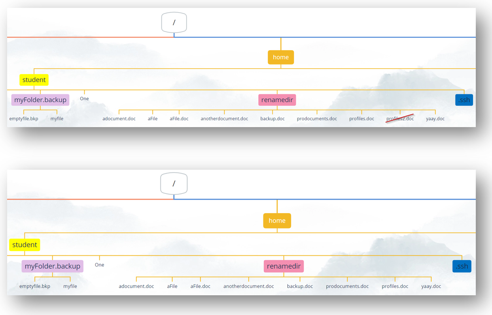

Voor het verwijderen van bestanden (en mappen) gebruiken we meestal `rm`:

```bash
student@linux-ess:~/renamedir$ ls
aFile  aFile.doc  adocument.doc  anotherdocument.doc  backup.doc  prodocuments.doc  profiles.doc  profiles2.doc  yaay.doc
student@linux-ess:~/renamedir$ rm profiles2.doc
student@linux-ess:~/renamedir$ ls
aFile  aFile.doc  adocument.doc  anotherdocument.doc  backup.doc  prodocuments.doc  profiles.doc  yaay.doc
```

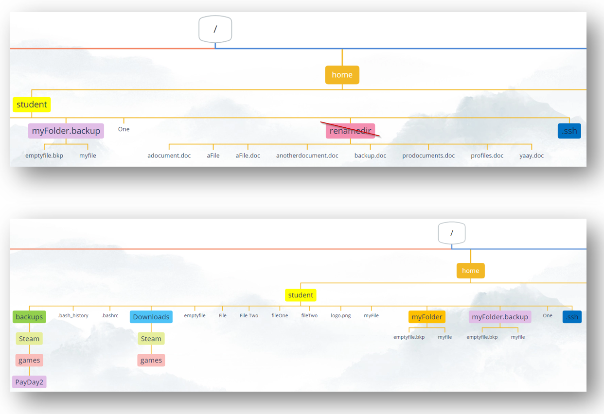

`rm` heeft ook verschillende opties. De meest gebruikte combinatie is `rm -rf`:

* `-r` (*recursive*): verwijdert ook mappen, met alles wat erin zit.
* `-f` (*force*): vraagt geen bevestiging en geeft geen foutmelding als iets niet bestaat.

Zonder `-r` weigert `rm` een map te verwijderen.

```bash
student@linux-ess:~$ ls
backups  Downloads  emptyfile  emptyfile.backup  File  fileOne  fileTwo  'File Two'  myFile  myFolder  myFolder.backup  One renamedir
student@linux-ess:~$ ls renamedir
aFile  aFile.doc  adocument.doc  anotherdocument.doc  backup.doc  prodocuments.doc  profiles.doc  yaay.doc
student@linux-ess:~$ rm -rf renamedir
student@linux-ess:~$ ls
backups  Downloads  emptyfile  emptyfile.backup  File  fileOne  fileTwo  'File Two'  myFile  myFolder  myFolder.backup  One
```

::: danger Geen prullenbak!
Op de command line is er geen prullenbak: wat je met `rm` verwijdert is weg. Wees vooral voorzichtig met `rm -rf`, zeker als `root` of met `sudo`. Een typfout (bv. een spatie te veel) kan je hele systeem wissen. Gebruik `rm -i` als je eerst een bevestiging wilt.
:::


## Zoeken naar bestanden en mappen


### Zoeken op het bestandssysteem (find)
Het eerste commando om te zoeken is `find`. Het doorzoekt het bestandssysteem. We geven aan in welke map de zoekopdracht begint en hoe de bestandsnaam eruit moet zien (met *globbing*, bv. `*sh*`). Geef je geen map op, dan begint het zoeken in de huidige werkmap. De zoekopdracht gaat altijd door in alle submappen.

::: warning Zet de zoekterm tussen aanhalingstekens
Schrijf `find -name "*sh*"` met aanhalingstekens, anders probeert de shell het patroon `*sh*` zelf al uit te breiden voor `find` het ziet.
:::

```bash
student@linux-ess:~$ find -name "*sh*"
./.bash_logout
./.local/share
./.lesshst
./.ssh
./.bashrc
./.bash_history
```

We kunnen ook een directory opgeven van waaruit de zoekopdracht moet worden gestart:

```bash
student@linux-ess:~$ find / -name "modem*"
...
find: ‘/snap/core/17200/var/spool/cron/crontabs’: Permission denied
find: ‘/snap/core/17200/var/spool/rsyslog’: Permission denied
find: ‘/tmp/systemd-private-41192bfd59a644f3aabea034752dc85e-systemd-timesyncd.service-y5dhWM’: Permission denied
find: ‘/tmp/snap-private-tmp’: Permission denied
find: ‘/tmp/systemd-private-41192bfd59a644f3aabea034752dc85e-upower.service-quWyki’: Permission denied
find: ‘/tmp/vmware-root_766-2990744190’: Permission denied
find: ‘/tmp/systemd-private-41192bfd59a644f3aabea034752dc85e-polkit.service-zl4vVd’: Permission denied
find: ‘/tmp/systemd-private-41192bfd59a644f3aabea034752dc85e-ModemManager.service-jhvr5E’: Permission denied
find: ‘/tmp/systemd-private-41192bfd59a644f3aabea034752dc85e-systemd-resolved.service-T7IstT’: Permission denied
find: ‘/tmp/systemd-private-41192bfd59a644f3aabea034752dc85e-systemd-logind.service-zMuUdp’: Permission denied
find: ‘/boot/lost+found’: Permission denied
find: ‘/root’: Permission denied
/usr/share/lintian/overrides/modemmanager
/usr/share/doc/modemmanager
/usr/share/doc/util-linux/modems-with-agetty.txt
/usr/share/doc/netplan/examples/modem.yaml
/usr/lib/firmware/qcom/sdm845/modemuw.jsn
/usr/lib/firmware/qcom/sdm845/modem_nm.mbn.zst
/usr/lib/firmware/qcom/sdm845/modem.mbn.zst
/usr/lib/firmware/qcom/qrb4210/modemuw.jsn
/usr/lib/firmware/qcom/qrb4210/modem.mbn.zst
/usr/lib/firmware/qcom/qrb4210/modemr.jsn
/usr/lib/firmware/qcom/apq8016/modem.mbn.zst
/usr/lib/firmware/qcom/apq8096/modem.mbn.zst
/usr/lib/firmware/qcom/apq8096/modemr.jsn
/usr/lib/firmware/qcom/qcm2290/modemuw.jsn
/usr/lib/firmware/qcom/qcm2290/modem.mbn.zst
/usr/lib/firmware/qcom/qcm2290/modemr.jsn
```

We zien veel foutmeldingen (*Permission denied*) voor mappen waar we geen toegang toe hebben. De oplossing is `sudo` te gebruiken:

```bash
student@linux-ess:~$ sudo find / -name "modem*"
[sudo] password for student:
/var/lib/dpkg/info/modemmanager.conffiles
/var/lib/dpkg/info/modemmanager.md5sums
/var/lib/dpkg/info/modemmanager.postinst
/var/lib/dpkg/info/modemmanager.postrm
/var/lib/dpkg/info/modemmanager.prerm
/var/lib/dpkg/info/modemmanager.list
/usr/share/lintian/overrides/modemmanager
/usr/share/doc/modemmanager
/usr/share/doc/util-linux/modems-with-agetty.txt
/usr/share/doc/netplan/examples/modem.yaml
/usr/lib/firmware/qcom/sdm845/modemuw.jsn
/usr/lib/firmware/qcom/sdm845/modem_nm.mbn.zst
/usr/lib/firmware/qcom/sdm845/modem.mbn.zst
/usr/lib/firmware/qcom/qrb4210/modemuw.jsn
/usr/lib/firmware/qcom/qrb4210/modem.mbn.zst
/usr/lib/firmware/qcom/qrb4210/modemr.jsn
/usr/lib/firmware/qcom/apq8016/modem.mbn.zst
/usr/lib/firmware/qcom/apq8096/modem.mbn.zst
/usr/lib/firmware/qcom/apq8096/modemr.jsn
/usr/lib/firmware/qcom/qcm2290/modemuw.jsn
/usr/lib/firmware/qcom/qcm2290/modem.mbn.zst
/usr/lib/firmware/qcom/qcm2290/modemr.jsn
...
```

Willen we hoofdletterongevoelig zoeken, dan gebruiken we `-iname` in plaats van `-name`:

```bash
student@linux-ess:~$ sudo find / -iname "modem*"
/sys/fs/cgroup/system.slice/ModemManager.service
/run/systemd/propagate/ModemManager.service
/etc/ModemManager
/etc/systemd/system/multi-user.target.wants/ModemManager.service
/var/lib/dpkg/info/modemmanager.conffiles
/var/lib/dpkg/info/modemmanager.md5sums
/var/lib/dpkg/info/modemmanager.postinst
/var/lib/dpkg/info/modemmanager.postrm
/var/lib/dpkg/info/modemmanager.prerm
/var/lib/dpkg/info/modemmanager.list
/var/lib/systemd/deb-systemd-helper-enabled/multi-user.target.wants/ModemManager.service
/var/lib/systemd/deb-systemd-helper-enabled/ModemManager.service.dsh-also
/usr/share/ModemManager
/usr/share/man/man8/ModemManager.8.gz
...
```

### Zoeken in een bestandssysteemdatabase (locate)
Een andere manier om te zoeken is `locate`. Dat doorzoekt een **database** met de bestandsnamen van het bestandssysteem. Daardoor is het veel sneller dan `find`, maar de database kan verouderd zijn: werk ze eerst bij met `sudo updatedb`.

::: info locate niet gevonden?
Op Ubuntu Server zit `locate` niet altijd standaard geïnstalleerd. Installeer het met `sudo apt install plocate`.
:::

::: info locate doorzoekt het volledige bestandssysteem
Je geeft geen directory op bij `locate` — het zoekt altijd door alle bestanden op het bestandssysteem:
:::

```bash
student@linux-ess:~$ touch testfile
student@linux-ess:~$ ls
  emptyfile  emptyfile.backup  testfile
student@linux-ess:~$ find -name "testfile"
./testfile
student@linux-ess:~$ locate testfile
student@linux-ess:~$ sudo updatedb
student@linux-ess:~$ locate testfile
/home/student/testfile
student@linux-ess:~$ locate .profile
/etc/lvm/profile/cache-mq.profile
/etc/lvm/profile/cache-smq.profile
/etc/lvm/profile/command_profile_template.profile
/etc/lvm/profile/lvmdbusd.profile
/etc/lvm/profile/metadata_profile_template.profile
/etc/lvm/profile/thin-generic.profile
/etc/lvm/profile/thin-performance.profile
/etc/lvm/profile/vdo-small.profile
/etc/skel/.profile
/home/student/.profile
/snap/core20/1405/etc/skel/.profile
/snap/core20/1405/usr/share/base-files/dot.profile
...
```

Als we ook bestanden willen zien waar we de privileges niet voor hebben, dan moeten we sudo gebruiken:

```bash
student@linux-ess:~$ sudo locate .profile
/etc/lvm/profile/cache-mq.profile
/etc/lvm/profile/cache-smq.profile
/etc/lvm/profile/command_profile_template.profile
/etc/lvm/profile/lvmdbusd.profile
/etc/lvm/profile/metadata_profile_template.profile
/etc/lvm/profile/thin-generic.profile
/etc/lvm/profile/thin-performance.profile
/etc/lvm/profile/vdo-small.profile
/etc/skel/.profile
/home/student/.profile
/root/.profile
/snap/core20/1405/etc/skel/.profile
/snap/core20/1405/root/.profile
...
```

Als we ook hoofdletterongevoelig willen zoeken, dan moeten we de optie -i gebruiken:

```bash
student@linux-ess:~$ sudo locate -i modem
/boot/grub/x86_64-efi/spkmodem.mod
/etc/ModemManager
/etc/ModemManager/connection.d
/etc/ModemManager/fcc-unlock.d
/etc/systemd/system/dbus-org.freedesktop.ModemManager1.service
/etc/systemd/system/multi-user.target.wants/ModemManager.service
/usr/include/linux/if_cablemodem.h
/usr/lib/firmware/qcom/apq8016/modem.mbn.zst
/usr/lib/firmware/qcom/apq8096/modem.mbn.zst
/usr/lib/firmware/qcom/apq8096/modemr.jsn
...
```

Willen we enkel in de **bestandsnaam** zoeken (niet in de rest van het pad), dan gebruiken we de optie `-b` (*basename*):

```bash
student@linux-ess:~$ sudo locate -i -b modem
/boot/grub/x86_64-efi/spkmodem.mod
/etc/ModemManager
/etc/systemd/system/dbus-org.freedesktop.ModemManager1.service
/etc/systemd/system/multi-user.target.wants/ModemManager.service
/usr/include/linux/if_cablemodem.h
/usr/lib/firmware/qcom/apq8016/modem.mbn.zst
/usr/lib/firmware/qcom/apq8096/modem.mbn.zst
/usr/lib/firmware/qcom/apq8096/modemr.jsn
```