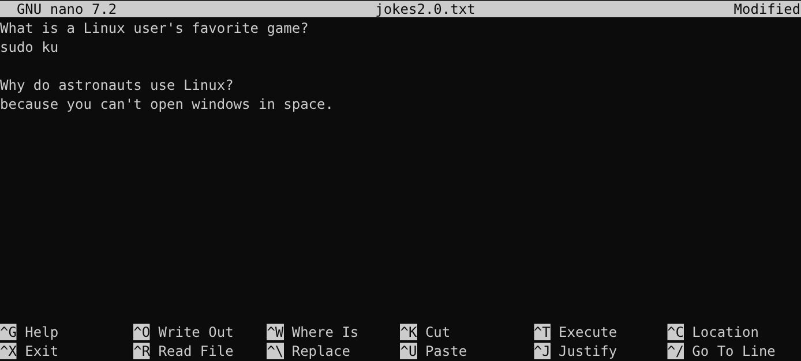
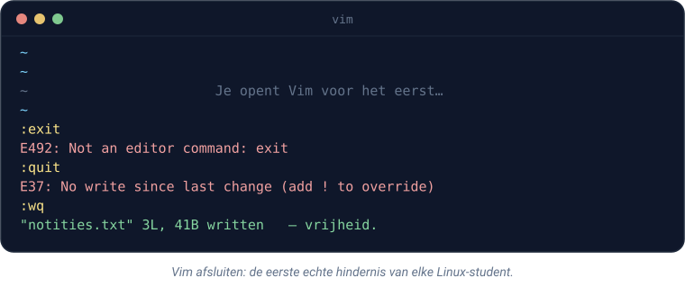

# 06. Bestandsinhoud

In Linux is (bijna) alles een bestand: configuratie, logboeken, gebruikersgegevens, ... Als sysadmin ga je dus voortdurend bestanden **lezen**, **doorzoeken** en **aanpassen**. In dit hoofdstuk leer je welk gereedschap daarvoor dient.

::: tip Welk commando gebruik ik wanneer?

| Ik wil...                                         | Commando | Voorbeeld                           |
| ------------------------------------------------- | -------- | ----------------------------------- |
| een **klein bestand** helemaal tonen              | `cat`    | `cat /etc/os-release`               |
| een bestand **omgekeerd** tonen (laatste regel eerst) | `tac`    | `tac /etc/passwd`                   |
| enkel het **begin** zien                          | `head`   | `head -n 5 /etc/passwd`             |
| enkel het **einde** zien (bv. logboek)            | `tail`   | `tail -n 20 /var/log/auth.log`      |
| een logboek **live volgen**                       | `tail -f` | `tail -f /var/log/auth.log`        |
| door een **groot bestand bladeren** en zoeken     | `less`   | `less /var/log/dpkg.log`            |
| een bestand **bewerken**                          | `nano`   | `nano jokes.txt`                    |
| **tekst naar een bestand** schrijven              | `echo`, `cat` + `>` / `>>` | `echo hallo > demofile` |

:::

## Bekijk een volledig bestand (cat & tac)

Om de inhoud van bestanden te bekijken, gebruiken we het commando `cat` (afkorting van *concatenate*). Het commando krijgt een pad naar een bestand als argument:

```bash
student@linux-ess:~$ cat /etc/os-release
PRETTY_NAME="Ubuntu 26.04.1 LTS"
NAME="Ubuntu"
VERSION_ID="26.04"
VERSION="26.04.1 LTS (Resolute Raccoon)"
VERSION_CODENAME=resolute
ID=ubuntu
ID_LIKE=debian
HOME_URL="https://www.ubuntu.com/"
SUPPORT_URL="https://help.ubuntu.com/"
BUG_REPORT_URL="https://bugs.launchpad.net/ubuntu/"
PRIVACY_POLICY_URL="https://www.ubuntu.com/legal/terms-and-policies/privacy-policy"
UBUNTU_CODENAME=resolute
LOGO=ubuntu-logo
```

Hiermee wordt de volledige bestandsinhoud in de terminal afgedrukt. (Het versienummer op jouw VM kan lichtjes verschillen, bv. `26.04.0`. Dat is geen probleem.)

::: warning cat overspoelt de terminal
In een terminal zonder muis- of scrollbalkondersteuning (zoals de console van een server) kun je niet eenvoudig terugscrollen. Is het bestand groot, dan scrolt alles voorbij en zie je enkel de laatste 30 à 40 regels. Gebruik `less` om door grote bestanden te bladeren.
:::

Het commando `tac` is `cat` achterstevoren geschreven. Dit is ook precies wat het doet: het toont de bestandsinhoud in omgekeerde volgorde (van onder naar boven):

```bash
student@linux-ess:~$ tac /etc/os-release
LOGO=ubuntu-logo
UBUNTU_CODENAME=resolute
PRIVACY_POLICY_URL="https://www.ubuntu.com/legal/terms-and-policies/privacy-policy"
BUG_REPORT_URL="https://bugs.launchpad.net/ubuntu/"
SUPPORT_URL="https://help.ubuntu.com/"
HOME_URL="https://www.ubuntu.com/"
ID_LIKE=debian
ID=ubuntu
VERSION_CODENAME=resolute
VERSION="26.04.1 LTS (Resolute Raccoon)"
VERSION_ID="26.04"
NAME="Ubuntu"
PRETTY_NAME="Ubuntu 26.04.1 LTS"
```

`cat` en `tac` kunnen meerdere bestanden als argumenten krijgen. De inhoud wordt dan achter elkaar (samengevoegd) getoond:

```bash
student@linux-ess:~$ cat count1.txt
1 2 3
student@linux-ess:~$ cat count2.txt
4 5 6
student@linux-ess:~$ cat count1.txt count2.txt
1 2 3
4 5 6
```

Elk bestand mag je met een pad opgeven. In het voorbeeld hierboven gebruiken we **relatieve paden** naar bestanden in de huidige werkmap (`/home/student`). Het commando `cat /home/student/count1.txt /home/student/count2.txt` geeft dus exact dezelfde output.

::: tip Regelnummers tonen
Met de optie `-n` zet `cat` een regelnummer voor elke regel. Handig als je later naar "regel 12" wilt verwijzen:

```bash
student@linux-ess:~$ cat -n count1.txt count2.txt
     1	1 2 3
     2	4 5 6
```
:::

## Eerste of laatste regels weergeven (head & tail)

Soms wil je niet de volledige inhoud bekijken. Enkel de eerste of laatste regels volstaan (bijvoorbeeld bij logbestanden). Daarvoor gebruiken we `head` (kop) en `tail` (staart):

```bash
student@linux-ess:~$ head /etc/passwd
root:x:0:0:root:/root:/bin/bash
daemon:x:1:1:daemon:/usr/sbin:/usr/sbin/nologin
bin:x:2:2:bin:/bin:/usr/sbin/nologin
sys:x:3:3:sys:/dev:/usr/sbin/nologin
sync:x:4:65534:sync:/bin:/bin/sync
games:x:5:60:games:/usr/games:/usr/sbin/nologin
man:x:6:12:man:/var/cache/man:/usr/sbin/nologin
lp:x:7:7:lp:/var/spool/lpd:/usr/sbin/nologin
mail:x:8:8:mail:/var/mail:/usr/sbin/nologin
news:x:9:9:news:/var/spool/news:/usr/sbin/nologin
```

Standaard toont `head` de **eerste 10 regels**. `tail` toont de **laatste 10 regels**:

```bash
student@linux-ess:~$ tail /etc/passwd
polkitd:x:991:991:User for polkitd:/:/usr/sbin/nologin
syslog:x:103:104::/nonexistent:/usr/sbin/nologin
uuidd:x:104:105::/run/uuidd:/usr/sbin/nologin
tcpdump:x:105:107::/nonexistent:/usr/sbin/nologin
tss:x:106:108:TPM software stack,,,:/var/lib/tpm:/bin/false
landscape:x:107:109::/var/lib/landscape:/usr/sbin/nologin
fwupd-refresh:x:989:989:Firmware update daemon:/var/lib/fwupd:/usr/sbin/nologin
usbmux:x:108:46:usbmux daemon,,,:/var/lib/usbmux:/usr/sbin/nologin
sshd:x:109:65534::/run/sshd:/usr/sbin/nologin
student:x:1000:1000:student:/home/student:/bin/bash
```

Het aantal regels pas je aan met de optie `-n` (je mag `2` vervangen door een willekeurig getal). Het kortere `-2` werkt ook, maar `-n 2` is de duidelijkste schrijfwijze:

```bash
student@linux-ess:~$ head -n 2 /etc/passwd
root:x:0:0:root:/root:/bin/bash
daemon:x:1:1:daemon:/usr/sbin:/usr/sbin/nologin
```

Wil je het aantal **tekens (bytes)** in plaats van regels, gebruik dan `-c`:

```bash
student@linux-ess:~$ head -c 4 /etc/passwd
root
```

Dit wordt vaak gebruikt voor logboekbestanden, waarbij de laatste regels meestal de recentste gebeurtenissen bevatten, bv.:

```bash
student@linux-ess:~$ sudo tail -n 5 /var/log/auth.log
2026-09-14T19:30:48.004065+00:00 linux-ess sshd[1145]: Server listening on :: port 22.
2026-09-14T19:30:49.947204+00:00 linux-ess sshd[1147]: Accepted password for student from 192.168.234.1 port 52232 ssh2
2026-09-14T19:30:49.949910+00:00 linux-ess sshd[1147]: pam_unix(sshd:session): session opened for user student(uid=1000) by student(uid=0)
2026-09-14T19:30:49.964087+00:00 linux-ess systemd-logind[859]: New session 1 of user student.
2026-09-14T19:30:50.027265+00:00 linux-ess (systemd): pam_unix(systemd-user:session): session opened for user student(uid=1000) by student(uid=0)
```

::: info Permission denied?
Logbestanden in `/var/log` zijn vaak enkel leesbaar voor `root` en de groep `adm`. Krijg je *Permission denied*, zet dan `sudo` voor het commando.
:::

### Meerdere bestanden en een stukje vanaf regel N

Geef je **meerdere bestanden** mee, dan zetten `head` en `tail` er automatisch een kopregel `==> bestandsnaam <==` voor, zodat je weet welke regels van welk bestand komen:

```bash
student@linux-ess:~$ head -n 1 count1.txt count2.txt
==> count1.txt <==
1 2 3

==> count2.txt <==
4 5 6
```

Met een **plusteken** vraag je `tail` om te starten **vanaf** een bepaalde regel: `tail -n +3 bestand` toont alles vanaf regel 3. En een **minteken** bij `head` betekent *alles behalve de laatste x regels*: `head -n -3 bestand`.

### Een logboek live volgen (tail -f)

Met `tail -f` (*follow*) volg je een logbestand **live**. Het commando toont eerst de laatste 10 regels en blijft daarna draaien: elke nieuwe regel die aan het bestand wordt toegevoegd verschijnt meteen op je scherm. Stoppen doe je met {{Ctrl+C}}.

```bash
student@linux-ess:~$ sudo tail -f /var/log/auth.log
```

::: tip tail -F en journalctl
- `tail -F` (hoofdletter) volgt het bestand op **naam**. Dat is handig wanneer een logbestand geroteerd (vervangen) wordt, want `-f` blijft dan naar het oude bestand kijken.
- Logt een dienst enkel naar de systemd-journal (zonder tekstbestand), dan gebruik je `journalctl -f` om live mee te kijken. Dat zien we later in de cursus.
:::

## Bladeren door een bestand (less)

Bij grote bestanden toont `cat` enkel het laatste stukje. Met een **pager** zoals `less` kan je het hele bestand per scherm bekijken en erin zoeken.

```bash
student@linux-ess:~$ less /var/log/dpkg.log
2026-09-06 13:17:28 startup archives unpack
2026-09-06 13:17:28 install unzip:amd64 <none> 6.0-28ubuntu4.1
... output omitted
2026-09-09 19:02:21 status half-configured man-db:amd64 2.12.0-4build2
2026-09-09 19:02:21 status installed man-db:amd64 2.12.0-4build2
```

::: tip less is more
Er bestaat ook een ouder commando `more`. Dat is een **beperktere pager**: je bladert vooral vooruit, per scherm, en het sluit zichzelf af zodra je het einde bereikt. `less` kan alles wat `more` kan, en veel meer (vandaar de grap *"less is more"*). Je gebruikt dus altijd `less`.
:::

De belangrijkste toetsen in `less`:

| Toets | Functie |
| ----- | ------- |
| `Spatie` of `Page Down` | een scherm naar beneden |
| `b` of `Page Up` | een scherm omhoog |
| `↓` / `↑` (of `j` / `k`) | een regel naar beneden / omhoog |
| `g` / `G` | naar de **eerste** / **laatste** regel |
| `/tekst` + `Enter` | **vooruit zoeken** naar *tekst* |
| `?tekst` + `Enter` | **achteruit zoeken** naar *tekst* |
| `n` / `N` | volgende / vorige treffer |
| `-i` + `Enter` | hoofdletterongevoelig zoeken aan/uit |
| `-N` + `Enter` | regelnummers aan/uit |
| `F` | live volgen (zoals `tail -f`), stoppen met {{Ctrl+C}} |
| `h` | hulpscherm met alle toetsen |
| `q` | **afsluiten** |

::: warning Afsluiten met q, niet met Ctrl+C
In `less` sluit je af met `q`. {{Ctrl+C}} stopt enkel een lopende actie (bv. een zoekopdracht of `F`) en sluit `less` **niet** af.
:::

Wist je dat `man`-pagina's ook met `less` geopend worden? Alles wat je hier leert (`/`, `n`, `N`, `g`, `G`, `q`) werkt dus ook in elke manpage.

Een kleine nuance bij hoofdletterongevoelig zoeken: `-i` negeert hoofdletters, **behalve** als je zelf een hoofdletter in je zoekterm typt (*smartcase*). Met `-I` (hoofdletter i) negeer je hoofdletters altijd.

## Bestanden met inhoud aanmaken

### Echo gebruiken

Er zijn verschillende manieren om bestanden te maken en er inhoud aan toe te voegen. Een eerste manier gebruikt het commando `echo`. Standaard drukt `echo` gewoon af wat je als argument meegeeft:

```bash
student@linux-ess:~$ echo hello world
hello world
```

Je kan aanhalingstekens gebruiken om duidelijker te maken wat het argument is (dit beïnvloedt ook het gedrag van het commando, wat we in een later hoofdstuk zien):

```bash
student@linux-ess:~$ echo "hello world"
hello world
```

Nu wordt het interessant. Met het teken `>` zeggen we aan de shell: *neem de uitvoer van het commando en schrijf die naar een bestand in plaats van naar het scherm*:

```bash
student@linux-ess:~$ echo hello world > demofile
```

De uitvoer van `echo` verschijnt dus niet in de shell, maar wordt **omgeleid** naar het bestand `demofile`. Dat kunnen we bevestigen:

```bash
student@linux-ess:~$ ls
demofile
student@linux-ess:~$ cat demofile
hello world
```

Het teken `>` **overschrijft** het bestand (of maakt het aan als het nog niet bestaat). Wil je iets **toevoegen** aan het einde van een bestaand bestand, gebruik dan `>>`:

```bash
student@linux-ess:~$ cat demofile
hello world
student@linux-ess:~$ echo hello everyone >> demofile
student@linux-ess:~$ cat demofile
hello world
hello everyone
```

::: danger Let op: > overschrijft zonder te waarschuwen
Een enkel `>` gooit de oude inhoud meteen weg, zonder bevestiging. Wees zeker dat je het juiste teken gebruikt!

Een klassieke valkuil: `cat bestand > bestand`. De shell leegt het bestand **vóór** `cat` het kan lezen, en het resultaat is een leeg bestand.
:::

Het concept dat we hier gebruiken heet **output redirection**. In een later hoofdstuk gaan we hier dieper op in.

### cat gebruiken

We kunnen `cat` ook combineren met output redirection (`>`), zoals in het voorbeeld hieronder. Na het commando typ je één of meer regels. Ben je klaar, druk dan op {{Ctrl+D}}. Dat stuurt een **end of file (EOF)**-signaal naar het lopende proces, waarmee je zegt: *"ik ben klaar met typen"*.

```bash
student@linux-ess:~$ cat > jokes.txt
What is a Linux user's favorite game?
sudo ku                                    ⟵ druk nu op {{Ctrl+D}}
student@linux-ess:~$ cat jokes.txt
What is a Linux user's favorite game?
sudo ku
```

We drukten {{Ctrl+D}} na de regel `sudo ku`.

::: tip Ctrl+D werkt niet?
{{Ctrl+D}} werkt het best aan het **begin van een lege regel** (druk eerst op `Enter`). Staat de cursor achter tekst, dan moet je {{Ctrl+D}} **twee keer** indrukken.
:::

### Bestanden kopiëren met cat

Met wat we over output redirection geleerd hebben, kunnen we de inhoud van een bestand naar een ander bestand kopiëren:

```bash
student@linux-ess:~$ cat jokes.txt > jokes2.0.txt
student@linux-ess:~$ cat jokes2.0.txt
What is a Linux user's favorite game?
sudo ku
```

::: info Ter info: het echte kopieercommando
Dit werkt, maar het officiële commando om bestanden te kopiëren is `cp` (komt in een ander hoofdstuk aan bod). `cat` + `>` is vooral nuttig om te begrijpen hoe redirection werkt.
:::

### Een aangepaste eindmarkering gebruiken (here-document)

Een andere methode is een **eigen eindmarkering** opgeven met `<<`, zoals hieronder. Zo hoef je geen {{Ctrl+D}} te gebruiken: je typt gewoon het woord (hier `end`) op een **eigen regel** en de invoer stopt. Dit heet een *here-document*. Het grote voordeel: je kan zonder problemen enkele en dubbele aanhalingstekens in de tekst gebruiken.

```bash
student@linux-ess:~$ cat > schooltasks.txt << end
create new vm
learn 'new commands'
play "minecraft"
end
student@linux-ess:~$ cat schooltasks.txt
create new vm
learn 'new commands'
play "minecraft"
```

::: info Welk woord als eindmarkering?
Je mag zelf kiezen. In handleidingen en scripts zie je meestal `EOF` (*end of file*). Kies een woord dat niet in je tekst zelf voorkomt, anders stopt de invoer te vroeg!
:::

## nano gebruiken

Ten slotte kunnen we een **teksteditor** gebruiken om bestandsinhoud te maken of aan te passen. Er zijn er veel. `nano` is een eenvoudige editor die standaard op Ubuntu geïnstalleerd is. Je start hem met `nano`, gevolgd door het pad naar een nieuw of bestaand bestand:

```bash
student@linux-ess:~$ nano jokes2.0.txt
```

Er opent een teksteditor, zoals in de afbeelding hieronder. Je navigeert met de pijltoetsen en kan tekst typen, aanpassen of wissen zoals in Kladblok.



Onderaan zie je een lijst met sneltoetsen. Het teken `^` staat voor de {{Ctrl}}-toets (`^X` = {{Ctrl+X}}). `M-` staat voor de {{Alt}}-toets (`M-U` = {{Alt+U}}).

### Belangrijkste sneltoetsen

**Opslaan en afsluiten**

| Sneltoets | Functie |
| --------- | ------- |
| {{Ctrl+S}} | wijzigingen **opslaan** in hetzelfde bestand |
| {{Ctrl+O}} | opslaan **onder een andere naam** (*Write Out*). Vraagt om een bestandsnaam en overschrijft een bestaand bestand met dezelfde naam. |
| {{Ctrl+X}} | nano **afsluiten**. Heb je niet-opgeslagen wijzigingen, dan vraagt nano of je wilt opslaan (`Y` = ja, `N` = nee). Bevestig de bestandsnaam met `Enter`. |

**Selecteren, knippen en plakken**

| Sneltoets | Functie |
| --------- | ------- |
| {{Ctrl+6}} of {{Alt+A}} | **selectie starten** (*Mark*). Beweeg daarna met de pijltjestoetsen. |
| {{Shift+Pijltjes}} | tekst selecteren (alternatief voor Mark) |
| {{Ctrl+K}} | **knippen**: de selectie, of de hele regel als er niets geselecteerd is |
| {{Alt+6}} | **kopiëren** (zonder te knippen) |
| {{Ctrl+U}} | **plakken** van de laatst geknipte of gekopieerde tekst |

**Zoeken en navigeren**

| Sneltoets | Functie |
| --------- | ------- |
| {{Ctrl+W}} | **zoeken** naar tekst |
| {{Alt+W}} / {{Alt+Q}} | volgende / vorige treffer |
| {{Ctrl+\}} | **zoeken en vervangen**: geef eerst het te zoeken woord, dan het nieuwe woord, en kies daarna `Y` (deze), `N` (overslaan) of `A` (alles). Alternatief: {{Ctrl+W}} gevolgd door {{Ctrl+R}}. |
| {{Ctrl+/}} (of {{Ctrl+_}}) | **ga naar regel** (en kolom), bv. `10,80` |
| {{Ctrl+Home}} / {{Ctrl+End}} | naar de eerste / laatste regel (alternatief: {{Ctrl+W}} en dan {{Ctrl+Y}} / {{Ctrl+V}}) |

**Ongedaan maken en extra's**

| Sneltoets | Functie |
| --------- | ------- |
| {{Alt+U}} | laatste wijziging **ongedaan maken** (*undo*) |
| {{Alt+E}} | laatste wijziging **opnieuw uitvoeren** (*redo*) |
| {{Alt+D}} | **aantal regels, woorden en tekens** tonen |
| {{Alt+N}} | regelnummers tonen/verbergen |
| {{Alt+S}} | automatische tekstterugloop (*soft wrap*) aan/uit |
| {{Ctrl+G}} | **hulp** met alle sneltoetsen |

Een specifiek stuk tekst knip je zo: selecteer het eerst ({{Ctrl+6}} of {{Shift+Pijltjes}}), knip met {{Ctrl+K}} en plak daarna met {{Ctrl+U}}.

::: tip De snelste manier om op te slaan en af te sluiten
Typ {{Ctrl+S}} (opslaan) gevolgd door {{Ctrl+X}} (afsluiten).
:::

::: info Plakken in de terminal
Tekst van **buiten** de terminal (bv. uit een oefening) plak je niet met nano, maar met je terminal: via de rechtermuisknop (Windows Terminal, PowerShell) of met {{Ctrl+Shift+V}} (Linux-terminals). Tekst die je **in nano** geknipt hebt, plak je met {{Ctrl+U}}. In nano zelf betekent {{Ctrl+V}} trouwens "een scherm omlaag".
:::

## Andere editors: vi en vim

Een andere populaire teksteditor op Linux is `vi`. Die is erg krachtig, maar heeft een steile leercurve. In deze cursus behandelen we `vi` niet, maar voel je vrij om zelf te experimenteren. `vim` is een uitgebreidere variant van `vi`, die ook op je systeem geïnstalleerd kan zijn. Om meer te leren is er een interactieve tutor: het commando `vimtutor`.



::: warning Vast in vim?
Iedereen zit een keer vast in `vim`. Zo kom je eruit: druk op {{Esc}}, typ `:q!` en druk op `Enter` (afsluiten **zonder** opslaan). Wil je wel opslaan en afsluiten: {{Esc}}, dan `:wq` en `Enter`.
:::

## Samenvatting

::: tip Overzicht: commando's

| Commando | Wat doet het? |
| -------- | ------------- |
| `cat bestand` | toont het hele bestand |
| `cat -n bestand` | toont het bestand met regelnummers |
| `tac bestand` | toont het bestand van onder naar boven |
| `head -n 5 bestand` | eerste 5 regels |
| `head -c 4 bestand` | eerste 4 tekens (bytes) |
| `tail -n 5 bestand` | laatste 5 regels |
| `tail -n +3 bestand` | alles vanaf regel 3 |
| `tail -f bestand` | bestand live volgen ({{Ctrl+C}} om te stoppen) |
| `less bestand` | bladeren en zoeken (`q` om af te sluiten) |
| `echo tekst > bestand` | tekst naar bestand schrijven (**overschrijft**) |
| `echo tekst >> bestand` | tekst **toevoegen** aan bestand |
| `cat > bestand` | typ tekst, eindig met {{Ctrl+D}} |
| `cat > bestand << EOF` | typ tekst, eindig met `EOF` op een eigen regel |
| `nano bestand` | bestand bewerken |

:::
