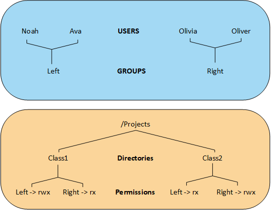

# Oefeningen op Standard file permissions

## Oefening 1

Voer het volgende commando uit:

```
ls /root
```

::: details Oplossing tonen
```bash
ls /root    # geeft 'Permission denied' als je geen sudo gebruikt
```
:::

## Oefening 2

Deze uitvoer wordt getoond omdat de directory `/root` eigendom is van de gebruiker root en omdat de beveiliging zo is ingesteld dat niemand behalve de root (en misschien gebruikers die lid zijn van de groep root) toegang heeft. Je kunt dit zien met het commando `ls -ld /root`.

Laten we nu zeggen dat jij de systeembeheerder bent en dat je toegang nodig hebt tot de mappen van de groep root. In dit geval moeten we onze gebruiker toevoegen aan de groep root.

Welk commando kan worden gebruikt om dit te bereiken?

::: details Oplossing tonen
```bash
sudo usermod -aG root "$USER"   # of vervang $USER door je loginnaam (student)
```
:::

## Oefening 3

Wat is er gewijzigd in het bestand `/etc/group`?

::: details Oplossing tonen
```bash
grep -w root /etc/group    # of: getent group root
```

*Je gebruiker is toegevoegd als lid bij de groep `root`.*
:::

## Oefening 4

Kan je het `ls` commando in de directory `/root` gebruiken? JA / NEE

::: details Oplossing tonen
**NEE** — `/root` heeft typisch rechten `700` → alleen de user root kan erin.
:::

## Oefening 5

Zo niet, los dit probleem dan op.

::: details Oplossing tonen
```bash
# Gebruik sudo i.p.v. de permissies van /root te wijzigen:
sudo ls -la /root
```

*(of: `sudo -i` en dan `ls`)*
:::

## Oefening 6

Verander je umask in `0027`. Maak een nieuwe file en folder en check de rechten.

::: details Oplossing tonen
```bash
umask 0027
touch testfile; mkdir testdir
ls -l testfile     # geeft  -rw-r----- (640)
ls -ld testdir     # geeft  drwxr-x--- (750)
```
:::

## Oefening 7

Test op je systeem of het volgende correct is:

*'Als iemand schrijfrechten heeft in een map, worden deze schrijfrechten ook automatisch toegekend aan alle bestanden in deze map, wat betekent dat deze persoon al deze bestanden kan wijzigen?'*

::: details Antwoord & test tonen
**ONJUIST.** Schrijfrecht op een map ≠ schrijfrecht op de bestanden.

```bash
mkdir demo; touch demo/file; chmod 444 demo/file     # alleen-lezen
chmod 777 demo                                        # map volledig schrijfbaar
# Bewerken van 'file' faalt zonder schrijfrecht op het bestand.
# Je kunt 'file' wél verwijderen/aanmaken als je op de map schrijfrecht (w) hebt.
```
:::

## Oefening 8

Kopieer het bestand `.bashrc` van de homefolder van de gebruiker root naar `/tmp`.

::: details Oplossing tonen
```bash
sudo cp /root/.bashrc /tmp/
```
:::

## Oefening 9

Wijzig de groupowner van het bestand `/tmp/.bashrc` naar de groep `users`.

::: details Oplossing tonen
```bash
sudo chgrp users /tmp/.bashrc
```
:::

## Oefening 10

Wijzig de userowner van het bestand `/tmp/.bashrc` naar jouw gebruiker.

::: details Oplossing tonen
```bash
sudo chown "$USER" /tmp/.bashrc    # of vervang $USER door je loginnaam (student)
```
:::

## Oefening 11

Wijzig de machtigingen van het bestand `/tmp/.bashrc` naar:

- De gebruikerseigenaar: lezen, bewerken en uitvoeren
- De groepseigenaar: alleen-lezen
- Anderen: niets

::: details Oplossing tonen
```bash
chmod 740 /tmp/.bashrc     # rwx r-- ---
```
:::

## Oefening 12

Wat is de opdracht die ervoor zorgt dat alle nieuw gemaakte bestanden de volgende machtiging krijgen?

```
rw-r-----
```

::: details Antwoord tonen
`rw-r-----` = `640`

De formule: `666 - umask = 640` → umask moet `0026` zijn. Maar omdat `x` nooit automatisch gezet wordt op bestanden (de basis voor bestanden is `666`, voor mappen `777`), geldt: `777 - 0027 = 750` voor mappen en `666 - 0027 = 640` voor bestanden.

```bash
umask 0027
# (permanent: voeg toe aan ~/.profile of ~/.bashrc)
```
:::

## Oefening 13

Kopieer de thuismap van iemand anders (niet die van root) met alle inhoud naar de map `/tmp`. Controleer de ownerships en de permissions van de gekopieerde bestanden.

Wat valt je op?

::: details Oplossing & uitleg tonen
```bash
sudo cp -r /home/<andergebruiker> /tmp/
```

*Opvallend: eigenaarschap wordt **niet** behouden; bestanden behoren toe aan `root`.*
:::

## Oefening 14

Kopieer de homefolder van iemand anders (niet die van root) met alle inhoud naar de map `/tmp`, zorg ervoor dat alle permissions en ownerships behouden blijven. Controleer de ownerships en de permissions van de gekopieerde bestanden.

Wat valt je op?

::: details Oplossing & uitleg tonen
```bash
sudo cp -a /home/<andergebruiker> /tmp/
# ook juist: cp -rp
```

*`cp -a` (archive): kopieert recursief en bewaart eigenaar, groep, tijden, rechten en symlinks.*
:::

---

# Oefeningen op Users, Groups en Special permissions

## Oefening 1

Maak een groep met de naam `pxl` en een gebruiker `itstudent`. De primaire groep van deze gebruiker is `pxl`. Stel het wachtwoord voor de gebruiker in op `test123`. De home directory voor deze gebruiker is `/home/itstudent` en voor de shell gebruikt de gebruiker `/bin/bash`.

::: details Oplossing tonen
```bash
sudo groupadd pxl
sudo useradd -m -d /home/itstudent -s /bin/bash -g pxl itstudent
echo "itstudent:test123" | sudo chpasswd
```
:::

## Oefening 2

Zorg ervoor dat de gebruiker `itstudent` een sudoer wordt. Test of dit werkt.

::: details Oplossing tonen
```bash
sudo usermod -aG sudo itstudent
```

```bash
# test:
su - itstudent
sudo -v && echo "sudo werkt"
```
:::

## Oefening 3

Kopieer het bestand `/etc/hosts` naar je home directory (doe dit niet als root!). Stel de rechten met de opdracht `chmod` als volgt in:

`r-x` voor anderen, `rw-` voor groep en geen rechten (`---`) voor de eigenaar van het bestand. Controleer met het `ls -l` commando of alles is gewijzigd.

- Kan de eigenaar van het bestand de inhoud van het bestand bekijken? Waarom / Waarom niet?
- Kan hij de rechten wijzigen?
- Kan hij het bestand verwijderen?

::: details Oplossing & uitleg tonen
```bash
cp /etc/hosts ~/
chmod u=,g=rw,o=rx ~/hosts
ls -l ~/hosts
```

- **Inhoud bekijken door eigenaar?** Nee — `u` heeft geen `r`.
- **Rechten wijzigen?** Ja — de eigenaar mag `chmod` altijd uitvoeren.
- **Verwijderen?** Hangt af van de rechten op de map (`~`) en het sticky-bit.
:::

## Oefening 4

**Maak 7 gebruikers aan met de naam:** Walter, Michael, Ben, James, Mia, Emma en Charlotte.

- Emma, Charlotte en Mia hebben de groep `users` als primaire groep; hun secundaire groep moet `Sales` zijn.
- Walter en Michael hebben hun eigen primaire groep en zijn bijkomstig lid van de groep `Planning`.
- Ben en James hebben ook hun eigen primaire groep, maar maken deel uit van beide afdelingen en zijn daarom bijkomstig lid van beide groepen `Planning` en `Sales`.
- Alle gebruikers hebben hun home directory in `/home/gebruikersnaam`.

**Er zijn 3 extra mappen in `/home`:**

- `/home/planning`: bevat de planning, aanpasbaar voor alle leden van Planning.
- `/home/sales`: bevat informatie over de verkoop, aanpasbaar voor alle leden van Sales.
- `/home/general`: bevat algemene informatie voor iedereen. James is verantwoordelijk voor deze map en heeft daarom alleen James bewerkingsrechten voor deze map en de inhoud ervan.

Zorg ervoor dat de gebruikers die moeten samenwerken ook de bestanden van elk van hen kunnen wijzigen. Maak gebruik van setgid en gebruik geen ACL's.

Alle gebruikers hebben leesrechten voor deze mappen.

**Test het scenario!**

*Extra Challenge!* Zorg ervoor dat de personen binnen de sales-share elkaars bestanden niet kunnen verwijderen!

::: details Voorbeeldoplossing tonen

**Stap 1 — Groepen aanmaken**

```bash
sudo groupadd Sales
sudo groupadd Planning
# 'users' bestaat normaal al; anders: sudo groupadd users
```

**Stap 2 — Gebruikers aanmaken**

```bash
for u in Walter Michael Ben James Mia Emma Charlotte; do
  sudo useradd -m -s /bin/bash "$u"
done
```

**Stap 3 — Primaire/secundaire groepen instellen**

```bash
# Emma, Charlotte, Mia: primaire = users, secundair = Sales
sudo usermod -g users -aG Sales Emma
sudo usermod -g users -aG Sales Charlotte
sudo usermod -g users -aG Sales Mia

# Walter & Michael: eigen primaire groep, secundair = Planning
sudo usermod -aG Planning Walter
sudo usermod -aG Planning Michael

# Ben & James: eigen primaire groep + beide afdelingen
sudo usermod -aG Planning,Sales Ben
sudo usermod -aG Planning,Sales James
```

**Stap 4 — Shares aanmaken en eigenaars/groepen zetten**

```bash
sudo mkdir -p /home/planning /home/sales /home/general   # eigenaar is nu root
sudo chgrp Planning /home/planning     # alleen de groep wijzigen
sudo chgrp Sales    /home/sales
sudo chown James    /home/general      # alleen de eigenaar wijzigen
```

**Stap 5 — Rechten: setgid en leesrechten voor anderen**

```bash
sudo chmod 2775 /home/planning   # setgid + groep schrijfbaar + anderen lees
sudo chmod 2775 /home/sales
sudo chmod 755  /home/general    # alleen James (eigenaar) mag schrijven
```

**Stap 6 — Samenwerken mogelijk maken (umask 0002)**

Gebruikers met een eigen primaire groep (Walter, Michael, Ben en James) hebben standaard al umask `0002`. Emma, Charlotte en Mia hebben als primaire groep `users`, dus zij krijgen `0022` en hun bestanden zijn niet schrijfbaar voor de groep. Zet de umask enkel voor hen:

```bash
for u in Emma Charlotte Mia; do
  echo 'umask 0002' | sudo tee -a /home/$u/.profile >/dev/null
done
```

**Stap 7 — Extra Challenge: sticky bit op sales**

```bash
sudo chmod +t /home/sales
# ls -ld /home/sales → drwxrwsr-t root Sales /home/sales
```

**Validatie**

```bash
getent group Planning
getent group Sales
ls -ld /home/planning /home/sales /home/general
```

```bash
# Schrijven als teamlid (planning). -i = inloggen, zodat .profile (umask) wordt uitgevoerd:
sudo -iu Walter touch /home/planning/demo.txt
sudo -iu Michael bash -c 'echo "ok" >> /home/planning/demo.txt'
ls -l /home/planning/demo.txt    # verwacht: -rw-rw-r--  Walter Planning
```

```bash
# Sticky bit test (sales):
sudo -iu Emma touch /home/sales/e1.txt
sudo -iu Charlotte rm /home/sales/e1.txt
# verwacht: rm: cannot remove '/home/sales/e1.txt': Operation not permitted
```
:::

---

# Oefeningen op ACL's

## Oefening 1

Kopieer recursief een ACL-map met alles erin naar een nieuwe map. Zoek uit hoe je, met het gebruik van `getfacl` en `setfacl`, de ACL-configuraties van de ene map naar de andere kopieert.

::: details Voorbeeld tonen
```bash
# ACL's van SRC exporteren en naar DEST toepassen:
cp -r /pad/naar/SRC /pad/naar/DEST
cd /pad/naar/SRC
getfacl -R . > /tmp/acls.txt
cd /pad/naar/DEST
sudo setfacl --restore=/tmp/acls.txt
```
:::

## Oefening 2

Zoek hoe je een back-up maakt van de ACL-configuraties die in een directory zijn ingesteld.

::: details Antwoord tonen
```bash
getfacl -R /pad/naar/dir > acls-backup.txt
# herstel vanuit de root van het filesystem (wegens verwijderen van leading slash):
setfacl --restore=acls-backup.txt
```
:::

## Oefening 3

Stel dat je in een bedrijf werkt waar apparaten worden ontworpen, gemaakt, gerepareerd en verkocht. Ingenieurs ontwerpen de apparaten, technici maken en repareren ze, en verkopers verkopen ze. Alle medewerkers werken binnen een centraal Linux-systeem.

**Vereisten:**

- Ingenieurs hebben een eigen homefolder en een gedeelde map `/home/shared/design` (alle rechten).
- Alle technici delen één homefolder `/home/technicians`.
- Sales heeft eigen homefolders en een gedeelde map `/home/shared/info` (alle rechten) voor technische/marketinggegevens. Ingenieurs hebben ook alle rechten op `/home/shared/info`.

| Job | Linux groep | Gebruiker | Wachtwoord |
|---|---|---|---|
| Ingenieurs | ingenieurs | George | summer1 |
| Ingenieurs | ingenieurs | Isla | summer2 |
| Technici | technici (primair) | Leo | winter1 |
| Technici | technici (primair) | Amelia | winter2 |
| Sales | sales | Jack | spring1 |
| Sales | sales | Grace | spring2 |

| Folder | Groep met alle rechten |
|---|---|
| `/home/shared/design` | ingenieurs |
| `/home/shared/info` | sales, ingenieurs |

De userowner van de gedeelde directories is de root gebruiker.

::: details Oplossing tonen

**1) Groepen aanmaken**

```bash
sudo groupadd ingenieurs
sudo groupadd technici
sudo groupadd sales
```

**2) Gebruikers aanmaken + wachtwoorden instellen**

```bash
# Ingenieurs (eigen home):
sudo useradd -m -s /bin/bash -g ingenieurs George
echo "George:summer1" | sudo chpasswd
sudo useradd -m -s /bin/bash -g ingenieurs Isla
echo "Isla:summer2" | sudo chpasswd
```

```bash
# Technici (gedeelde home /home/technicians):
sudo mkdir -p /home/technicians
sudo chown root:technici /home/technicians
sudo chmod 2770 /home/technicians
sudo useradd -M -s /bin/bash -g technici -d /home/technicians Leo
echo "Leo:winter1" | sudo chpasswd
sudo useradd -M -s /bin/bash -g technici -d /home/technicians Amelia
echo "Amelia:winter2" | sudo chpasswd
```

```bash
# Sales (eigen home):
sudo useradd -m -s /bin/bash -g sales Jack
echo "Jack:spring1" | sudo chpasswd
sudo useradd -m -s /bin/bash -g sales Grace
echo "Grace:spring2" | sudo chpasswd
```

**3) Gedeelde mappen aanmaken en rechten zetten**

```bash
sudo mkdir -p /home/shared/design /home/shared/info

# /home/shared/design → groep 'ingenieurs', geen toegang voor others
sudo chown root:ingenieurs /home/shared/design
sudo chmod 2770 /home/shared/design
sudo setfacl -d -m u::rwx,g::rwx,o::--- /home/shared/design

# /home/shared/info → groep 'sales' + volledige rechten voor 'ingenieurs'
sudo chown root:sales /home/shared/info
sudo chmod 2770 /home/shared/info
sudo setfacl -m g:ingenieurs:rwx /home/shared/info
sudo setfacl -d -m u::rwx,g::rwx,o::--- /home/shared/info
sudo setfacl -d -m g:ingenieurs:rwx /home/shared/info
```

**4) Testen**

```bash
# Design-share:
sudo -u George touch /home/shared/design/spec.txt
sudo -u Isla bash -c 'echo "ok" >> /home/shared/design/spec.txt'

# Info-share:
sudo -u Jack touch /home/shared/info/sales.txt
sudo -u George bash -c 'echo "engineer notes" >> /home/shared/info/sales.txt'

# Technici-home:
sudo -u Leo touch /home/technicians/task.txt
sudo -u Amelia bash -c 'echo "done" >> /home/technicians/task.txt'
```

**5) Controles**

```bash
getent group ingenieurs technici sales
id George; id Jack; id Leo
ls -ld /home/shared/design /home/shared/info /home/technicians
getfacl /home/shared/design /home/shared/info
```

**Tip:** Zorg dat de systeem-`umask` groep-schrijfbaar toelaat (bv. `0002`) zodat teamleden elkaars bestanden kunnen bewerken in de shares. Dit kan globaal via `/etc/profile` of per gebruiker in `~/.profile`.
:::

### Oefening 3.1

Maak de mappen, groepen en gebruikers zoals vermeld in bovenstaande situatie.

::: details Oplossing 7.1 tonen
```bash
sudo groupadd ingenieurs
sudo groupadd technici
sudo groupadd sales

for u in George Isla Leo Amelia Jack Grace; do
  sudo useradd -m -s /bin/bash "$u"
done

echo "George:summer1" | sudo chpasswd
echo "Isla:summer2"   | sudo chpasswd
echo "Leo:winter1"    | sudo chpasswd
echo "Amelia:winter2" | sudo chpasswd
echo "Jack:spring1"   | sudo chpasswd
echo "Grace:spring2"  | sudo chpasswd

sudo mkdir -p /home/shared/design /home/shared/info /home/technicians
sudo chown root:root /home/shared/design /home/shared/info /home/technicians
```
:::

### Oefening 3.2

Geef alle gebruikers de juiste groepen zoals vermeld in bovenstaande situatie.

::: details Oplossing 7.2 tonen
```bash
# Ingenieurs:
sudo usermod -aG ingenieurs George
sudo usermod -aG ingenieurs Isla

# Technici: primaire groep 'technici' & gedeelde home:
sudo usermod -g technici -d /home/technicians Leo
sudo usermod -g technici -d /home/technicians Amelia

# Sales:
sudo usermod -aG sales Jack
sudo usermod -aG sales Grace
```
:::

### Oefening 3.3

Stel alle machtigingen en ACL's in voor het hierboven genoemde scenario. Gebruik de speciale bit setgid **niet**, maar zorg er toch voor dat de ACL's worden overgeërfd naar eventuele later aangemaakte submappen.

::: details Oplossing 7.3 tonen
```bash
# Basisrechten: iedereen mag lezen/uitvoeren in shared:
sudo chmod 0755 /home/shared/design /home/shared/info

# /home/shared/design: ingenieurs hebben rwx + default ACL
sudo setfacl -m g:ingenieurs:rwx /home/shared/design
sudo setfacl -d -m g:ingenieurs:rwx /home/shared/design

# /home/shared/info: sales + ingenieurs hebben rwx + default ACL
sudo setfacl -m g:sales:rwx /home/shared/info
sudo setfacl -m g:ingenieurs:rwx /home/shared/info
sudo setfacl -d -m g:sales:rwx /home/shared/info
sudo setfacl -d -m g:ingenieurs:rwx /home/shared/info

# Technici gedeelde home:
sudo chgrp technici /home/technicians
sudo chmod 0770 /home/technicians
sudo setfacl -m g:technici:rwx /home/technicians
sudo setfacl -d -m g:technici:rwx /home/technicians
```
:::

## Oefening 4

Maak de directorystructuur met de benodigde gebruikers, groepen en ACL's zoals weergegeven in de onderstaande afbeelding. Test waar de gebruikers Ava en Oliver lees- en bewerkingsrechten hebben.



Test waar de gebruikers Ava en Oliver lees- en bewerkingsrechten hebben.

::: details Oplossing tonen
```bash
# Groepen aanmaken
sudo groupadd Left
sudo groupadd Right

# Gebruikers aanmaken en toevoegen aan de juiste secundaire groep
sudo useradd -m -G Left  Noah
sudo useradd -m -G Left  Ava
sudo useradd -m -G Right Olivia
sudo useradd -m -G Right Oliver

# Mappenstructuur aanmaken
sudo mkdir -p /Projects/Class1 /Projects/Class2

# ACL's instellen op /Projects (doorgang voor beide groepen)
sudo setfacl -m g:Left:rx  /Projects
sudo setfacl -m g:Right:rx /Projects

# /Projects/Class1: Left = rwx, Right = rw
sudo setfacl -m g:Left:rwx  /Projects/Class1
sudo setfacl -m g:Right:rw  /Projects/Class1
sudo setfacl -d -m g:Left:rwx  /Projects/Class1
sudo setfacl -d -m g:Right:rw  /Projects/Class1

# /Projects/Class2: Right = rwx, Left = rw
sudo setfacl -m g:Right:rwx /Projects/Class2
sudo setfacl -m g:Left:rw   /Projects/Class2
sudo setfacl -d -m g:Right:rwx /Projects/Class2
sudo setfacl -d -m g:Left:rw   /Projects/Class2
```

```bash
# Testen als Ava (Left):
sudo -u Ava touch /Projects/Class1/ava.txt       # OK
sudo -u Ava touch /Projects/Class2/ava.txt       # FOUT (geen x)

# Testen als Oliver (Right):
sudo -u Oliver touch /Projects/Class1/ol.txt     # FOUT (geen x)
sudo -u Oliver touch /Projects/Class2/ol.txt     # OK

# Controle:
sudo getfacl /Projects/Class1
sudo getfacl /Projects/Class2
```
:::
