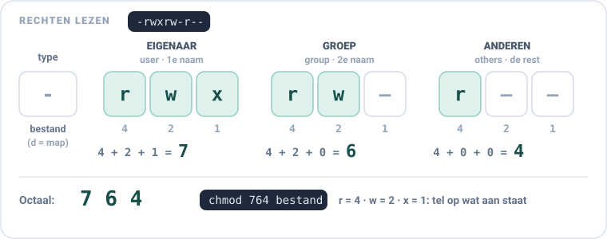
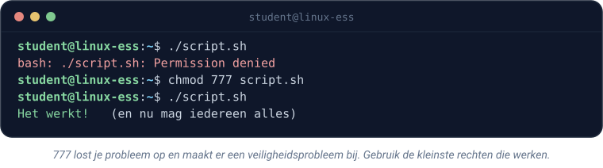
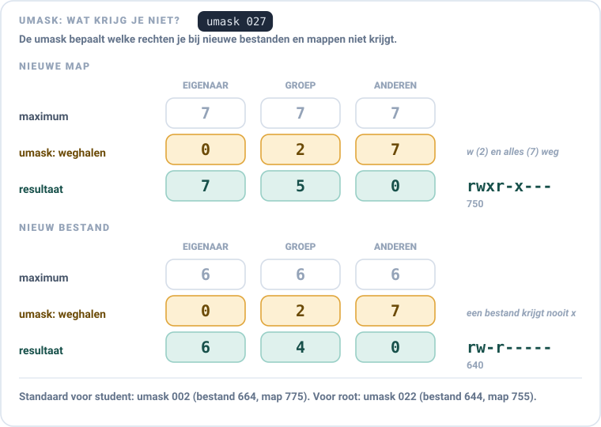
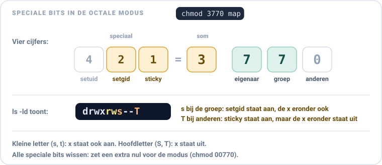

# 10. Rechten

Linux is een **multiuser**-systeem: meerdere gebruikers werken op dezelfde machine. Dat vraagt om regels:

* Gebruikers mogen niet zomaar aan elkaars bestanden.
* Gewone gebruikers mogen niet aan systeembestanden of programma's voor de beheerder.
* Gebruikers moeten bestanden wél kunnen delen om samen te werken.

**Rechten** (permissions) regelen dit. Wie rechten goed beheert, houdt een systeem veilig.

Je systeem heeft al verstandige standaardrechten:

* In je **homefolder** (`/home/student`) mag je alles: bestanden en mappen maken, wijzigen en verwijderen. `/tmp` is ook voor iedereen beschrijfbaar.
* Buiten je homefolder krijg je al snel een foutmelding: `Permission denied`.
* Sommige bestanden mag je lezen maar niet wijzigen, zoals `/etc/passwd` (de gebruikersdatabase).
* Andere bestanden mag je niet eens lezen, zoals `/etc/shadow` (de wachtwoorden van alle gebruikers).

`Permission denied` is een van de meest voorkomende fouten. Rechten begrijpen is dan ook een basisvaardigheid van elke Linux-beheerder.

::: warning Geef niet zomaar rechten
Rechten zijn je eerste verdedigingslinie tegen kwaadwillende gebruikers en programma's. Vraag je bij een `Permission denied` eerst af *waarom* iemand toegang nodig heeft. Geef geen rechten alleen om de foutmelding te laten verdwijnen.
:::


## Octale notaties
Met `ls -l` zie je per bestand de rechten. Er zijn drie rechten: **read** (lezen), **write** (wijzigen) en **execute** (uitvoeren als script of programma). Is een recht niet toegekend, dan staat er een `-` op die plaats.

```bash
student@linux-ess:~/course$ ls -l
total 4
-rw-rw-r-- 1 student student    0 okt  2 19:36 config
drwxrwxr-x 2 student student 4096 okt  2 19:36 folder
-rw-rw-r-- 1 student student    0 okt  2 19:36 rights.jpg
-rw-rw-r-- 1 student student    0 okt  2 19:36 test.txt
```

Het **eerste teken** is het type van het bestand:

| Teken | Type | Uitleg | Voorbeeld |
|---|---|---|---|
| `-` | gewoon bestand | tekst, een programma, een afbeelding, ... | `/etc/passwd` |
| `d` | map (directory) | bevat andere bestanden en mappen | `/home` |
| `l` | symbolische link | verwijst naar een ander bestand of een andere map, zoals een snelkoppeling | `/bin` |
| `b` | blokapparaat | hardware waarvan de gegevens in blokken worden gelezen en geschreven, zoals een schijf | `/dev/sda` |
| `c` | karakterapparaat | hardware waarvan de gegevens teken per teken worden verwerkt, zoals een terminal | `/dev/tty` |

```bash
student@linux-ess:~$ ls -l /dev/sda
brw-rw---- 1 root disk 8, 0 Sep 24 13:10 /dev/sda
student@linux-ess:~$ ls -l /dev/tty
crw-rw-rw- 1 root tty 5, 0 Nov 23 21:36 /dev/tty
student@linux-ess:~$ ls -ld /bin
lrwxrwxrwx 1 root root 7 Apr 22  2026 /bin -> usr/bin
```

* **`l` (link):** achter de naam zie je waar de link naartoe wijst. `/bin` is een link naar `usr/bin`: wie `/bin` opent, komt dus in `/usr/bin` terecht.
* **`b` (blokapparaat):** een schijf of partitie, zoals `/dev/sda`. Het systeem leest en schrijft er in blokken. Apparaatbestanden staan in `/dev`.
* **`c` (karakterapparaat):** hardware die een stroom van tekens verwerkt, zoals een terminal (`/dev/tty`).
* Bij een apparaatbestand staan er in plaats van de grootte twee nummers (`8, 0`). Die identificeren het apparaat voor de kernel.
* Je kan ook `p` (pipe) en `s` (socket) tegenkomen. Daar gaan we in deze cursus niet verder op in.

**Mappen** hebben dezelfde rechten, maar ze betekenen iets anders:

| Recht | Op een bestand | Op een map |
|---|---|---|
| `r` | de inhoud lezen | de inhoud tonen (`ls`) |
| `w` | de inhoud wijzigen | bestanden in de map maken, hernoemen en verwijderen |
| `x` | uitvoeren als script of programma | de map binnengaan (`cd`) en bestanden erin bereiken |

Zonder `x` kan je met een map weinig doen. Gangbare combinaties voor mappen zijn `rwx` (alles), `r-x` (alleen lezen) en `---` (geen toegang).

De rechten staan in **drie sets** van drie tekens, voor drie soorten gebruikers, altijd in deze volgorde:

* **userowner**: de eigenaar van het bestand (de eerste naam na de rechten).
* **groupowner**: de leden van de groep die eigenaar is (de tweede naam).
* **others**: iedereen die niet bij de eerste twee hoort.

Wie een bestand maakt, wordt automatisch de **eigenaar**. De **groepseigenaar** is de primaire groep van die gebruiker. Standaard heeft die groep dezelfde naam als de gebruiker, daarom zie je vaak `student student`. In `/dev` (de bestanden voor je hardware) vind je bestanden van root met een andere groep:

```bash
student@linux-ess:~$ ls -l /dev/[ns][drv]*
crw-rw---- 1 root root   237, 0 Nov 11 10:44 /dev/nvme0
brw-rw---- 1 root disk   259, 0 Nov 11 10:44 /dev/nvme0n1
brw-rw---- 1 root disk   259, 1 Nov 11 10:44 /dev/nvme0n1p1
brw-rw---- 1 root disk   259, 2 Nov 11 10:44 /dev/nvme0n1p2
brw-rw---- 1 root disk   259, 3 Nov 11 10:44 /dev/nvme0n1p3
brw-rw---- 1 root disk     8, 0 Nov 11 10:44 /dev/sda
brw-rw---- 1 root cdrom   11, 0 Nov 11 10:43 /dev/sr0
```

Rechten worden opgeslagen als bits: 1 betekent dat het recht is toegekend, 0 dat het niet is toegekend. `rwxrw-r--` is dus `111110100`. Binair is moeilijk te lezen. Daarom schrijven we elke set als één cijfer van 0 tot 7: de **octale notatie**.

Zo reken je: **r = 4, w = 2, x = 1**. Tel op wat aan staat:

* `rwx` = 4 + 2 + 1 = **7**
* `rw-` = 4 + 2 + 0 = **6**
* `r--` = 4 + 0 + 0 = **4**

`rwxrw-r--` is dus **764**.



Wat elk cijfer betekent, hangt af van of het om een **bestand** of een **map** gaat:

| Octaal | Binair | `rwx` | Op een bestand | Op een map |
|---|---|---|---|---|
| **0** | 000 | `---` | niets | geen toegang |
| **1** | 001 | `--x` | uitvoeren (een script heeft ook `r` nodig) | binnengaan (`cd`) en bestanden bereiken waarvan je de naam kent, maar de inhoud niet tonen |
| **2** | 010 | `-w-` | wijzigen, maar niet lezen | zonder `x` in de praktijk nutteloos: je kan niets aanpassen |
| **3** | 011 | `-wx` | wijzigen en uitvoeren (een script heeft ook `r` nodig) | binnengaan en bestanden maken, hernoemen en verwijderen, maar de inhoud niet tonen |
| **4** | 100 | `r--` | lezen | de namen tonen (`ls`), maar er niet in gaan |
| **5** | 101 | `r-x` | lezen en uitvoeren | de inhoud tonen en binnengaan (alleen lezen) |
| **6** | 110 | `rw-` | lezen en wijzigen | zonder `x` in de praktijk onbruikbaar: je kan er niet in |
| **7** | 111 | `rwx` | lezen, wijzigen en uitvoeren | alles: tonen, binnengaan, maken, hernoemen en verwijderen |

Veelgebruikte combinaties:

* **Bestanden:** `644` (iedereen leest, enkel de eigenaar wijzigt), `600` (privé) en `755` (programma of script dat iedereen mag uitvoeren).
* **Mappen:** `755` (iedereen mag erin kijken, enkel de eigenaar wijzigt) en `700` (privé).


## Rechten wijzigen (chmod)
Met `chmod` (change mode) wijzig je de rechten van een bestand of map. Er zijn twee manieren.

**1. Met letters**: handig voor een snelle aanpassing. Je zegt *voor wie*, *toevoegen of weghalen* en *welk recht*.

* Voor wie: `u` (userowner), `g` (groupowner), `o` (others) of `a` (alle drie).
* Wat: `+` (toevoegen) of `-` (weghalen).
* Welk recht: `r`, `w` en/of `x`.

```bash
student@linux-ess:~$ touch test  
student@linux-ess:~$ ls -l test
-rw-rw-r-- 1 student student 0 Nov 11 13:11 test
student@linux-ess:~$ chmod a+x test  
student@linux-ess:~$ ls -l test   
-rwxrwxr-x 1 student student 0 okt  2 19:36 test  
student@linux-ess:~$ chmod g-w test  
student@linux-ess:~$ ls -l test   
-rwxr-xr-x 1 student student 0 okt  2 19:36 test  
student@linux-ess:~$ chmod go-rx test
student@linux-ess:~$ ls -l test 
-rwx------ 1 student student 0 okt  2 19:36 test
```

**2. Met cijfers** (octaal): handig om alle rechten in één keer te herschrijven.

```bash
student@linux-ess:~$ touch config  
student@linux-ess:~$ ls -l config  
-rw-rw-r-- 1 student student    0 okt  2 19:36 config
student@linux-ess:~$ chmod 600 config 
student@linux-ess:~$ ls -l config
-rw------- 1 student student    0 okt  2 19:36 config
student@linux-ess:~$ chmod 744 config
student@linux-ess:~$ ls -l config
-rwxr--r-- 1 student student    0 okt  2 19:36 config
```

Welke manier kies je? Met cijfers herschrijf je alles in één keer, zonder de bestaande rechten te hoeven nakijken. Met letters pas je snel één detail aan, zoals een bestand uitvoerbaar maken (`chmod u+x`).



## Van eigenaar veranderen (chgrp, chown)
Naast de rechten zelf kan je ook wijzigen **van wie** een bestand is: de eigenaar en de groepseigenaar. Dat kan alleen met `sudo`.

Met `chgrp` wijzig je de **groepseigenaar** van een bestand of map. Met `-R` doe je dat recursief (voor alles in de map).

```bash
student@linux-ess:~$ ls -l course/
total 4
-rwxr--r-- 1 student student    0 okt  2 19:36 config
drwxrwxr-x 2 student student 4096 okt  2 19:36 folder
-rw-rw-r-- 1 student student    0 okt  2 19:36 rights.jpg
-rw-rw-rw- 1 student student    0 okt  2 19:36 test.txt
student@linux-ess:~$ sudo chgrp -R it course/
student@linux-ess:~$ ls -l course/
total 4
-rwxr--r-- 1 student it    0 okt  2 19:36 config
drwxrwxr-x 2 student it 4096 okt  2 19:36 folder
-rw-rw-r-- 1 student it    0 okt  2 19:36 rights.jpg
-rw-rw-rw- 1 student it    0 okt  2 19:36 test.txt
student@linux-ess:~$ ls -ld course/
drwxrwxr-x 3 student it 4096 okt  2 19:36 course/
```

Met `chown` wijzig je de **eigenaar en/of de groep**. Ook `chown` kent de optie `-R`. De schrijfwijze is `chown eigenaar`, `chown eigenaar:groep` of `chown :groep`.

```bash
student@linux-ess:~/course$ sudo chown teacher rights.jpg #verander de eigenaar
student@linux-ess:~/course$ ls -l rights.jpg
-rw-rw-r-- 1 teacher it    0 okt  2 19:36 rights.jpg
student@linux-ess:~/course$ sudo chown teacher:root config folder #verander de eigenaar en de groep
student@linux-ess:~/course$ ls -l 
total 4
-rwxr--r-- 1 teacher root    0 okt  2 19:36 config
drwxrwxr-x 2 teacher root 4096 okt  2 19:36 folder
-rw-rw-r-- 1 teacher it        0 okt  2 19:36 rights.jpg
-rw-rw-rw- 1 student it        0 okt  2 19:36 test.txt
student@linux-ess:~/course$ sudo chown :it config #verander de groep
student@linux-ess:~/course$ ls -l config
-rwxr--r-- 1 teacher    it        0 okt  2 19:36 config
```

## Default permissions (umask)
Welke rechten krijgt een **nieuw** bestand of een nieuwe map? Dat bepaalt de **umask**.

De maxima zijn:

* **Nieuw bestand:** maximaal 666 (`rw-rw-rw-`). Een nieuw bestand krijgt **nooit** uitvoerrechten. De kernel dwingt dat af. Wil je `x`, dan voeg je het later bewust toe met `chmod`.
* **Nieuwe map:** maximaal 777 (`rwxrwxrwx`). Een map zonder `x` is nutteloos, dus daar geldt die beperking niet.

```bash
student@linux-ess:~/course$ touch file
student@linux-ess:~/course$ mkdir folder
```

```bash
student@linux-ess:~/course$ ls -l
total 4
-rw-rw-r-- 1 student student    0 okt 15 15:56 file
drwxrwxr-x 2 student student 4096 okt 15 15:56 folder
```

Toch krijgen we niet `rw-rw-rw-` voor het bestand en ook niet `rwxrwxrwx` voor de map. Distributies zijn strenger dan de kernel: met de kernelstandaard kon elke gebruiker op het systeem alles wijzigen wat je maakt.

::: warning Bestanden zijn leesbaar voor anderen
Standaard zijn nieuw gemaakte bestanden leesbaar voor alle gebruikers op het systeem. Sla gevoelige bestanden niet zomaar op zonder de rechten aan te passen.
:::

De rechten voor nieuwe bestanden en mappen stelt de **umask** in. Een umask is een **masker**: het geeft aan welke rechten je *niet* krijgt. Bekijk de huidige waarde met `umask`:

```bash
student@linux-ess:~/course$ umask
0002
```

Hoe werkt dit? Elk cijfer van de umask haalt rechten weg uit het maximum (4 = lezen, 2 = schrijven, 1 = uitvoeren):

* **Map:** 777 met umask 002 geeft 775 (`rwxrwxr-x`).
* **Bestand:** 666 met umask 002 geeft 664 (`rw-rw-r--`). De `x` krijg je nooit.
* Umask `000` verbiedt niets. Umask `777` verbiedt alles: een nieuw bestand of een nieuwe map heeft dan geen enkel recht.



Met hetzelfde commando stel je de umask ook in:

```bash
student@linux-ess:~/course$ umask 000       # 777-000=777 en de x wordt nooit toegepast op nieuwe bestanden
student@linux-ess:~/course$ touch newfile1
student@linux-ess:~/course$ ls -l newfile1
-rw-rw-rw- 1 student student 0 okt 15 16:23 newfile1
 
student@linux-ess:~/course$ umask 027       # Als je meerdere bits wil maskeren, tel ze dan op  (777-027=750)
student@linux-ess:~/course$ touch newfile2
student@linux-ess:~/course$ ls -l newfile2
-rw-r----- 1 student student 0 okt 15 16:24 newfile2
student@linux-ess:~/course$ mkdir newfolder1
student@linux-ess:~/course$ ls -ld newfolder1
drwxr-x--- 2 student student 4096 okt 15 16:25 newfolder1
 
student@linux-ess:~/course$ umask 077 
student@linux-ess:~/course$ mkdir newfolder2
student@linux-ess:~/course$ ls -ld newfolder2
drwx------ 2 student student 4096 okt 15 16:25 newfolder2
```

::: info Umask permanent instellen
Als je de umask instelt met het commando, geldt dit alleen voor de huidige terminalsessie. Wanneer je de terminal sluit, wordt de standaardwaarde hersteld. Om de instelling permanent te maken, voeg je `umask <uw umask>` toe aan het `.profile`-bestand in je homefolder.
:::

::: warning Zet je umask terug
Na deze voorbeelden staat de umask van je sessie nog op `077`. Alles wat je daarna maakt, krijgt dan strenge rechten, en dat geeft later `Permission denied` (bijvoorbeeld bij `/shares/ict`). Zet hem terug met `umask 002`, of open een nieuwe sessie.
:::

Let op: bestanden die root maakt, hebben andere rechten dan die van `student`.

```bash
student@linux-ess:~/course$ touch file
student@linux-ess:~/course$ sudo touch file2
student@linux-ess:~/course$ ls -l
-rw-rw-r-- 1 student student 0 okt 15 16:44 file
-rw-r--r-- 1 root    root    0 okt 15 16:44 file2
```

Dit verschil heeft twee oorzaken:

* **Bestanden die je met `sudo` maakt:** `sudo` gebruikt zelf een standaard umask van `022`. Daardoor krijgen ze geen schrijfrechten voor groep en anderen (`644`), ook al is jouw umask `002`.
* **Je eigen umask (`002`):** die wordt bij het inloggen ingesteld door de PAM-module `pam_umask`, in combinatie met een instelling in `/etc/login.defs`:

```bash
student@linux-ess:~$ grep -i -E 'usergroups' /etc/login.defs
USERGROUPS_ENAB yes
```

De standaard umask is `022`. De regel `USERGROUPS_ENAB yes` zorgt ervoor dat `pam_umask` voor een gewone gebruiker met een eigen primaire groep (dezelfde naam als de gebruiker, zoals `student`) de groepsbits gelijk zet aan de eigenaarbits. Zo wordt `022` dus `002`, en dat verklaart waarom `student` bestanden maakt met `rw-rw-r--`. Root houdt `022`. Meer uitleg vind je in `man pam_umask`.

Je kan de umask ook in letters tonen en instellen:

```bash
student@linux-ess:~$ umask
0002
student@linux-ess:~$ umask -S
u=rwx,g=rwx,o=rx
student@linux-ess:~$ touch file3
student@linux-ess:~$ ls -l file3
-rw-rw-r-- 1 student student 0 Nov 11 14:01 file3
student@linux-ess:~$ umask u=rwx,g=rx,o=
student@linux-ess:~$ umask
0027
student@linux-ess:~$ umask -S
u=rwx,g=rx,o=
student@linux-ess:~$ touch file4
student@linux-ess:~$ ls -l file4
-rw-r----- 1 student student 0 Nov 11 14:03 file4
student@linux-ess:~$ mkdir folder4
student@linux-ess:~$ ls -ld folder4
drwxr-x--- 2 student student 4096 Nov 11 14:04 folder4
```


## Samenwerken in een team (setgid)
Wie samenwerkt, moet elkaars bestanden in een gedeelde map kunnen wijzigen. Beide gebruikers dezelfde primaire groep geven lijkt een oplossing, maar is een beveiligingsprobleem: ze krijgen dan ook toegang tot elkaars homefolder. Het voorbeeld hieronder toont dat probleem:

```bash
student@linux-ess:~$ sudo groupadd it 
student@linux-ess:~$ sudo useradd -m -g it -s /bin/bash liam
student@linux-ess:~$ sudo passwd liam
student@linux-ess:~$ sudo useradd -m -g it -s /bin/bash jacob
student@linux-ess:~$ sudo passwd jacob
student@linux-ess:~$ ls -ld /home/liam  /home/jacob
drwxr-x--- 2 jacob it 4096 Nov 26 15:39 /home/jacob
drwxr-x--- 2 liam  it 4096 Nov 26 15:32 /home/liam
student@linux-ess:~$ sudo ls -l /home/jacob/.profile
-rw-r--r-- 1 jacob it 807 Jan  6  2022 /home/jacob/.profile
student@linux-ess:~$ su - liam
Password:
liam@linux-ess:~$ head -3 /home/jacob/.profile
# ~/.profile: executed by the command interpreter for login shells.
# This file is not read by bash(1), if ~/.bash_profile or ~/.bash_login
# exists.  
liam@linux-ess:~$ exit
``` 

Liam kan de bestanden in de homefolder van Jacob lezen. Dat is niet de bedoeling.

We geven eerst beide gebruikers hun eigen primaire groep:

```bash
student@linux-ess:~$ sudo groupadd liam
student@linux-ess:~$ sudo groupadd jacob
student@linux-ess:~$ sudo usermod -g liam liam
student@linux-ess:~$ sudo usermod -g jacob jacob
student@linux-ess:~$ ls -ld /home/liam  /home/jacob                  # homefolders zijn opnieuw afgeschermd (=privé)
drwxr-x--- 2 jacob jacob 4096 Nov 26 15:39 /home/jacob
drwxr-x--- 2 liam  liam  4096 Nov 26 15:32 /home/liam
student@linux-ess:~$ sudo ls -l /home/jacob/.profile
-rw-r--r-- 1 jacob jacob 807 Jan  6  2022 /home/jacob/.profile
```

::: info Primaire groep en bestandseigendom
Het wijzigen van de primaire groep van een gebruiker verandert ook de groepseigenaar van elk bestand in zijn homefolder.
:::

We maken een groep voor de twee gebruikers om hen rechten te geven op een gedeelde map die we in de volgende stap zullen maken. We voegen de gebruikers ook toe aan deze nieuwe groep:

```bash
student@linux-ess:~$ sudo groupadd ict
student@linux-ess:~$ sudo usermod -aG ict liam
student@linux-ess:~$ sudo usermod -aG ict jacob
student@linux-ess:~$ grep ict /etc/group
ict:x:1005:liam,jacob
``` 

We zullen de map maken die wordt gedeeld tussen de twee gebruikers en geven deze de nodige machtigingen:

```bash
student@linux-ess:~$ sudo mkdir -p /shares/ict
student@linux-ess:~$ ls -ld /shares/ict
drwxr-xr-x 2 root root 4096 Nov 26 15:58 /shares/ict
student@linux-ess:~$ sudo chgrp ict /shares/ict
student@linux-ess:~$ ls -ld /shares/ict
drwxr-xr-x 2 root ict 4096 Nov 26 15:58 /shares/ict
student@linux-ess:~$ sudo chmod g+w /shares/ict
student@linux-ess:~$ ls -ld /shares/ict
drwxrwxr-x 2 root ict 4096 Nov 26 15:58 /shares/ict
```

Zoals je kan zien, hebben leden van de groep ict de toestemming om in de gedeelde map ict te kijken en om bestanden en mappen in deze map te maken/verwijderen

Maar er is een probleem wanneer de gebruikers een bestand maken in de share:

```bash
student@linux-ess:~$ su - jacob
Password:
jacob@linux-ess:~$ cd /shares/ict/
jacob@linux-ess:/shares/ict$ touch testfile
jacob@linux-ess:/shares/ict$ mkdir testdir
jacob@linux-ess:/shares/ict$ ls -l
total 4
drwxrwxr-x 2 jacob jacob 4096 Nov 26 16:12 testdir
-rw-rw-r-- 1 jacob jacob    0 Nov 26 16:11 testfile
jacob@linux-ess:/shares/ict$ exit
logout
student@linux-ess:~$ su - liam
Password:
liam@linux-ess:~$ cd /shares/ict/
liam@linux-ess:/shares/ict$ ls
testdir  testfile
liam@linux-ess:/shares/ict$ echo hallo >> testfile
-bash: testfile: Permission denied
liam@linux-ess:/shares/ict$ ls -ld testdir
drwxrwxr-x 2 jacob jacob 4096 Nov 27 20:44 testdir
liam@linux-ess:/shares/ict$ cd testdir
liam@linux-ess:/shares/ict/testdir$ touch testfile2
touch: cannot touch 'testfile2': Permission denied
liam@linux-ess:/shares/ict$ exit
```

Zoals je kan zien, kunnen ze niet samenwerken aan dezelfde bestanden of in dezelfde mappen

De oplossing is de speciale bit **setgid** op de gedeelde map. Je zet hem aan met `chmod g+s` (uit met `g-s`):

```bash
student@linux-ess:~$ ls -ld /shares/ict/
drwxrwxr-x 3 root ict 4096 Nov 26 16:12 /shares/ict/
student@linux-ess:~$ sudo chmod g+s /shares/ict            # or sudo chmod 2775 /shares/ict
student@linux-ess:~$ ls -ld /shares/ict/
drwxrwsr-x 3 root ict 4096 Nov 26 16:12 /shares/ict/
```

In de rechten van de groep staat nu een **`s`**. Een kleine `s` betekent dat de `x` ook aan staat. Een hoofdletter `S` betekent dat de `x` uit staat.

Met setgid krijgen nieuwe bestanden en mappen in deze map **dezelfde groepseigenaar als de map zelf**, niet de primaire groep van de maker:

```bash
student@linux-ess:~$ ls -l /shares/ict/ 
total 4
drwxrwxr-x 2 jacob jacob 4096 Nov 26 16:12 testdir
-rw-rw-r-- 1 jacob jacob    0 Nov 26 16:11 testfile
student@linux-ess:~$ su - jacob
Password:
jacob@linux-ess:~$ cd /shares/ict/
jacob@linux-ess:/shares/ict$ echo "This is Jacob's text" > testfile2
jacob@linux-ess:/shares/ict$ mkdir testdir2
jacob@linux-ess:/shares/ict$ ls -l
total 12
drwxrwxr-x 2 jacob jacob 4096 Nov 26 16:12 testdir
drwxrwsr-x 2 jacob ict   4096 Nov 26 16:26 testdir2
-rw-rw-r-- 1 jacob jacob    0 Nov 26 16:11 testfile
-rw-rw-r-- 1 jacob ict     21 Nov 26 16:26 testfile2
jacob@linux-ess:/shares/ict$ exit
logout
student@linux-ess:~$ su - liam
Password:
liam@linux-ess:~$ cd /shares/ict/
liam@linux-ess:/shares/ict$ echo "This is Liam's text" >> testfile2
liam@linux-ess:/shares/ict$ cat testfile2
This is Jacob's text
This is Liam's text
liam@linux-ess:/shares/ict$ exit
```

De groepseigenaar van het nieuwe bestand en de nieuwe map is `ict`. Daardoor kunnen beide gebruikers nu elkaars bestanden bewerken.

Let op: een nieuwe submap krijgt zelf ook de setgid-bit.

## De sticky bit
Setgid lost het delen op, maar brengt een nieuw probleem mee: iedereen met schrijfrechten op de map kan nu ook de bestanden van anderen verwijderen of hernoemen.

* Soms is dat prima, bijvoorbeeld in een gezamenlijk project.
* Wil je dat niet, zet dan de **sticky bit** op de map.
* Met de sticky bit kan niemand (behalve root) bestanden of submappen verwijderen of hernoemen die hij niet zelf bezit.

Je vindt dit ook in `/tmp`: gebruikers kunnen daar de tijdelijke bestanden van anderen niet verwijderen.

```bash
student@linux-ess:~$ ls -ld /tmp/
drwxrwxrwt 24 root root 4096 nov 27 13:50 /tmp/
```

::: info Sticky bit in ls-uitvoer
De `t` in de 'others' rechtenpositie vervangt de `x` wanneer de sticky bit is ingesteld.
:::

Ook de sticky bit zet je aan of uit met `chmod` (`o+t` en `o-t`):

```bash
student@linux-ess:~$ su - liam
Password: 
liam@linux-ess:~$ cd /shares/ict/
liam@linux-ess:/shares/ict$ ls -l
total 8
-rw-rw-r-- 1 jacob jacob    0 nov 27 14:59 testdir
drwxrwsr-x 2 jacob ict   4096 nov 27 15:03 testdir2
-rw-rw-r-- 1 jacob jacob    0 nov 27 14:59 testfile
-rw-rw-r-- 1 jacob ict      4 nov 27 15:03 testfile2
liam@linux-ess:/shares/ict$ rm testfile2     #Liam kan Jacob's bestanden verwijderen.
liam@linux-ess:/shares/ict$ ls -l
total 4
-rw-rw-r-- 1 jacob jacob    0 nov 27 14:59 testdir
drwxrwsr-x 2 jacob ict   4096 nov 27 15:03 testdir2
-rw-rw-r-- 1 jacob jacob    0 nov 27 14:59 testfile
liam@linux-ess:/shares/ict$ exit
logout
student@linux-ess:~$ sudo chmod o+t /shares/ict/         # or sudo chmod 3775 /shares/ict/
student@linux-ess:~$ ls -ld /shares/ict/
drwxrwsr-t 3 root ict 4096 nov 27 15:05 /shares/ict/
student@linux-ess:~$ su - liam
Password: 
liam@linux-ess:~$ cd /shares/ict              #Vergeet  sudo sysctl fs.protected_regular=1  niet -> zie lager
liam@linux-ess:/shares/ict$ rm -rf testdir2/  #Liam kan Jacob's bestanden of mappen niet langer verwijderen
rm: cannot remove 'testdir2/': Operation not permitted    
liam@linux-ess:/shares/ict$ exit
logout
student@linux-ess:~$ sudo chmod o-t /shares/ict/         # or sudo chmod 2775 /shares/ict/
student@linux-ess:~$ ls -ld /shares/ict/
drwxrwsr-x 3 root ict 4096 nov 27 15:05 /shares/ict/
```

Bij de octale notatie komt er een **extra cijfer vooraan** voor de speciale bits: setuid = 4, setgid = 2, sticky = 1. De sticky bit voeg je dus toe met een `1` vóór de gewone drie cijfers:

```bash
student@linux-ess:~$ cd /shares/
student@linux-ess:/shares$ sudo mkdir ict2
student@linux-ess:/shares$ sudo chown :ict ict2/         # or sudo chgrp ict ict2/
student@linux-ess:/shares$ ls -ld ict2/
drwxr-xr-x 2 root ict 4096 nov 27 15:16 ict2/
student@linux-ess:/shares$ sudo chmod 1775 ict2/
student@linux-ess:/shares$ ls -ld ict2/
drwxrwxr-t 2 root ict 4096 nov 27 15:16 ict2/
```

Je kan speciale bits **combineren**: tel hun waarden op en zet het resultaat vooraan. Setgid + sticky = 2 + 1 = 3, dus bijvoorbeeld `chmod 3750`.



```bash
student@linux-ess:/shares$ sudo mkdir ict3
student@linux-ess:/shares$ sudo chown :ict ict3         # or sudo chgrp ict ict3/
student@linux-ess:/shares$ ls -ld ict3
drwxr-xr-x 5 root ict 4096 nov 27 15:20 ict3
student@linux-ess:/shares$ sudo chmod o-rx ict3
student@linux-ess:/shares$ ls -ld ict3
drwxr-x--- 5 root ict 4096 nov 27 15:20 ict3
student@linux-ess:/shares$ sudo chmod 3770 ict3
student@linux-ess:/shares$ ls -ld ict3
drwxrws--T 2 root ict 4096 nov 27 15:20 ict3 #zowel setgid en sticky bit staan aan, wanneer de x voor others niet aan staat, wordt er een hoofdletter T getoont
```

::: tip Speciale bits verwijderen
Om de sticky bit uit te zetten gebruik je een nul. Een driecijferige modus verwijdert ook de sticky bit, maar de setgid bit blijft behouden. Om **alle** speciale machtigingen te verwijderen, voeg je een extra nul toe aan de voorkant (`00xxx`).
:::

```bash
student@linux-ess:/shares$ ls -ld ict3/
drwxrws--T 2 root ict 4096 nov 27 15:20 ict3/
student@linux-ess:/shares$ sudo chmod 0777 ict3/        # or chmod 777
student@linux-ess:/shares$ ls -ld ict3/
drwxrwsrwx 2 root ict 4096 nov 27 15:20 ict3/
student@linux-ess:/shares$ sudo chmod 00775 ict3/
student@linux-ess:/shares$ ls -ld ict3/
drwxrwxr-x 2 root ict 4096 nov 27 15:20 ict3/
``` 

Als je wilt dat de gebruikers van de groep ict samenwerken aan elkaars bestanden en je tegelijkertijd wilt dat ze elkaars bestanden niet kunnen verwijderen, moet je echter de kernelparameter fs.protected_regular=1 instellen.

```bash
student@linux-ess:~$ su - jacob
Password:
jacob@linux-ess:~$ cd /shares/ict/
jacob@linux-ess:/shares/ict$ echo "This is Jacob's new text" > testfile2
jacob@linux-ess:/shares/ict$ exit
student@linux-ess:~$ ls -ld /shares/ict/
drwxrwsr-t 3 root ict 4096 nov 27 15:05 /shares/ict/
student@linux-ess:~$ su - liam
Password: 
liam@linux-ess:~$ cd /shares/ict/
liam@linux-ess:/shares/ict$ ls -l
total 8
-rw-rw-r-- 1 jacob jacob    0 nov 27 14:59 testdir
drwxrwsr-x 2 jacob ict   4096 nov 27 15:03 testdir2
-rw-rw-r-- 1 jacob jacob    0 nov 27 14:59 testfile
-rw-rw-r-- 1 jacob ict      4 nov 27 15:03 testfile2
liam@linux-ess:/shares/ict$ echo text from liam > testfile2     #Liam kan Jacob's bestanden niet veranderen.
-bash: testfile2 Permission denied
liam@linux-ess:/shares/ict$ exit
student@linux-ess:~$ sudo sysctl -a | grep regular
fs.protected_regular = 2
student@linux-ess:~$ sudo sysctl fs.protected_regular=1
fs.protected_regular = 1
student@linux-ess:~$ su - liam
Password: 
liam@linux-ess:~$ cd /shares/ict/
liam@linux-ess:/shares/ict$ echo text from liam > testfile2     #Liam kan Jacob's bestanden veranderen.
liam@linux-ess:~$ cat testfile2
text from liam
```

Als we de kernelparameter in de toekomst willen behouden, moeten we deze parameter wijzigen in het bestand /usr/lib/sysctl.d/99-protect-links.conf


## Een binary (= uitvoerbaar bestand) uitvoeren als de userowner (setuid)
Er is nog een derde speciale bit: **setuid**. Die staat in het cijfer helemaal links (waarde 4). Een uitvoerbaar bestand met setuid draait met de rechten van de **eigenaar van het bestand**, niet van de gebruiker die het start. Zo mag een gewone gebruiker met `passwd` zijn eigen wachtwoord wijzigen, ook al mag hij `/etc/shadow` niet lezen. Setuid is een groot beveiligingsrisico en bijna altijd een slecht idee.

Het voorbeeld toont waarom dat werkt: `passwd` is eigendom van root en heeft een `s` bij de eigenaar (`4755`).

```bash
student@linux-ess:~$ ls -l /etc/shadow
-rw-r----- 1 root shadow 2456 Nov 28  2022 /etc/shadow
student@linux-ess:~$ ls -l /bin/passwd
-rwsr-xr-x 1 root root 59976 Nov 24  2022 /bin/passwd
student@linux-ess:~$ stat -c '%a %n' /bin/passwd
4755 /bin/passwd 
```


## Overzicht van speciale bits
| Toestemming  | Effect op bestanden                                                                                   | Effect op mappen |
| ------------ | ----------------------------------------------------------------------------------------------------- | ---------------- |
| u+s (setuid) | Het bestand wordt uitgevoerd als de eigenaar van het bestand, niet als de gebruiker die het uitvoerde | Geen effect      |
| g+s (setgid) | Het bestand wordt uitgevoerd als de groep die het bestand bezit                                       | Bestanden die in de directory worden aangemaakt, krijgen dezelfde groepseigenaar als de directory |
| o+t (sticky) | Geen effect                                                                                           | Gebruikers met schrijfrechten voor de directory kunnen alleen bestanden verwijderen die ze zelf bezitten; ze kunnen geen bestanden van anderen verwijderen of geforceerd opslaan |


## Access control lists
Met **ACL's** (access control lists) deel je een bestand of map met **specifieke gebruikers of groepen**, zonder de eigenaar of de groep te wijzigen.

Voordat ACL's kunnen worden geïmplementeerd, moeten we het pakket installeren:

```bash
student@linux-ess:~$ sudo apt install acl
```

Wanneer het is geïnstalleerd, moet het worden ingeschakeld wanneer het filesysteem wordt gemount. In onze Ubuntu installatie wordt de ACL-functionaliteit standaard geladen.

```bash
student@linux-ess:~$ sudo tune2fs -l /dev/mapper/ubuntu--vg-ubuntu--lv | grep --color=never "Filesystem\|mount"
Filesystem volume name:   <none>
Last mounted on:          /
Filesystem UUID:          a2d7c681-3183-4d3b-bc5a-3e9cb8411246
Filesystem magic number:  0xEF53
Filesystem revision #:    1 (dynamic)
Filesystem features:      has_journal ext_attr resize_inode dir_index filetype needs_recovery extent 64bit flex_bg sparse_super large_file huge_file dir_nlink extra_isize metadata_csum
Filesystem flags:         signed_directory_hash
Default mount options:    user_xattr acl
Filesystem state:         clean
Filesystem OS type:       Linux
Filesystem created:       Fri May 31 15:43:52 2024
Last mount time:          Sun Dec  1 10:21:35 2024
Maximum mount count:      -1
```

Met `setfacl` stel je ACL's in en met `getfacl` bekijk je ze.

Belangrijke regels:

* Alleen de **eigenaar** van het bestand of de map kan ACL's instellen. Een plaats in een ACL geeft je dat recht dus niet.
* ACL's gaan **voor op de gewone rechten**, behalve voor de rechten van de eigenaar. Zijn de rechten van de eigenaar beperkter dan zijn ACL (bijvoorbeeld `r--` met ACL `u:student:rw`), dan blijft het bij lezen.
* De ACL's van de groepen waar je lid van bent **tellen op**. Zit je in twee groepen met `r--` en `rwx`, dan heb je `rwx`.

::: warning Gebruiker-ACL overschrijft groep-ACL
Als je ACL-rechten hebt ingesteld op zowel een gebruiker als op een groep waar die gebruiker in zit, dan worden **alleen de gebruikersrechten** toegepast!
:::

Met het commando setfacl kunnen we ACL's wijzigen (-m) of verwijderen (-x).

```bash
student@linux-ess:~$ touch memo
student@linux-ess:~$ ls -l memo
-rw-rw-r-- 1 student student 0 Nov 11 14:15 memo
student@linux-ess:~$ getfacl memo
# file: memo
# owner: student
# group: student
user::rw-
group::rw-
other::r--
 
student@linux-ess:~$ setfacl -m u:teacher:rw memo
student@linux-ess:~$ setfacl -m g:it:rw memo
student@linux-ess:~$ ls -l memo
-rw-rw-r--+ 1 student student 0 Nov 11 14:15 memo
```

::: info ACL-indicator in ls -l
ACL's worden aangegeven door een `+` aan het einde van de rechtenpermissies in de uitvoer van `ls -l`.
:::

Met getfacl kunnen we de bestaande ACL's op een bestand of map controleren.

```bash
student@linux-ess:~$ getfacl memo
# file: memo
# owner: student
# group: student
user::rw-
user:teacher:rw-
group::rw-
group:it:rw-
mask::rw-
other::r--
```

 Om de gebruiker 'teacher' toegang te geven tot het bestand memo uit de homefolder van 'student' , moeten we enkele machtigingen bewerken. Een mogelijke oplossing zou zijn: setfacl -m u:teacher:rx /home/student. Nu kan de leraar de homefolder van de student openen en bekijken.

 In het vorige voorbeeld zien we ook een regel met de optie mask. Deze optie bepaalt de maximale machtiging en heeft ook voorrang op de reguliere bestandsmachtigingen, behalve voor de eigenaar van het bestand. We kunnen deze parameter als volgt toevoegen:

```bash
student@linux-ess:~$ setfacl -m m:r memo 
student@linux-ess:~$ getfacl memo 
# file: memo
# owner: student
# group: student
user::rw-
user:teacher:rw-                #effective:r--
group::rw-                      #effective:r--                      
group:it:rw-                    #effective:r--
mask::r--
other::r--

student@linux-ess:~$ ls -l memo
-rw-r--r--+ 1 student student 0 Nov 11 14:15 memo
```

 De mask is te zien als groepsrechten bij een ls -l. Merk ook op dat iedereen die in de groep student zit ook geen write-rechten meer heeft!

Als we een ACL-instelling uit het bestand willen verwijderen, kunnen we de optie -x gebruiken:

```bash
student@linux-ess:~$ setfacl -x g:it memo
student@linux-ess:~$ getfacl memo 
# file: memo
# owner: student
# group: student
user::rw-
user:teacher:rw-
group::rw-
mask::rw-
other::r-- 
 
student@linux-ess:~$ ls -l memo
-rw-rw-r--+ 1 student student 0 Nov 11 14:15 memo
```

 We zien hierboven dat de mask van het bestand memo terug op rw- staat. Dit komt omdat we een ACL hebben veranderd en de mask dan automatisch terug wordt gezet zodanig dat alle gebruikers-ACLs en groep-ACLs dan ook kunnen worden toegepast (user : teacher : rw-).

Als we alle ACL-instellingen uit een bestand willen verwijderen, kunnen we de optie -b gebruiken:

```bash
student@linux-ess:~$ setfacl -b memo
student@linux-ess:~$ getfacl memo 
# file: memo
# owner: student
# group: student
user::rw-
group::rw-
other::r--
 
student@linux-ess:~$ ls -l memo
-rw-rw-r-- 1 student student 0 Nov 11 14:15 memo
```

We kunnen ook default ACL's toevoegen door de parameter `d:` toe te voegen of de optie `-d` te gebruiken. De default-instelling zorgt ervoor dat nieuwe subbestanden en submappen dezelfde ACL's krijgen als de opgegeven map.

::: warning Machtigingen vereist voor default ACL's
Default ACL's werken alleen als de groep of gebruiker ook daadwerkelijk de machtigingen heeft om het respectievelijke bestand of de respectievelijke map aan te maken!
:::

```bash
student@linux-ess:~$ mkdir memos
student@linux-ess:~$ ls -ld memos
drwxrwxr-x 2 student student 4096 Nov 11 14:48 memos
student@linux-ess:~$ getfacl memos
# file: memos
# owner: student
# group: student
user::rwx
group::rwx
other::r-x
student@linux-ess:~$ setfacl -m g:it:rwx memos         # We moeten de groep ook rechtstreeks toevoegen aan de map, anders kan de groep niet in de folder geraken
student@linux-ess:~$ setfacl -m d:g:it:rwx memos       # of setfacl -d -m g:it:rwx memos
student@linux-ess:~$ getfacl memos
# file: memos
# owner: student
# group: student
user::rwx
group::rwx
group:it:rwx
other::r-x                 
default:user::rwx
default:group::rwx
default:group:it:rwx
default:mask::rwx
default:other::r-x
 
student@linux-ess:~$ mkdir memos/January
student@linux-ess:~$ getfacl memos/January/
# file: memos/January/
# owner: student
# group: student
user::rwx
group::rwx
group:it:rwx
mask::rwx
other::r-x
default:user::rwx
default:group::rwx
default:group:it:rwx
default:mask::rwx
default:other::r-x
 
student@linux-ess:~$ touch memos/January/24
student@linux-ess:~$ getfacl memos/January/24
# file: memos/January/24
# owner: student
# group: student
user::rw-
group::rwx                      #effective:rw-
group:it:rwx                    #effective:rw-
mask::rw-
other::r--
```